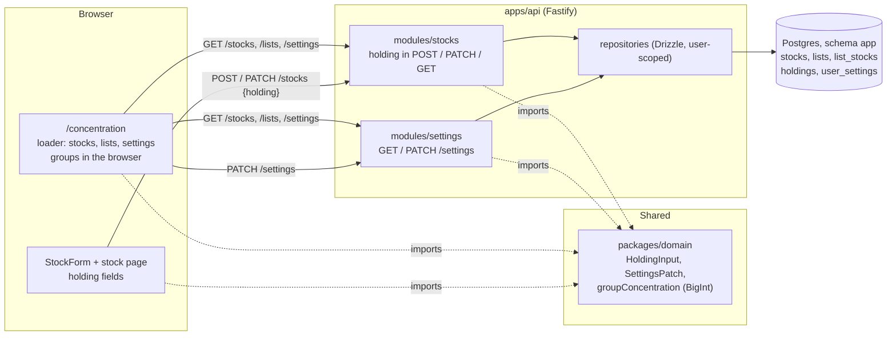

# System Design: Holdings and Concentration

The design adds two tables (`app.holdings`, `app.user_settings`), a `holding` field on the stock
the API already returns, a small `settings` API module, one pure grouping function in
`@investhesis/domain`, and the `/concentration` page. Concentration is **computed in the browser**
from the stocks the page already loads, so changing the scope, lens or measure needs no request
([NFR-001](requirements.md#nfr-001), [ADR-002](#key-decisions)). It follows the patterns of
[Stock Lists v1.0](../../stock-lists/v1.0/design.md): `app` schema, composite user keys, hand-written
Drizzle typings with a drift test, Zod in `@investhesis/domain`, loaders and actions in the web.

## Architecture Overview



The page loads everything once, then regroups locally:

```mermaid
sequenceDiagram
  actor U as Investor
  participant W as Web /concentration
  participant API as API
  participant DB as Postgres
  U->>W: open /concentration?scope=held&lens=sector
  W->>API: GET /stocks, GET /lists, GET /settings (parallel)
  API->>DB: stocks left join holdings; lists; settings row
  API-->>W: stocks with holding, lists, settings
  W->>W: filter by scope, groupConcentration(stocks, lens, rate, threshold)
  U->>W: change lens / scope / measure
  W->>W: regroup, update the address (no request)
  U->>W: change threshold or rate
  W->>API: PATCH /settings
  API-->>W: settings; loader revalidates, page regroups
```

## Components

| Component | Responsibility |
|-----------|----------------|
| `supabase/migrations/*_holdings.sql` | Creates `app.holdings` and `app.user_settings` ([ADR-001](#key-decisions)). |
| `apps/api/src/db/schema/holdings.ts` | Drizzle typings for the two tables, checked by the existing drift test. |
| `modules/stocks` (changed) | Every `Stock` the module returns carries `holding`; `POST` and `PATCH` take an optional `holding` and write it in the same transaction as the stock ([ADR-004](#key-decisions)). See [Changes to the stocks module](#changes-to-the-stocks-module). |
| `modules/settings` (new) | `GET /settings`, `PATCH /settings`; one row per user, upserted, defaults when no row ([ADR-005](#key-decisions)). |
| `lib/logger.ts` (changed) | Redaction covers `averageCost`, `usdThbRate` and `holding` (and drops the stale `costBasis`); an `err` serializer drops a Postgres error's `detail` and `where` ([NFR-004](requirements.md#nfr-004), [Logging](#logging)). |
| `packages/domain` (changed) | `HoldingInput`, `SettingsPatch`, `CONCENTRATION_LENSES`, and `groupConcentration`, exact decimal arithmetic on `BigInt` ([ADR-002](#key-decisions), [ADR-003](#key-decisions)). |
| `apps/web/src/features/concentration/` (new) | `/concentration` loader and action, the controls, the group table, the flagged summary, the left-out note, the settings dialog. |
| `apps/web/src/features/stocks/` (changed) | `Stock.holding`; holding fields in `StockForm`; a Held column in `StockTable`; a holding card and its actions on the stock page. |

## Data Model

Both tables are in the `app` schema, with RLS enabled and no policies, like the Stock Lists tables
(Stock Lists ADR-002, ADR-003).

```sql
-- One row = the stock is held. No row = not held ([FR-001](requirements.md#fr-001)).
create table app.holdings (
  stock_id      uuid primary key,
  user_id       uuid not null,
  shares        numeric(18,4) check (shares > 0),
  average_cost  numeric(18,4) check (average_cost >= 0),
  cost_currency text not null check (cost_currency in ('USD','THB')),
  created_at    timestamptz not null default now(),
  updated_at    timestamptz not null default now(),
  foreign key (stock_id, user_id) references app.stocks (id, user_id) on delete cascade
);
create index holdings_user on app.holdings (user_id);

-- One row per user, created on the first save; absent = defaults.
create table app.user_settings (
  user_id                 uuid primary key,
  concentration_threshold smallint not null default 40
                          check (concentration_threshold between 1 and 100),
  usd_thb_rate            numeric(18,6) check (usd_thb_rate > 0),
  usd_thb_rate_updated_at timestamptz,   -- set when a rate is saved, null when it is cleared
  updated_at              timestamptz not null default now()
);

alter table app.holdings      enable row level security;
alter table app.user_settings enable row level security;
```

- `shares` and `average_cost` are `null` for "held, amount unknown" ([FR-002](requirements.md#fr-002)).
  `numeric` keeps exact decimals; `pg` returns it as a string, which is what the API sends
  ([FR-003](requirements.md#fr-003), [ADR-003](#key-decisions)).
- The composite foreign key stops a holding from pointing at another user's stock and deletes the
  holding with its stock. The import's update mode never touches holdings.
- `cost_currency` defaults to the stock's `currency` in the service, not in the database, so
  a later market with a third currency only needs the `check` widened.
- `user_settings` has no foreign key, like `stocks.user_id`: users live in Supabase's `auth`
  schema, which the `app` tables do not reference.

## Shared vocabulary and rules (`@investhesis/domain`)

- `HoldingInput` (Zod): `{ shares?: string | null, averageCost?: string | null, costCurrency?: 'USD' | 'THB' }`.
  `shares` and `averageCost` are **strings** matching `^\d{1,14}(\.\d{1,4})?$` (numbers are rejected,
  so a float never enters); `shares` must be greater than 0. Unknown keys are rejected with the key
  as the issue path. Messages go in `messages.ts`.
- `SettingsPatch` (Zod): `concentrationThreshold?: integer 1..100`, `usdThbRate?: string | null`
  matching `^\d{1,12}(\.\d{1,6})?$` and greater than 0 (`null` clears the rate).
- `CONCENTRATION_LENSES`: the list [FR-006](requirements.md#fr-006) names, each with `key`, `label`,
  `kind: 'single' | 'multi'` and a getter from a stock: `gicsSector` ("Sector (GICS)"),
  `setIndustryGroup`, `valueChain`, `valueChainPosition`, `size`, `style`, `economicCycle`,
  `lynchType`, `lifeCycle`, `customers`, `revenueTypes`, `moat`, `themes`, `volatility`, `market`,
  `indexMembership`.
- `groupConcentration({ stocks, lens, usdThbRate, threshold })` returns
  `{ groups, leftOut, multiValue }`:
  - `groups`: `{ label, notSet, count, countShare, value, valueShare, countFlag, valueFlag, stockIds }[]`.
    The caller sorts by the chosen measure; the function returns them by count, ties by label,
    with `Not set` always last. An unset lens value (`null` or `[]`) is the group `Not set`; a
    multi-value stock is in every group it has ([FR-007](requirements.md#fr-007),
    [OQ-2](requirements.md#oq-2)).
  - Denominators: `countShare` divides by the number of stocks in scope; `valueShare` by the sum
    of the valued stocks in scope, each once. With a multi-value lens either can add up to more
    than 100%, and `multiValue` is `true` so the page can say so
    ([FR-008](requirements.md#fr-008)). A zero total value gives `valueShare: null` and no value
    flags.
  - `countFlag` and `valueFlag` are always `false` for `Not set` ([FR-010](requirements.md#fr-010)).
  - `leftOut`: `{ notHeld, noAmount, needsRate }` with stock ids, for the note of
    [FR-009](requirements.md#fr-009). A held stock with no `shares` or no `averageCost` is `noAmount`;
    a USD holding with no rate is `needsRate`; neither is valued.
  - Value is `shares × averageCost` as scaled `BigInt` (4 + 4 decimals), times the rate (6 decimals)
    for USD. Shares of the total and the flag use `BigInt` too ([ADR-007](#key-decisions)).
  - Pure, no I/O, erasable syntax, relative imports end in `.ts` (Stock Lists ADR-005).

## API Contracts

All routes follow the Stock Lists conventions: identity required (`401 unauthenticated`), JSON,
problem responses `{ type, title, status, code, detail?, errors?: [{ path, message }] }`, and
another user's stock answers `404 not_found` ([NFR-003](requirements.md#nfr-003)).

`Holding` (new, nested in `Stock`):

```json
{ "shares": "120.5000", "averageCost": "412.3300", "costCurrency": "USD" }
```

`shares` and `averageCost` are decimal strings or `null`. `Stock` gains one field,
`"holding": Holding | null` (`null` = not held). Nothing else in `Stock` changes.

### Stocks (changed)

#### GET /stocks, GET /stocks/{id}

- **200** — each `Stock` includes `holding` ([FR-004](requirements.md#fr-004)). No new query
  parameter: the concentration page filters held stocks itself ([ADR-002](#key-decisions)).

#### POST /stocks

- **Request** — as before, plus `holding?: HoldingInput | null` ([FR-001](requirements.md#fr-001),
  [FR-002](requirements.md#fr-002)). `costCurrency` defaults to the stock's currency.
- **201** — `Stock` with `holding`. The stock, its list memberships and its holding are written in
  one transaction ([ADR-004](#key-decisions)).
- **Errors** — `400 validation_failed` with paths such as `holding.shares` and
  `holding.averageCost`; the rest as before.

#### PATCH /stocks/{id}

- **Request** — as before, plus `holding?`: omitted = unchanged, `null` = not held (row deleted),
  an object = **replace** the holding (omitted fields become `null`, `costCurrency` defaults to
  the stock's currency). An empty object `{}` marks "held, amount unknown". Because it replaces,
  a client always sends the whole holding, never one field of it.
- **200** — `Stock`. **Errors** — `400`, `404`.

### Settings (new)

#### GET /settings

- **200** — `{ "concentrationThreshold": 40, "usdThbRate": "36.250000" | null, "usdThbRateUpdatedAt": "2026-11-23T10:00:00.000Z" | null }`.
  With no stored row the answer is `{ 40, null, null }` and nothing is written ([FR-011](requirements.md#fr-011)).

#### PATCH /settings

- **Request** — `SettingsPatch`; omitted = unchanged, `usdThbRate: null` clears it.
- **200** — the settings after the change (upsert). **Errors** — `400 validation_failed`
  (`concentrationThreshold`, `usdThbRate`).

There is no `/concentration` endpoint: the page groups what `GET /stocks` returns
([ADR-002](#key-decisions)). The OpenAPI spec (`/openapi.json`) gains the new schemas and routes.

### Changes to the stocks module

The current code shapes these changes, so they are spelled out here:

- **Create body**: `CreateBody` in `stocks.routes.ts` takes `listIds` out of the body before
  `StockInput` parses the rest, and `StockInput` rejects any other key. `holding` is taken out the
  same way and parsed with `HoldingInput`; issues keep the `holding.` prefix in their path.
- **Patch body**: `PatchBody` is `StockPatch`, which also rejects unknown keys. The route takes
  `holding` out before `StockPatch` parses the rest, and `updateStock` merges only the stock fields
  into `StockInput` as it does today. A body with only `holding` is a valid patch.
- **Response**: `StockOut` (the Zod response schema) gains `holding: HoldingOut.nullable()`. Without
  it the serializer would not send the field.
- **Read**: the repository's `columns` already adds `listIds` with a correlated subquery; `holding`
  is added the same way (`json_build_object` of the user's row, or `null`), so every query that
  returns a stock, including the import's `findByMarketTickers`, carries it with no extra call.
- **Import**: `insertMany` and the update mode write only stock columns, so an import never
  creates, changes or clears a holding.

### Logging

The request logger records method, URL, host, address and headers, never the body, so a holding
in a request is not logged today. Two gaps remain, both closed in this slice
([NFR-004](requirements.md#nfr-004)):

- `REDACT_PATHS` lists `shares` and `costBasis`; the wire names are `averageCost`, `usdThbRate`
  and `holding`, so those are added and `costBasis` dropped.
- On a 5xx the error handler logs `err: error.cause ?? error`. A Postgres error from a failed
  insert carries `detail: "Failing row contains (…)"` with every value of the row, so a holding
  that slipped past validation would be logged. The logger gets an `err` serializer that keeps
  `code`, `constraint`, `table` and `message` of a Postgres error and drops `detail` and `where`.

## Web

- **Route**: `/concentration` (exists as a placeholder) gets a loader that calls `GET /stocks`,
  `GET /lists` and `GET /settings` in parallel, and an action with the intent `save-settings`
  (`PATCH /settings`). It stays a lazy view with the loader and action attached in
  `concentration-routes.tsx`, like `stocksRoutes` (Stock Lists ADR-008).
- **View state in the address** ([FR-012](requirements.md#fr-012), [ADR-008](#key-decisions)):
  `?scope=all|held|<listId>`, `?lens=<key>`, `?measure=count|value`; defaults `scope=all`,
  `lens=gicsSector`, `measure=count`. An unknown lens or measure, or a list id that is not among
  the loaded lists (deleted, or another user's), falls back to the default with a note. A
  `measure=value` with nothing to value shows count and says why
  ([FR-005](requirements.md#fr-005)). Changing a control `navigate`s with `replace`, so Back
  leaves the page rather than stepping through every tweak.
- **Page**: controls row (scope, lens, measure), a summary of flagged groups
  ([FR-010](requirements.md#fr-010)), the group table (count, share, value, value share, flag text
  and icon), the left-out note with links to the stocks ([FR-009](requirements.md#fr-009)), the
  multi-value note ([FR-007](requirements.md#fr-007)), the advice note
  ([FR-014](requirements.md#fr-014)), and a settings dialog for the threshold and rate. A chart, if
  Phase 3 adds one, sits beside a table with the same figures ([NFR-006](requirements.md#nfr-006)).
- **Holdings in the stock UI**: `StockForm` gets a Holding section (Held checkbox, shares, average
  cost, currency; the numbers stay `''` until typed and go as strings); in edit mode it sends
  the whole `holding` only when some part of it changed, `null` when unticked. `StockTable` gets a Held column. The stock
  page gets a Holding card with an edit dialog whose action takes the intents `set-holding` and
  `clear-holding` (both `PATCH /stocks/{id}`), returning `{ ok: false, message }` for problems the
  user can act on, as the other stock intents do.
- **Visual specs** come from Phase 3 (`ux-design.md`), built from the existing shadcn layout and
  theme tokens. Expected new shadcn components: none beyond the installed set (`table`, `select`,
  `dialog`, `badge`, `checkbox`, `radio-group`, `input-group`); a chart is optional.

## Testing approach

- `packages/domain`: unit tests for `HoldingInput` and `SettingsPatch` boundaries (14 integer digits,
  4 and 6 decimals, 0 shares, 0 cost, numbers rejected), and for `groupConcentration`: single and
  multi lenses, `Not set` (last, never flagged), USD with and without a rate, `noAmount`, zero
  total value, value shares above 100% for a multi lens, ties, the
  39.96%-shown-as-40.0% case ([NFR-005](requirements.md#nfr-005)), a threshold of 1 and of 100.
  Coverage stays at or above 95%.
- `apps/api`: `app.inject` tests against local Supabase, each file with its own random user ids.
  Stocks: create with and without a holding, replace, clear, `{}`, validation paths, cascade on
  delete, an import that updates a held stock and leaves its holding alone, a two-user isolation
  case for the holding. Settings: defaults without a row,
  upsert, clear the rate, validation. A logging test posts a holding and a rate and proves none of
  the values appears in the captured log lines, and a forced Postgres check violation on
  `app.holdings` proves the logged error has no `detail` ([NFR-004](requirements.md#nfr-004)). The schema
  drift test covers both tables; `scripts/` gets a database-exposure check that `app.holdings`
  and `app.user_settings` are not reachable through the Data API (as TC-A-106 does for the others).
  A timed test covers [NFR-002](requirements.md#nfr-002).
- `apps/web`: Testing Library tests for the holding fields, the Held column, the stock page card,
  the concentration page against `StubApi` (every scope, lens and measure, left-out note, flagged
  summary, settings dialog, address state), plus a 200-stock regroup timing test
  ([NFR-001](requirements.md#nfr-001)). Router tests cover the changed `/concentration` route.
- E2E (`e2e/hc-*.spec.ts`): mark a holding, see it in the table, open `/concentration`, change
  lens and scope, set the rate and watch a USD holding join the value shares, axe in light and
  dark, 360 px width, keyboard-only use.

## Key Decisions

| Decision | Options Considered | Chosen | Rationale |
|----------|-------------------|--------|-----------|
| ADR-001: Where a holding lives | Columns on `app.stocks`; separate `app.holdings` table | Separate `holdings` table, one row per held stock | A held mark is a different fact from a stock's identity and lenses. "Not held has no shares" becomes "no row", the private amounts are kept away from every query and future provider adapter that reads `stocks` (brief NFR-004), and lots can later replace the table without touching `stocks`. Cost: a left join on `GET /stocks`. |
| ADR-002: Where concentration is computed | `GET /concentration` aggregating in SQL; compute in the browser | In the browser, from `GET /stocks` | The page already needs the stocks and their lenses; one pure function shared with its tests makes every scope, lens and measure change instant with no request ([NFR-001](requirements.md#nfr-001)) and avoids a second copy of the grouping rules in SQL. Fine at the brief's 200 to 500 stocks; revisit if a list grows past a few thousand. |
| ADR-003: Money and share arithmetic | `number`; `decimal.js`; scaled `BigInt` | Decimal strings on the wire, `numeric` in Postgres, scaled `BigInt` in the domain function | No float anywhere ([FR-003](requirements.md#fr-003)) and no new dependency. Shares and cost have 4 decimals, the rate 6, so a product has 14 and fits easily. |
| ADR-004: How a holding is written | Separate `PUT/DELETE /stocks/{id}/holding`; a `holding` field on `POST` and `PATCH /stocks` | Field on `POST` and `PATCH /stocks` | The Add and Edit forms save the stock and its holding in one atomic call, and one set of validation paths. No half-saved state, and no second route to secure and document. Cost: the stock routes grow; the service splits the write into `stocks` and `holdings` steps in one transaction. |
| ADR-005: Where the threshold and rate live | Browser storage; columns on a profile; `app.user_settings` row | `app.user_settings`, one row per user, upsert, defaults when absent | They must follow the investor across devices (brief goal), and the rate is private ([NFR-004](requirements.md#nfr-004)). A row per user is the smallest place that later holds the base-currency and language settings. |
| ADR-006: The exchange rate | Provider fetch; typed by the investor | Typed by the investor, one USD to THB rate, meaning 1 USD = rate THB | Resolved in [OQ-1](requirements.md#oq-1). No provider, nothing sent out. A dated rate history is out of scope. |
| ADR-007: The flag test and share rounding | Compare the rounded percentage; compare the exact share | Exact: group value × 100 ≥ threshold × total (cross-multiplied in `BigInt`), shown to one decimal, half up | A share of 39.96% displays as 40.0% but is not flagged ([NFR-005](requirements.md#nfr-005)); the flag never depends on display rounding. Count shares use the same test with counts. |
| ADR-008: Where the view state lives | Component state; Zustand; the address | Search params `scope`, `lens`, `measure` | Linkable, reloadable and Back-friendly ([FR-012](requirements.md#fr-012)) with no store; the router is already in data mode. |

## Dependencies

- **Supabase CLI** and **Docker**: the migration and the DB-backed tests, unchanged from Stock Lists.
- No new npm package. Exact arithmetic uses `BigInt`; the grouping lives in `@investhesis/domain`,
  whose only dependency stays Zod.

## Risks

- **`GET /stocks` grows**: each stock carries a small `holding`; at 500 stocks this is tens of
  kilobytes more. Accepted for single-user v1 ([ADR-002](#key-decisions)).
- **Cost, not market value**: shares at cost can mislead when a position has moved a lot. Every
  value is labelled "at cost" and live prices stay out of scope; the market-value slice would add a
  price column and a second measure without changing this design.
- **A USD rate typed once goes stale**: the page shows the date the rate was last saved
  (`usdThbRateUpdatedAt` in `GET /settings`).
- **Redaction by key name**: pino redacts by field name, so a renamed field would escape it; the
  logging test in the API suite guards this.
- **`Stock` gains a field**: tests that compare a whole stock (`toEqual` in the API tests,
  `makeStock` in the web fixtures, the E2E `apiAs` helpers) need `holding: null` added. Expect a
  wide but mechanical change in the first task.
