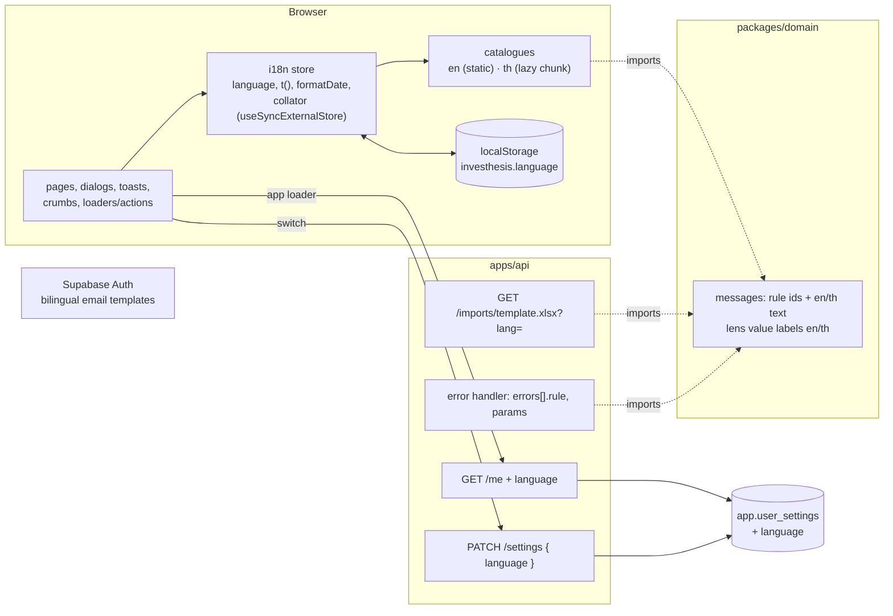
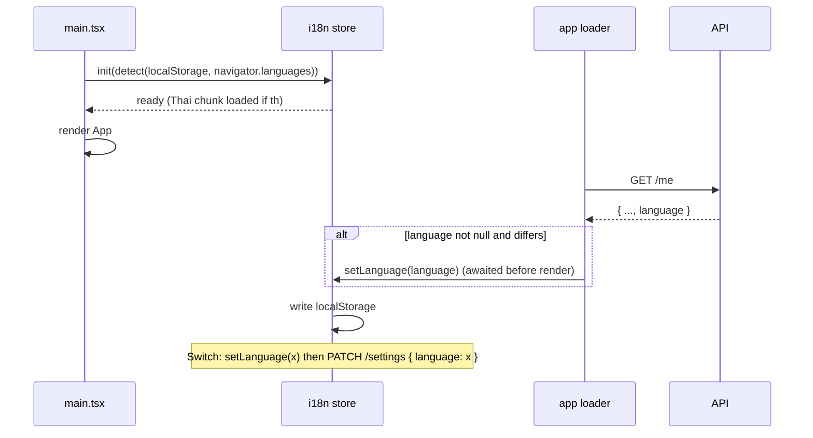

# System Design: Thai and English UI

The design adds a small in-house translation layer (no i18n library), per-language catalogues
with typed keys, a `language` column on `app.user_settings`, the language in `GET /me`, rule ids
on validation issues so the web can translate them, a self-hosted Thai font, an instructions
sheet in the XLSX template, and bilingual auth emails. Stored, imported and exported data does
not change. It follows the patterns of
[Holdings and Concentration v1.0](../../holdings-concentration/v1.0/design.md) (settings) and
[Stock Lists v1.0](../../stock-lists/v1.0/design.md) (domain vocabulary, problem bodies).

## Architecture Overview



## Components

| Component | Responsibility |
|---|---|
| `packages/domain/src/i18n/` | `LANGUAGES = ['en','th']`, `Language`, the domain message catalogue (`MESSAGES_EN`, `MESSAGES_TH`: validation rules), lens value labels (`LENS_VALUE_LABELS_EN/TH`), lens names, "Not set", thesis type labels; `issueRule(message)` and `formatRule(rule, params, lang)`. Used by the web, the API (English `message`, XLSX instructions) and tests. |
| `apps/web/src/i18n/` | `store.ts` (current language, subscribe, `setLanguage`, lazy Thai load), `catalogue/en.ts` (source of truth), `catalogue/th.ts` (typed as `Catalogue`), `t.ts` (lookup, interpolation, plurals via `Intl.PluralRules`), `format-date.ts`, `collate.ts`, `use-i18n.ts` (`useT`, `useLanguage`), `rich.tsx` (`Rich` for messages with links or emphasis), `detect.ts` (FR-003 order), `language-switch.tsx`. |
| Account menu (`nav-user.tsx`) and `AuthLayout` | Host the `LanguageSwitch` ([FR-001](requirements.md#fr-001)). |
| `features/auth/current-user.ts` | App loader reads `language` from `GET /me`, applies it before the page renders ([FR-003](requirements.md#fr-003)). |
| `features/settings/save-language.ts` | `PATCH /settings { language }` with error toast and Retry ([FR-002](requirements.md#fr-002)). |
| `apps/api/src/modules/settings` | Reads and writes `language`. |
| `apps/api/src/modules/me` | Adds `language` (from `user_settings`, `null` without a row or value). |
| `apps/api/src/plugins/error-handler.ts`, `lib/app-error.ts` | `FieldError` gains `rule` and `params` ([FR-008](requirements.md#fr-008)). |
| `apps/api/src/modules/imports/imports.template.ts` | XLSX instructions sheet in `?lang=` ([FR-012](requirements.md#fr-012)). |
| `supabase/templates/*.html` | Thai then English in one email ([FR-013](requirements.md#fr-013)). |
| `apps/web/src/index.css` | Thai font in the stack, `:lang(th)` line height ([FR-010](requirements.md#fr-010)). |

## Data Model

Migration `supabase/migrations/<ts>_user_language.sql`:

```sql
alter table app.user_settings
  add column language text check (language in ('en', 'th'));
-- null = never chosen; the web then keeps the browser-derived language (OQ-1).
```

- No default, no backfill: existing rows read `null`. RLS unchanged (on, no policy).
- Drizzle typing in `src/db/schema/` gains `language: text('language')`; the drift test covers it.
- The language is a UI preference, not portfolio data: it is **not** added to the JSON backup, so
  `BackupV2` stays as it is ([ADR-007](#key-decisions)).

## Shared vocabulary and rules (`@investhesis/domain`)

### Rule ids on validation issues

Today a domain issue's `message` is English text from `MESSAGES` and the API passes it through
as `{ path, message }`. The web cannot translate free text, so messages become **rule ids**:

- `MESSAGES` keeps its keys (`required`, `tickerFormat`, `oneOf`, `exchangeForMarket`, ...). Each
  schema sets the issue `message` to an encoded rule: `rule('tickerFormat')` → `"tickerFormat"`,
  `rule('oneOf', { values })` → `"oneOf|{\"values\":[...]}"`. Zod issues carry only a string
  message reliably across built-in and custom checks, hence the encoding.
- `issueRule(message) → { rule: MessageKey | 'invalid', params }` decodes it; a Zod built-in
  message the domain did not set (wrong type and so on) decodes to `invalid`.
- `formatRule(rule, params, lang)` renders the text from `MESSAGES_EN` / `MESSAGES_TH`. English
  output is byte-for-byte today's text, so API responses and existing tests are unchanged.

### Labels

- `LENS_VALUE_LABELS_EN/TH: Record<LensKey, Record<CanonicalValue, string>>` covers every value
  in `LENS_VALUES` plus `NOT_SET`; typed so a missing value fails typecheck. English labels equal
  the canonical value. `LENS_LABELS` becomes `LENS_LABELS_EN/TH`; `THESIS_TYPE_LABELS` likewise.
- `lensValueLabel(lens, value, lang)` returns the label, or the value itself for free-text lenses
  (themes, value chain name) and unknown values.
- The Thai labels are the owner-approved glossary ([NFR-007](requirements.md#nfr-007)); the UX
  phase drafts it.

### Language-aware ordering

`filterOptions`, `groupConcentration` (tie order) and the web's `sortStocks` take an optional
`order: { label(lens, value): string; compare(a, b): number }`. Default = today's behaviour
(canonical value, code-unit order), so the API and existing tests are unchanged. The web passes
`Intl.Collator(lang)` and `lensValueLabel` ([FR-007](requirements.md#fr-007)). "Not set" stays
last. `groupChains` is unchanged (chain names are not translated). The filter sheet's find box
matches an option's displayed label and its canonical value, so `การเงิน` and `Financials` both
find the Financials option in Thai.

## API Contracts

Only additive changes; the OpenAPI document is regenerated.

### GET /me (changed)

```json
{ "id": "uuid", "email": "a@example.test", "displayName": null, "language": "th" }
```

- `language`: `"en" | "th" | null`, read from `app.user_settings` in the same handler (one
  indexed read by primary key). A database failure does not fail `/me`: it answers `language:
  null` and logs a warning, since the menu and language are cosmetic.

### GET /settings, PATCH /settings (changed)

- Response gains `"language": "en" | "th" | null`.
- `SettingsPatch` gains `language: 'en' | 'th'` (optional; `null` not accepted: there is no
  "unset" action in the UI). `{ "language": "xx" }` → `400 validation_failed` with
  `errors: [{ path: "language", message: "must be one of: en, th", rule: "oneOf", params: { values: ["en","th"] } }]`.
- The "empty patch creates no row" rule includes `language`.

### Problem bodies (changed)

```json
{
  "type": "about:blank", "title": "Bad Request", "status": 400, "code": "validation_failed",
  "errors": [
    { "path": "ticker", "message": "must be 1-12 characters ...", "rule": "tickerFormat" },
    { "path": "exchange", "message": "must be SET or mai for market TH",
      "rule": "exchangeForMarket", "params": { "market": "TH", "allowed": ["SET", "mai"] } }
  ],
  "requestId": "..."
}
```

- `rule` is always present on `errors[]` entries (`invalid` when the domain set no rule);
  `params` only when the rule takes some. `message` stays English. Import preview row errors
  carry the same pair; the import module's own texts (`column is missing`, `repeats row N in this
  file`) become domain rules `columnMissing` and `repeatsRow` (`params: { row }`).
- Top-level `code` values are unchanged; the web maps each known `code` to text.

### GET /imports/template.xlsx?lang=en|th (changed)

- Optional `lang` (default `en`; anything else → `400 validation_failed`). The `Stocks` sheet is
  unchanged (canonical headers and example rows). A second sheet, `Instructions` (`คำแนะนำ` in
  Thai), lists per column: name, required or optional, what it takes, allowed values as
  `Canonical — Thai label` in Thai, `Canonical` in English. `template.csv` ignores `lang`.

## Web

### Store and lookup

- `i18n/store.ts` is a module singleton (`getLanguage`, `subscribe`, `setLanguage(lang)`),
  read in components through `useSyncExternalStore` and directly by loaders and actions (which
  raise toasts and return messages outside React). `setLanguage('th')` awaits the Thai chunk
  (`import('./catalogue/th.ts')`) once, then notifies; English is in the main chunk as the
  fallback ([FR-014](requirements.md#fr-014)).
- Catalogue shape: nested `as const` object in `en.ts`; `th.ts` is `satisfies Catalogue` where
  `Catalogue` maps every leaf of `en` to `string` (or `{ other: string }` for plural entries), so
  a missing or extra key fails typecheck. Keys are grouped by feature (`nav`, `stocks`, `lists`,
  `holdings`, `concentration`, `filters`, `exports`, `imports`, `theses`, `chains`, `auth`,
  `errors`, `common`). Placeholders are `{name}`; plurals are `{ one, other }` chosen by
  `Intl.PluralRules(lang)`.
- `t(key, params)` returns a string; `<Rich k=... components={{ link: (c) => <Link/> }}>` handles
  messages with `<link>...</link>` / `<b>...</b>` tags (no HTML parsing, tag names only).
- `useT()` re-renders on a language change. Because every visible string comes from `t`,
  switching re-renders in place: no reload, no navigation, form state kept
  ([FR-001](requirements.md#fr-001)). Route data is not re-fetched.
- Crumbs: `RouteHandle.crumb` becomes `string key | (params, data, t) => string`; tab titles go
  through `t` in `PageHeader`, `AuthHeading`, `PagePlaceholder`; the brand "Investhesis" is not
  translated.
- `document.documentElement.lang` is set by the store on every change
  ([FR-010](requirements.md#fr-010)).

### Choosing the language (FR-002, FR-003)



- `detect()`: `localStorage['investhesis.language']` if valid; else the first of
  `navigator.languages` whose primary subtag is `th` or `en`, `th` → Thai; else English.
- Signed in with `language: null`: nothing is written ([OQ-1](requirements.md#oq-1)).
- Switch: the store changes first (instant), then `saveLanguage` patches. On failure: a toast
  "Couldn't save your language" with Retry; the screen keeps the new language and localStorage
  holds it. In `AUTH_MODE=mock` the save goes to the mock user as any other setting.
- Auth pages: the switch only changes the store and localStorage (no session, no API call).
- Sign-out leaves localStorage, so the sign-in page keeps the last language.

### Formatting

- `formatDate(ymd, lang)` from the `YYYY-MM-DD` text (never through a `Date`, as theses do):
  `27 Nov 2026` / `27 พ.ย. 2026`, month names from fixed tables (not `Intl` with `th`, whose
  default calendar is Buddhist). `formatTimestamp(iso, lang)` takes the browser-local date of an
  ISO time, then `formatDate`. All current `toLocale*` date calls move to these.
- Numbers keep `lib/number-format.ts` unchanged ([FR-009](requirements.md#fr-009)).

### Error text (FR-008)

- `describeIssue({ path, rule, params }, lang)` = field label (`t`) + `formatRule(...)`. Client
  checks (`checkValues` in the stock, holding, thesis and settings forms) decode the domain
  issue message with `issueRule`; server errors use `rule`/`params` from the body. Missing `rule`
  (older API) or an unknown one → `errors.invalidField`.
- Existing code→text maps (`importProblemMessage`, thesis and chain action messages, auth error
  mapping) move their strings into the catalogue; logic unchanged.

### Exports (FR-011)

- `csvOfRows`, `tableOfRows`, `exportRow` keep canonical values; nothing in `features/exports`
  reads the language except menu labels ([OQ-2](requirements.md#oq-2)).
- `ImportWizard` downloads `/imports/template.xlsx?lang=<current>`.

### Font and layout (FR-010, NFR-002, NFR-005)

- `@fontsource-variable/noto-sans-thai` (self-hosted by Vite, Thai subset only via its
  `thai.css` entry, `font-display: swap`). Stack: `"Geist Variable", "Noto Sans Thai Variable",
  sans-serif`; the browser picks Noto for Thai code points through `unicode-range`.
- `:lang(th)` raises body `line-height` (exact value in the UX phase) so tone marks above
  vowels are not clipped by `truncate` and fixed-height controls.

### Testing seams

- `test/setup.ts` sets the store to `en` before each test, so every existing test keeps its
  English assertions. `renderApp(path, api, { language: 'th' })` and a `FakeStorage` cover Thai.
- `StubApi` default `/me` gains `language: null`.

## Testing approach

- **Domain** — every `MESSAGES` key renders in both languages; `formatRule(..., 'en')` equals the
  old text for each key (snapshot of today's strings); `issueRule` round-trip for every rule;
  every `LENS_VALUES` value has a Thai label; ordering helpers with a Thai collator; coverage
  stays ≥ 95 %.
- **API** — migration and drift test; `/me` with and without a row, and with the settings read
  failing; `PATCH /settings { language }` happy, invalid, empty patch; problem bodies carry
  `rule`/`params` for each route that validates; XLSX instructions sheet per `lang`; `lang`
  invalid → 400. Coverage thresholds unchanged.
- **Web unit/component** — catalogue parity (also enforced by typecheck), plural selection,
  `Rich`, `formatDate` table, `detect()` matrix, switch re-renders in place and keeps typed
  form input, save failure toast and Retry, crumbs and tab titles in Thai, Thai labels in table,
  filter sheet, concentration and forms, sort order by Thai label, server error translated from
  `rule`, a static scan for English literals in JSX text and in `aria-label`, `placeholder`,
  `title`, `alt` (allow-list for brand, codes, test ids).
- **E2E** — switch on one device, sign in on a fresh context and see Thai; first visit with
  `locale: 'th-TH'`; every route in Thai (axe in light and dark, 360 px no horizontal scroll,
  no clipped text check by `scrollHeight`); export and backup bytes identical in both languages;
  template XLSX instructions in Thai; NFR-001 timing of a switch on `/stocks` with 200 stocks;
  first-load bundle size check against the 40 KB budget.
- **Supabase scripts** — the templates contain both language parts and the same link.

## Key Decisions

| Decision | Options Considered | Chosen | Rationale |
|---|---|---|---|
| ADR-001: Translation layer | i18next + react-i18next; Lingui (macro, compile step); in-house typed catalogue | In-house: typed nested catalogue, `Intl.PluralRules`, a tiny `Rich` component | Two languages, no ICU needs beyond plurals; zero runtime deps (NFR-002 budget); `satisfies Catalogue` gives the typecheck failure NFR-006 asks for without a codegen step; loaders and actions need a non-React `t`, which a singleton store gives directly. |
| ADR-002: Where validation text is translated | API returns localized text (`Accept-Language`); web maps English text back; rule ids in the issue | Rule ids encoded in the domain issue message, sent by the API as `rule`/`params` next to the English `message` | API stays English and stateless about language (FR-008); additive, non-breaking contract; the same decoder serves client and server checks. |
| ADR-003: Where the saved language is read | Separate `GET /settings` in the app loader; in `GET /me` | `GET /me` | The app loader already calls `/me` on entry, so no extra request and no flash; `/settings` also returns it for completeness. |
| ADR-004: Thai catalogue loading | Both in main chunk; Thai lazy | English in main chunk, Thai as a lazy chunk, awaited before first render when needed | Keeps the first load within the 40 KB budget for English users, and no untranslated flash for Thai users. |
| ADR-005: Date formatting | `Intl.DateTimeFormat('th-TH-u-ca-gregory')`; fixed month tables | Fixed tables from the `YYYY-MM-DD` text | Same output in every browser and in jsdom; avoids the Buddhist default and time-zone shifts already avoided by theses. |
| ADR-006: Lens labels location | Web catalogue only; domain | Domain (`LENS_VALUE_LABELS_EN/TH`) | The API needs the Thai labels for the XLSX instructions sheet; one source for both. |
| ADR-007: Language in the backup | Add to `settings` (BackupV3); leave out | Leave out | A display preference, not portfolio data (NFR-009 covers the data); avoids a backup format bump for one field. |
| ADR-008: Thai font | IBM Plex Sans Thai; Sarabun; Noto Sans Thai | `@fontsource-variable/noto-sans-thai`, Thai subset | Variable weights like Geist, loopless modern style that sits next to Geist, self-hosted (NFR-003). Final pick confirmed in the UX phase with a rendered sample. |
| ADR-009: Auth emails | Per-user language via Supabase metadata; bilingual | Bilingual, Thai first ([OQ-3](requirements.md#oq-3)) | Owner decision; no write to Supabase Auth on every switch. |

## Dependencies

- **`@fontsource-variable/noto-sans-thai`** — self-hosted Thai font (new web dependency).
- **Supabase Auth email templates** — the hosted project's templates must be updated by hand
  with the same files (step added to the hosted checklist in `supabase/README.md`).
- No new API or domain dependency.

## Risks

- **Size of the string move** — about 94 component files hold English literals; a missed one is
  caught by the static scan, and the task split keeps each feature folder in its own task.
- **Thai copy quality** — machine-drafted Thai may read oddly; the glossary and the Thai
  catalogue go to the owner for review before the slice is released (NFR-007).
- **Thai text in tight UI** — badges, table headers, select triggers and the sidebar may clip;
  the 360 px and clipped-text E2E checks and the UX specs target these.
- **Existing tests querying by English text** keep passing because tests default to `en`; Thai
  coverage is added on top rather than by rewriting them.
