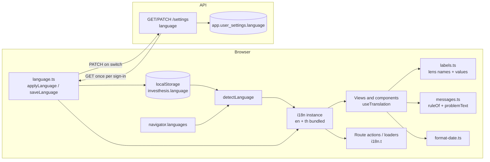

# System Design: Thai and English UI (react-i18next)

The web app gets an i18next instance with both languages bundled, a language state that follows
the account setting, catalogues for every screen, and two lookup layers that turn canonical data
(lens values, domain rule messages, API problem codes) into catalogue text at render time. The API
gains one nullable column and one field in `/settings`. The domain is not changed except for the
`language` field of `SettingsPatch`.

The i18n wiring follows Pacta's web (`~/Workspaces/Github/pacta/apps/web/src/locales/`): JSON
catalogues per namespace bundled into the entry chunk, keys typed from the English bundles, a
bundle-parity test, `@fontsource-variable/noto-sans-thai`. Two differences: the default and
fallback language is English ([FR-003](requirements.md#fr-003)), and there is no Zustand store
(this app has none); the language lives in the i18next instance itself.

## Architecture Overview



Flow:

1. `main.tsx` calls `initI18n(detectLanguage(...))` synchronously before the first render
   ([FR-003](requirements.md#fr-003)); `initAsync: false`, so the first paint is already in the
   right language and no catalogue request is made ([NFR-001](requirements.md#nfr-001)).
2. After sign-in, the `app` route's loader reads `GET /settings` once per signed-in user per tab
   and, if `language` is set, applies it ([FR-002](requirements.md#fr-002), ADR-004).
3. The switch calls `setLanguage(lang)`: apply at once, remember in this browser, and (signed in)
   `PATCH /settings { language }`; a failure keeps the language and raises a toast with Retry.

## Components

| Component | Responsibility |
|-----------|----------------|
| `apps/web/src/i18n/i18n.ts` | `LANGUAGES = ['en','th']`, `Language`, `resources` (imports of `locales/{en,th}/<ns>.json`), `initI18n(lng)`, the exported singleton `i18n`. `fallbackLng: 'en'`, `interpolation.escapeValue: false`, `initAsync: false`, `returnNull: false` |
| `apps/web/src/i18n/locales/{en,th}/<ns>.json` | Catalogues, one namespace per area: `common` (shell, nav, crumbs, generic buttons, errors, not-found, language switch), `auth`, `stocks`, `lists`, `imports`, `exports`, `filters`, `concentration`, `chains`, `theses`, `lenses` (lens names and values), `validation` (one key per domain `MESSAGES` rule), `problems` (one key per API problem code) |
| `apps/web/src/types/i18next.d.ts` | `CustomTypeOptions { defaultNS: 'common'; resources: typeof resources.en }`, so an unknown key or missing variable fails `tsc` ([NFR-005](requirements.md#nfr-005)) |
| `apps/web/src/i18n/language.ts` | `detectLanguage({ stored, languages })` (pure, [FR-003](requirements.md#fr-003)), `readStoredLanguage` / `storeLanguage` (try/catch around `localStorage`), `applyLanguage(lng)` (i18next `changeLanguage`, `<html lang>`, store) |
| `apps/web/src/i18n/use-language.ts` | `useLanguage()` hook: current language, `setLanguage(lng)` that applies and, when signed in, saves through the API client with one Retry toast on failure ([FR-002](requirements.md#fr-002)) |
| `apps/web/src/i18n/sync-account-language.ts` | `syncAccountLanguage(api, userId)`: the once-per-user `GET /settings` read and apply (ADR-004) |
| `apps/web/src/components/language-switch.tsx` | `LanguageSwitch` for the auth layout and `LanguageMenuItems` (a `DropdownMenuRadioGroup`) for the account menu; each option has `lang` ([NFR-004](requirements.md#nfr-004)); look per `ux-design.md` |
| `apps/web/src/i18n/labels.ts` | `useLensLabels()` → `{ lensName(lens), lensValue(lens, value), notSet }`, thesis type and holding state labels; unknown values fall back to the stored text ([FR-005](requirements.md#fr-005)) |
| `apps/web/src/i18n/messages.ts` | `ruleOf(message)` maps a domain `MESSAGES` text (from a client-side Zod issue or an API `errors[].message`) to its rule key and params (ADR-005); `useProblemText()` / `problemText(error, t, overrides?)` maps an `ApiError` to text by `code` with per-call overrides and a generic fallback ([FR-008](requirements.md#fr-008), [FR-009](requirements.md#fr-009)) |
| `apps/web/src/lib/format-date.ts` | `formatDay('YYYY-MM-DD', lng)` and `formatInstantDay(iso, lng)` from the text, never through `Intl` calendars: English `27 Nov 2026`, Thai `27 พ.ย. 2026` ([FR-010](requirements.md#fr-010)); replaces the English-only helpers in `features/theses/format.ts` and elsewhere |
| `lib/number-format.ts` | Unchanged: stays `en-US` in both languages ([FR-011](requirements.md#fr-011)) |
| `routers/route-handle.ts` | `crumb` becomes a catalogue key or `(params, data, t) => string`; `crumbOf` takes `t`, so the breadcrumb re-renders on a switch |
| `src/index.css` | `--font-sans: 'Geist Variable', 'Noto Sans Thai Variable', sans-serif`; `main.tsx` imports `@fontsource-variable/noto-sans-thai/thai.css` (Thai subset only, `unicode-range` so the file is fetched only when Thai text shows) ([FR-013](requirements.md#fr-013)) |
| `apps/web/src/i18n/*.test.ts` | Bundle parity, coverage of `LENS_VALUES` and `MESSAGES` and the problem codes, and the literal scan ([NFR-003](requirements.md#nfr-003)) |
| `supabase/migrations/*_user_language.sql` | Adds `language` to `app.user_settings` |
| `packages/domain` `SettingsPatch` | Adds `language: z.enum(['en','th']).nullable().optional()` |
| `apps/api` `modules/settings` | `language` in `SettingsOut`, `SettingsView`, `SettingsRow`, `SettingsChange` and the upsert; the empty-patch shortcut counts it |
| `apps/web/src/test/setup.ts` | `initI18n('en')` once, `afterEach` back to `en`; `renderInThai()` helper for Thai cases |

## Data Model

```sql
-- supabase/migrations/20261127000000_user_language.sql
alter table app.user_settings
  add column language text check (language in ('en', 'th'));
-- null = never chosen; the browser decides (FR-003). No default, no backfill.
```

Drizzle: `language: text('language').$type<'en' | 'th'>()` in `src/db/schema/holdings.ts`;
`schema.drift.test.ts` already compares it against `information_schema`. RLS stays on with no
policy, as for the rest of the table.

Not in the backup: `buildBackup` keeps the `BackupV2` settings shape (threshold and rate only), so
backups are unchanged and still validate (ADR-007).

Web-side catalogue shape (examples, English):

```json
// lenses.json
{
  "names": { "gicsSector": "Sector (GICS)", "moat": "Moat", "...": "..." },
  "values": {
    "gicsSector": { "Information Technology": "Information Technology", "...": "..." },
    "economicCycle": { "Cyclical": "Cyclical", "Defensive": "Defensive", "Sensitive": "Sensitive" }
  },
  "notSet": "Not set"
}
// validation.json — keys are the MESSAGES keys of packages/domain/src/messages.ts
{ "required": "is required", "oneOf": "must be one of: {{values}}", "...": "..." }
// problems.json — keys are API problem codes
{ "list_name_taken": "A list with this name already exists.", "generic": "Something went wrong. Try again." }
// stocks.json — plurals use i18next suffixes; Thai has only _other
{ "count_one": "{{count}} stock", "count_other": "{{count}} stocks" }
```

Lens value keys are the canonical spellings, which contain no `.` or `:` (checked by a test), so
i18next's default separators work.

## API Contracts

### Read settings

- **Method / Path** — `GET /settings`
- **Request** — none (bearer token)

```json
{
  "concentrationThreshold": 40,
  "usdThbRate": "35.120000",
  "usdThbRateUpdatedAt": "2026-11-27T03:00:00.000Z",
  "language": "th"
}
```

- `language` is `"en"`, `"th"` or `null` (never chosen; also when no settings row exists).
- **Errors** — unchanged: 401 `unauthenticated`, 503 `db_unavailable`.

### Save settings

- **Method / Path** — `PATCH /settings`
- **Request** — `{ "language": "th" }`; may be combined with the existing fields; `null` clears it.
  Absent = unchanged; `{}` still changes nothing and creates no row.
- **Response** — the settings as above.
- **Errors** — 400 `validation_failed` with `errors: [{ path: "language", message: "must be one of: en, th" }]`
  for any other value (the existing `oneOf` message), 401, 503.

No other endpoint changes. Problem bodies stay English (`detail`); the web never shows `detail`
in Thai ([FR-009](requirements.md#fr-009)).

## Key Decisions

| Decision | Options Considered | Chosen | Rationale |
|----------|-------------------|--------|-----------|
| ADR-001: Library and loading | react-i18next + i18next (bundled JSON); lazy-loaded catalogues via `i18next-http-backend`; Lingui | react-i18next ^17 / i18next ^26, both languages bundled in the entry chunk, `initAsync: false` | Owner asked for react-i18next. Bundling removes a loading state and a request ([NFR-001](requirements.md#nfr-001)); the catalogues are small ([NFR-002](requirements.md#nfr-002), checked by a size test). Same setup as Pacta |
| ADR-002: Key typing | Typed from `en` JSON via `CustomTypeOptions`; i18next-cli `types` generation; untyped | `CustomTypeOptions.resources = typeof resources.en`, string keys `t('stocks:title')` | Gives [NFR-005](requirements.md#nfr-005) without a codegen step; string keys keep the literal scan and grep simple. Thai JSON is checked by the parity test rather than by types |
| ADR-003: Where the language lives | Zustand store (Pacta); React context; the i18next instance | The i18next instance plus `localStorage['investhesis.language']`; `useTranslation` re-renders on `languageChanged` | The app has no Zustand and needs no second source of truth. Non-React code (route actions raising toasts, loaders) uses the exported `i18n.t` |
| ADR-004: Applying the account setting | Add `language` to `GET /me`; read `/settings` in the `app` loader on every revalidation; read `/settings` once per user per tab | Once per signed-in user id per tab, in parallel with `/me` in the `app` route's loader (`syncAccountLanguage`, memoised by user id, reset on sign-out) | Requirements keep the API change to `/settings`. Once-only keeps query-only changes and form submits from sending an extra request (TC-E-406, TC-E-507 stay valid). A failed read keeps the current language silently and is retried on the next sign-in |
| ADR-005: Translating domain validation messages | Domain emits rule ids (changes domain and API, rejected by scope); per-parse Zod error map (schema-level errors take precedence, so it cannot override); reverse map from the domain's own `MESSAGES` | `ruleOf(message)`: a `Map` from each static `MESSAGES` string to its key, plus one regex per function message built by calling it with sentinel arguments (`oneOf`, `exchangeForMarket`, `indexForMarket`, `chainExists`) that captures the parameters. A test runs every `MESSAGES` entry through `ruleOf` and fails on a miss | Rules are identified by the domain's constants, not by English text copied into the web, so a wording change in the domain cannot silently drift. Works for both client-side issues and API `errors[].message` (the API validates with the same schemas). An unmatched message shows the generic `validation:invalid` text, never English in Thai |
| ADR-006: API problems | Translate `detail`; map `code` in the web | `problems` namespace keyed by `code`, with context overrides per call site (e.g. thesis 404 on add vs edit) and `problems:generic` as the fallback | Matches [FR-009](requirements.md#fr-009) and keeps the API unchanged. The import module's `importProblemMessage` and the auth `AuthErrorCode` messages move into catalogues |
| ADR-007: Language in the backup | Add to `BackupV2.settings`; leave out | Leave out | A backup holds the investor's data, not a UI preference; adding it would need `formatVersion: 3`. [FR-006](requirements.md#fr-006) wants backups unaffected |
| ADR-008: Ordering | Sort by translated label (`localeCompare('th')`); keep canonical order | Canonical order everywhere it applies today ([FR-007](requirements.md#fr-007)) | A switch must not reorder rows; tests that pin order keep passing; addresses stay meaningful across languages |
| ADR-009: Dates | `Intl.DateTimeFormat('th-TH-u-ca-gregory')`; hand-written month tables | Month tables per language in `format-date.ts`, formatting from the `YYYY-MM-DD` text | Deterministic across ICU builds and jsdom, no time-zone shift for thesis dates, CE year guaranteed ([FR-010](requirements.md#fr-010)) |
| ADR-010: English literal scan | Regex over `.tsx`; TypeScript compiler API; `oxc-parser` | `oxc-parser` (dev dependency) walking `apps/web/src/**/*.tsx?` (no tests, no `components/ui/`): JSX text, string literals in `aria-label`, `placeholder`, `title`, `alt`, and the first argument of `toast*`. Allowlist in `i18n/literal-allowlist.ts` | TypeScript 7's compiler API is not a JS library; oxc is already the lint toolchain and parses TSX quickly. Regex misses multi-line JSX ([NFR-003](requirements.md#nfr-003)) |
| ADR-011: Thai font | Noto Sans Thai; IBM Plex Sans Thai; Sarabun | `@fontsource-variable/noto-sans-thai`, Thai subset only | One variable file covers all weights; matches Geist's neutral sans look; self-hosted from the bundle ([NFR-006](requirements.md#nfr-006)); same choice as Pacta |
| ADR-012: Tests' language | Start tests in Thai (Pacta); start in English | English by default, Thai via `renderInThai` / `i18n.changeLanguage('th')` | Hundreds of existing tests query English text; [Constraints](requirements.md#constraints) say they need no rewrite |

## Dependencies

- **i18next ^26.7** and **react-i18next ^17.1** — translation runtime and React bindings
  (versions as in Pacta's web).
- **@fontsource-variable/noto-sans-thai ^5.3** — self-hosted Thai font.
- **oxc-parser** (dev) — the literal scan of ADR-010.
- No new API dependency.

## Risks

- **Catalogue size and wording.** About 65 lens values and every screen's copy; the Thai wording
  of the lens values needs the owner's approval ([OQ-1](requirements.md#oq-1)), done in the UX
  phase before the screen tasks start.
- **Longer Thai labels** in tight places (table headers, Filters sheet, badges, 360 px): covered
  by the responsive and axe E2E runs in Thai ([NFR-004](requirements.md#nfr-004)).
- **Sentinel regexes in ADR-005** depend on function messages putting their arguments in
  recognisable places; the `MESSAGES` coverage test catches any function the regex cannot invert.
