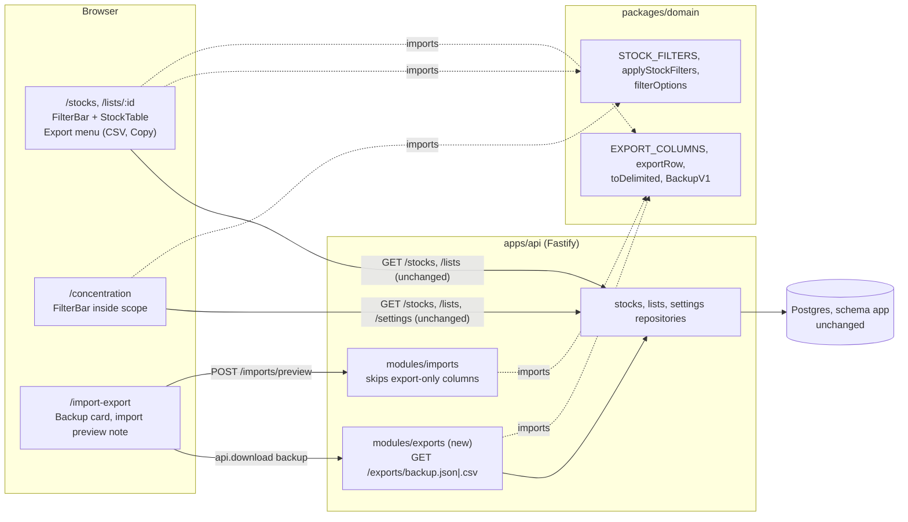
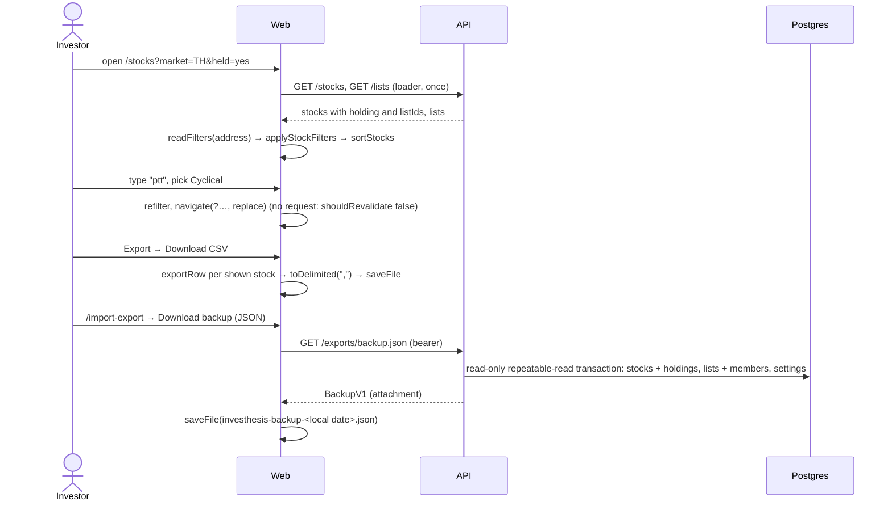

# System Design: Search, Filter and Export

Search and filters run **in the browser** on the stocks each page already loads, so typing or
picking a filter sends no request ([NFR-001](requirements.md#nfr-001), [ADR-001](#key-decisions)).
The filter state lives in the page address next to the sort ([ADR-003](#key-decisions)), and one
filter function in `@investhesis/domain` serves `/stocks`, `/lists/:id` and `/concentration`. The
filtered CSV is built in the browser from the rows on screen ([ADR-004](#key-decisions)); the full
backup is built by a new `exports` API module in one read-only snapshot ([ADR-005](#key-decisions)).
The CSV row layout is defined once in the domain and used by both. No table, column or migration
is added.

It follows the patterns of [Stock Lists v1.0](../../stock-lists/v1.0/design.md) and
[Holdings and Concentration v1.0](../../holdings-concentration/v1.0/design.md): user-scoped
repositories, Zod in `@investhesis/domain`, loaders and actions attached in each route's `lazy`,
view state in search params.

## Architecture Overview



A filter change never leaves the browser; a backup is one request:



## Components

| Component | Responsibility |
|-----------|----------------|
| `packages/domain` `filters.ts` (new) | `STOCK_FILTERS` (market, exchange, held, then the 16 `CONCENTRATION_LENSES` minus market), `applyStockFilters(stocks, state)`, `filterOptions(stocks)` with per-value counts. Pure, structural `FilterableStock` type ([FR-002](requirements.md#fr-002)..[FR-004](requirements.md#fr-004)) |
| `packages/domain` `export.ts` (new) | `EXPORT_COLUMNS` (19 template columns + 5 export-only), `EXPORT_ONLY_HEADERS`, `exportRow(stock, listNames)`, `toDelimited(rows, ',' \| '\t')` with RFC 4180 quoting, `BackupV1` Zod schema and `BACKUP_FORMAT` ([FR-012](requirements.md#fr-012), [FR-016](requirements.md#fr-016), [NFR-008](requirements.md#nfr-008)) |
| `apps/api` `modules/exports` (new) | `exports.routes.ts` → `exports.service.ts` (`buildBackup`, `backupCsv`) → reads through the existing stocks, lists and settings repositories plus one membership query; one read-only snapshot transaction |
| `apps/api` `modules/imports` (changed) | `mapHeaders` treats `EXPORT_ONLY_HEADERS` as known and ignored; the preview gains `ignoredColumns` ([FR-014](requirements.md#fr-014)) |
| `apps/web` `features/stock-filters` (new) | `filter-address.ts` (`readFilters`, `filterSearch`, sort params), `use-filter-state.ts`, `FilterBar` (search + filter sheet), `ActiveFilters` (removable items, Clear all), `ResultCount` (polite live region), `NoMatches` |
| `apps/web` `features/exports` (new) | `ExportMenu` (Download CSV, Copy), `export-file-name.ts`, `copy-rows.ts`, `BackupCard` for `/import-export` |
| `apps/web` `StockTable` (changed) | Sort becomes controlled (`sort`, `onSort` props) so the page keeps it in the address; default stays ticker ascending |
| `apps/web` stocks, list detail, concentration pages (changed) | Mount the filter bar; `/stocks` and `/lists/:id` get `shouldRevalidate` like `/concentration`; concentration filters inside its scope ([FR-010](requirements.md#fr-010)) |
| `apps/web` import wizard (changed) | Shows one note when `ignoredColumns` is not empty |

## Data Model

No change. Everything this slice reads exists: `app.stocks`, `app.holdings`, `app.lists`,
`app.list_stocks` (with `added_at`) and `app.user_settings`.

### Filter state

```ts
type FilterState = {
  q: string                                   // trimmed; '' = no search
  // One entry per active filter. null in the set means "Not set".
  picks: ReadonlyMap<FilterKey, ReadonlySet<string | null>>
}
// FilterKey = 'market' | 'exchange' | 'held' | lens keys of CONCENTRATION_LENSES except 'market'
```

Matching ([FR-001](requirements.md#fr-001), [FR-003](requirements.md#fr-003)):

- Search: `q` lower-cased (`toLocaleLowerCase('en')`, which leaves Thai unchanged) is a substring
  of the ticker, the name, or any theme.
- `held`: values `yes` / `no` (`holding !== null`).
- Single-value field: the stock's value (or `null`) is in the picked set.
- Multi-value field: any of its values is picked, or `null` is picked and the list is empty.
- A stock is kept when it passes the search and every entry of `picks` (OR within a filter,
  AND across filters).

`filterOptions(stocks)` returns, per filter, the vocabulary values (`LENS_VALUES`, `MARKETS`,
`ALL_EXCHANGES`, `ALL_INDEXES`) or, for `valueChain` and `themes`, the distinct values found
(case-insensitive, first spelling kept, sorted with the table's collator), each with the number
of stocks having it, plus a "Not set" count ([FR-004](requirements.md#fr-004)). It counts over the
page's base set (all stocks, the list's members, or the concentration scope), not the filtered
result.

### Address ([FR-006](requirements.md#fr-006), [ADR-003](#key-decisions))

| Param | Values | Example |
|---|---|---|
| `q` | search text | `q=ptt` |
| `<filterKey>` (repeatable) | a canonical value; **empty means "Not set"** | `economicCycle=Cyclical&economicCycle=` |
| `held` | `yes`, `no` | `held=yes` |
| `sort`, `dir` | `ticker\|name\|market\|sector\|held`, `asc\|desc` | `sort=held&dir=desc` |
| `scope`, `lens`, `measure` | `/concentration` only, unchanged | |

- An empty value is never a valid stored value (every text field is 1+ characters and the
  vocabularies have no empty entry), so it is safe as "Not set". The vocabulary value `None` of
  value-chain position stays an ordinary value.
- Values match the vocabulary case-insensitively and are kept in canonical spelling; free-text
  values (`valueChain`, `themes`) are kept as typed, matched case-insensitively.
- An unknown param name is ignored silently (other tools add their own, e.g. `utm_*`). A known
  filter with an unknown value, a repeated `q`/`sort`/`dir`, or an unknown sort drops that part
  with one note per dropped part; the address is not rewritten.
- `filterSearch(state, sort)` writes params in `STOCK_FILTERS` order, values in vocabulary order,
  so equal views have equal addresses.

### CSV row ([FR-012](requirements.md#fr-012))

`EXPORT_COLUMNS` = `TEMPLATE_COLUMNS` headers in order, then `lists`, `held`, `shares`,
`average_cost`, `cost_currency`. `exportRow(stock, listNamesById)`:

| Column | Value |
|---|---|
| `sector` | `gicsSector` for `US`, `setIndustryGroup` for `TH` |
| `gics_sector` | `gicsSector` for `TH`, empty for `US` (as the template's example rows) |
| multi-value columns | values joined with `;` (no spaces), in stored order |
| `lists` | list names in name order (table collator), joined with `;` |
| `held` | `yes` / `no` |
| `shares`, `average_cost` | the API's decimal string as is (4 places), empty when `null` or not held |
| `cost_currency` | `USD` / `THB`, empty when not held |
| everything else | stored value or empty |

`toDelimited(rows, sep)` quotes a field containing the separator, `"`, CR or LF, doubling quotes;
lines end in CRLF; the caller adds the BOM for files (`''`), not for the clipboard. No
formula escaping ([OQ-3](requirements.md#oq-3)). The web's `buildErrorCsv` switches to
`toDelimited` so there is one quoting rule.

### Backup JSON (`BackupV1`, [FR-016](requirements.md#fr-016))

```json
{
  "format": "investhesis-backup",
  "formatVersion": 1,
  "exportedAt": "2026-11-24T09:30:00.000Z",
  "stocks": [
    {
      "id": "0193…", "ticker": "PTTEP", "market": "TH", "exchange": "SET",
      "name": "PTT Exploration and Production", "indexMembership": ["SET50"],
      "gicsSector": "Energy", "setIndustryGroup": "Resources",
      "valueChain": "Oil and gas", "valueChainPosition": "Upstream",
      "size": "Large", "style": "Dividend", "economicCycle": "Cyclical",
      "lynchType": "Stalwart", "lifeCycle": "Mature",
      "customers": ["B2B"], "revenueTypes": ["Product sale"], "moat": "Cost advantage",
      "themes": ["Energy"], "volatility": "Mid",
      "lensSources": { "economicCycle": "manual" },
      "holding": { "shares": "1000.0000", "averageCost": "120.5000", "costCurrency": "THB" },
      "createdAt": "2026-11-22T10:00:00.000Z", "updatedAt": "2026-11-23T08:00:00.000Z"
    }
  ],
  "lists": [
    { "id": "0193…", "name": "Core holdings", "createdAt": "…", "updatedAt": "…",
      "stockIds": ["0193…"] }
  ],
  "settings": { "concentrationThreshold": 40, "usdThbRate": "34.045000",
                "usdThbRateUpdatedAt": "2026-11-23T08:00:00.000Z" }
}
```

- A stock is the API's `Stock` without `listIds`; membership is held once, on the list
  (`stockIds` in `added_at` order, then stock id). Stocks are ordered by market, then ticker;
  lists by name.
- `holding` is `null` when not held. Decimals are strings. No `userId`, email or token.
- `BackupV1` (Zod, in the domain) is the documented format: the API test parses every backup with
  it, and a future restore starts from it. A later slice that adds thesis notes or financials bumps
  `formatVersion` to 2 and adds arrays; readers keep accepting 1 ([NFR-008](requirements.md#nfr-008)).

## API Contracts

All routes need a bearer token (`401 unauthenticated` otherwise) and answer
`503 db_unavailable` without a database, as the other modules do. Responses carry
`cache-control: no-store` (existing `security` plugin).

### Exports (new)

#### GET /exports/backup.json

- **Request** — no body, no params.
- **Response** — `200`, `content-type: application/json; charset=utf-8`,
  `content-disposition: attachment; filename="investhesis-backup-YYYY-MM-DD.json"` (UTC date; the
  web names the saved file by the investor's local date). Body: `BackupV1` above.
- **Errors** — `401`, `503`.

#### GET /exports/backup.csv

- **Request** — none.
- **Response** — `200`, `content-type: text/csv; charset=utf-8`,
  `content-disposition: attachment; filename="investhesis-backup-YYYY-MM-DD.csv"`. Body: BOM, the
  `EXPORT_COLUMNS` header, one row per stock ordered by market then ticker
  ([FR-015](requirements.md#fr-015)); header only when there are no stocks
  ([FR-017](requirements.md#fr-017)).
- **Errors** — `401`, `503`.

Both run `buildBackup(db, userId)` in `db.transaction(..., { isolationLevel: 'repeatable read',
accessMode: 'read only' })`: `listOwnedStocks` (with holdings), `listLists`, one
`select list_id, stock_id from app.list_stocks where user_id = $1 order by added_at, stock_id`,
and `findSettings` (defaults when no row). The OpenAPI spec declares the JSON response with the
`BackupV1` schema and the CSV as `text/csv` string.

### Imports (changed)

#### POST /imports/preview, POST /imports

- `mapHeaders` treats `lists`, `held`, `shares`, `average_cost` and `cost_currency` as known:
  not mapped to a field, no "Unknown column" warning, still subject to the duplicate-header rule.
- The preview response gains `ignoredColumns: string[]` (the export-only headers found, in file
  order, as written in the file). Confirm ignores those columns as before. Existing clients that
  do not read the field are unaffected.

```json
{ "fileName": "investhesis-stocks-2026-11-24.csv", "format": "csv",
  "counts": { "new": 3, "duplicate": 32, "error": 0 },
  "headerWarnings": [], "ignoredColumns": ["lists", "held", "shares", "average_cost", "cost_currency"],
  "rows": [ … ] }
```

### Stocks, lists, settings

Unchanged. Filtering never reaches the API.

### Logging

The exports routes log the request line, status and duration only, as every route does; no
response body is logged (Fastify's default). A test captures the log stream during a backup of a
held stock with a rate and asserts that no share, cost or rate value appears
([NFR-004](requirements.md#nfr-004)).

## Web

- **Filter bar** on `/stocks`, `/lists/:id` and `/concentration`: a search input (`InputGroup`
  with a search icon and a clear button), a **Filters** button that opens the filter panel (a
  `Sheet` on every width: right from `sm`, bottom below it, [NFR-007](requirements.md#nfr-007);
  refined in `ux-design.md` from the Popover first planned here) with one checkbox group per
  filter and counts, the active filters as
  removable badges with **Clear all**, and the count "N of M stocks" in a polite live region
  ([FR-005](requirements.md#fr-005), [NFR-006](requirements.md#nfr-006)). Visual specs come from
  Phase 3.
- **State**: `useFilterState()` reads `useSearchParams()` through `readFilters` and writes with
  `setSearchParams(filterSearch(...), { replace: true })`, the same history rule as
  `/concentration` (Holdings and Concentration ADR-008): reload and Back from a stock page return
  to the view, and no keystroke adds a history entry. The table renders from
  `useDeferredValue(state)` so typing stays responsive at 200 stocks.
- **No request on a filter change**: `/stocks` and `/lists/:id` get the `shouldRevalidate` that
  `/concentration` has (re-read only on a form submit or a path change).
- **Sort in the address**: `StockTable` takes `sort` and `onSort`; the pages keep them in
  `sort`/`dir`. The default (ticker ascending) is not written.
- **List page** ([FR-007](requirements.md#fr-007)): the base set is the list's members; the
  filter options and counts come from them. The empty-list card stays for a list with no stocks;
  `NoMatches` with **Clear all** shows when filters hide every member
  ([FR-008](requirements.md#fr-008)).
- **To concentration** ([FR-009](requirements.md#fr-009)): a link "See concentration" builds
  `/concentration?scope=<all|listId>&` + the filter params (not `sort`/`dir`).
- **Concentration** ([FR-010](requirements.md#fr-010)): `readView` keeps its three params and
  `readFilters` reads the rest; `planView` groups `applyStockFilters(stocksInScope(...))`;
  `viewSearch` writes scope, lens, measure, then the filter params. The header shows
  "N of M stocks in scope". Filter options count over the scope.
- **Export menu** on `/stocks` and `/lists/:id`: **Download CSV** builds
  `BOM + toDelimited([EXPORT_COLUMNS, ...shown.map(exportRow)], ',')` from the filtered, sorted
  rows and calls `saveFile`; **Copy** writes the same rows with `'\t'` and no BOM through
  `navigator.clipboard.writeText`, toasts "Copied N rows", and on a rejected promise or no
  clipboard API toasts an error pointing to Download CSV ([FR-013](requirements.md#fr-013)). Both
  are disabled with a reason when no row is shown.
- **File names** ([FR-011](requirements.md#fr-011)): `exportFileName(base, now)` uses the local
  date (`YYYY-MM-DD`); a list name has `/ \ : * ? " < > |` and control characters replaced by `-`,
  runs of `-` collapsed, trimmed, cut to 60 code points, falling back to `list` when nothing is left.
- **Backup card** on `/import-export`: two buttons, **Download JSON** and **Download CSV**, calling
  `api.download('/exports/backup.json' | '.csv')` then `saveFile(blob, local-date name)`, with a
  spinner (`motion-reduce:animate-none`) and an error message on failure; a short line says what
  the files contain and that they include holdings.
- **Import preview**: when `ignoredColumns` is not empty, one note: "Lists and holdings columns
  are not imported: lists, held, …".

## Testing approach

- `packages/domain` (coverage ≥ 95%): `applyStockFilters` for every filter kind, "Not set" on
  single and multi fields, OR within and AND across, search on ticker / name / theme with case and
  Thai text, `None` as a value vs "Not set"; `filterOptions` counts and free-text de-duplication;
  `exportRow` for US and TH, not held, held with unknown amounts, multi-value joins, list-name
  order; `toDelimited` quoting (comma, quote, CR, LF, tab with each separator) and CRLF; `BackupV1`
  accepts a full and an empty backup and rejects a missing `formatVersion`. A round-trip test:
  `exportRow` output fed through `canonicaliseRow` gives back the same `StockInput`
  ([NFR-005](requirements.md#nfr-005)).
- `apps/api` (local Supabase, random user ids per file): backup JSON and CSV for a user with
  stocks, holdings, lists and a rate; empty user (defaults, header-only CSV); a second user's rows
  never appear; 401 without a token; `content-disposition` names; a backup that parses with
  `BackupV1`; the log sentinel test; a timed test with 1,000 stocks and 20 lists
  ([NFR-002](requirements.md#nfr-002)). Imports: a file written by the export round-trips through
  preview and confirm with no warnings and `ignoredColumns` filled; holdings and lists are not
  touched by it.
- `apps/web` (Testing Library + `StubApi`): `readFilters` / `filterSearch` (dropped parts and
  notes, canonical order, empty value = Not set); the filter bar, active filters and Clear all on
  `/stocks` and a list page; sort in the address; no API call on a filter change (the stub counts
  requests, as TC-E-406 does); the concentration link and filtered concentration; export CSV
  content and file name; copy success and refusal; backup card success and failure; the import
  preview note; a 200-stock timing test for a keystroke ([NFR-001](requirements.md#nfr-001)).
- E2E (`e2e/sfe-*.spec.ts`): search and filter then Back from a stock page; reload keeps the view;
  filtered list to concentration; download the CSV and re-import it into a fresh user; download
  both backups; axe in light and dark with the filter panel open; 360 px with the sheet;
  keyboard-only filtering.

## Key Decisions

| Decision | Options Considered | Chosen | Rationale |
|----------|-------------------|--------|-----------|
| ADR-001: Where search and filters run | Query params on `GET /stocks` with SQL filters; in the browser | In the browser, on the stocks the page already loads | The pages already hold every stock with its lenses and holding; filtering locally is instant and sends nothing ([NFR-001](requirements.md#nfr-001), [NFR-004](requirements.md#nfr-004)). One function serves three pages, as concentration grouping does (Holdings and Concentration ADR-002). Revisit with the same trigger: lists of several thousand stocks. |
| ADR-002: Where the filter rules live | In the web feature; in `@investhesis/domain` | `@investhesis/domain` (`filters.ts`), address parsing in the web | The matching rules ("Not set", multi-value OR) sit beside the lens definitions they reuse, get the domain's 95% coverage bar, and are ready if the API ever filters (an export by filter, a future public API). The address format is a web concern and stays in `features/stock-filters`. |
| ADR-003: How filters appear in the address | One JSON-encoded param; one param per filter with repeated values | One param per filter key (the lens keys), repeated for several values, empty value = "Not set", `replace` history | Readable and hand-editable links, the same keys as `lens=` on the concentration page, no escaping problems with Thai text beyond normal URL encoding. Empty is free because no stored value is empty. `replace` keeps Back meaning "previous page", as on `/concentration`. |
| ADR-004: Where the filtered CSV is built | `GET /exports/stocks.csv?<filters>` on the API; in the browser | In the browser from the shown rows | The file must equal what the investor sees (filters, sort, list scope); rebuilding the filter on the server would duplicate [ADR-001](#key-decisions)'s rules and send the filter to the API. No new route, works offline of the API once loaded. |
| ADR-005: Where the full backup is built | In the browser from `GET /stocks`, `/lists`, `/settings`; an API endpoint | `GET /exports/backup.json` and `.csv` | A backup must be complete and consistent whatever the page loaded: one repeatable-read snapshot in the API gives that, and later slices (thesis, financials) add their tables there without the web loading them. It also gives a stable, documented URL for scripts. |
| ADR-006: How the import treats export columns | Unknown-column warnings (no change); import holdings and lists; recognise and skip | Recognise and skip, report them in `ignoredColumns` | [FR-014](requirements.md#fr-014): a clean re-import without warnings, while importing holdings or lists stays out of scope. A separate field keeps the existing warning list meaning "something is wrong". |
| ADR-007: The CSV quoting rule | Keep `buildErrorCsv`'s private helper; a CSV library (`csv-stringify`); one domain `toDelimited` | Domain `toDelimited` for files, clipboard and the API backup CSV | One rule everywhere, no new dependency, and the same code writes the browser's filtered CSV and the API's backup CSV so they cannot drift. |
| ADR-008: Backup membership shape | `listIds` on each stock; `stockIds` on each list; both | `stockIds` on each list, in `added_at` order | Membership stated once, so a future restore has no consistency check to make; the list order is kept for a restore that wants it. |

## Dependencies

- No new npm package and no new external service. Clipboard uses the browser's
  `navigator.clipboard` (secure context: `localhost` and HTTPS).
- **Supabase CLI** and **Docker** for the API tests, unchanged.
- **shadcn/ui**: no component to add;
  `sheet`, `collapsible`, `checkbox`, `badge`, `dropdown-menu` and `input-group` are installed.

## Risks

- **Address length**: picking many free-text themes makes long URLs. At realistic sizes (a few
  dozen values) this is far below browser limits; no mitigation.
- **Clipboard refusal**: some browsers deny `writeText` outside a user gesture or in an insecure
  context; the copy runs in the click handler and falls back to a message pointing to Download CSV.
- **Excel and formulas**: cells are written as typed ([OQ-3](requirements.md#oq-3)); a name typed
  as `=…` would evaluate when the investor opens the file in Excel. Accepted by the owner; all text
  is the investor's own.
- **`StockTable` sort becomes controlled**: every page and test that renders it must pass `sort`,
  or use a default; a mechanical change in the first web task.
- **Concentration address grows**: `viewSearch` now writes filter params too; the existing
  TC-E-406/TC-E-419 request-count tests must keep passing with filters present.
- **Backup size**: 1,000 stocks is roughly 1 MB of JSON; built in memory and sent in one
  response, well within limits for single-user v1.
