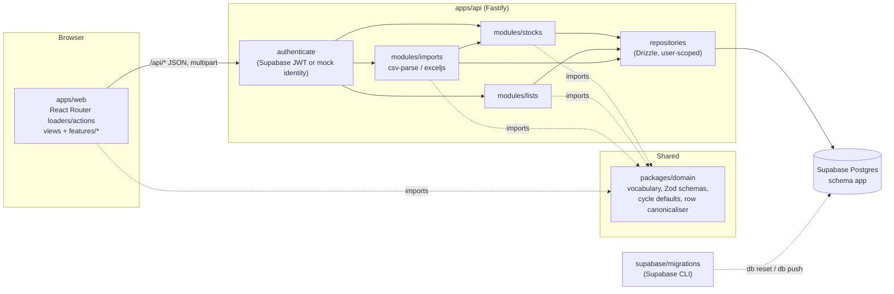
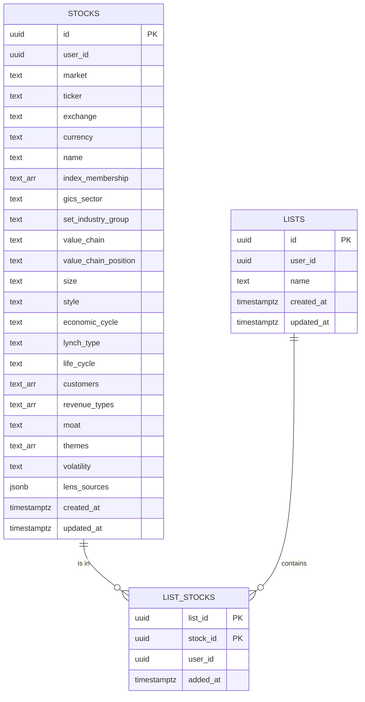

# System Design: Stock Lists

The design adds three tables, two API modules (`stocks`, `lists`) and one import module, a shared
`@investhesis/domain` package that holds the vocabulary and rules both sides need, and the web
pages under `/stocks`, `/lists` and `/import-export`. It follows the patterns already in
`apps/api` (routes → service → repository, `AppError` → RFC 7807, `requireIdentity`) and in
`apps/web` (React Router data mode, lazy views, shadcn/ui).

## Architecture Overview



The import is two stateless calls with the same file: **preview** parses and validates without
writing anything, and **confirm** parses again and writes everything in one transaction
([ADR-006](#key-decisions)).

```mermaid
sequenceDiagram
  actor U as Investor
  participant W as Web /import-export
  participant API as API /imports
  participant DB as Postgres
  U->>W: choose file (.csv / .xlsx)
  W->>API: POST /imports/preview (multipart: file)
  API->>API: size/type checks, parse, map headers, canonicalise + validate rows
  API->>DB: select saved (market, ticker) for this user
  API-->>W: rows with new / duplicate / error, counts, header warnings
  U->>W: pick target list, duplicate mode, Confirm
  W->>API: POST /imports (multipart: options + same file)
  API->>API: parse + validate again
  API->>DB: BEGIN; create list?; insert new; skip/update duplicates; add to list; COMMIT
  API-->>W: summary (created / updated / skipped / failed) + error rows
  W->>U: summary, link to list, error CSV download (built in the browser)
```

## Components

| Component | Responsibility |
|-----------|----------------|
| `packages/domain` (`@investhesis/domain`) | Single source for the lens vocabulary ([FR-003](requirements.md#fr-003)), market/exchange/index rules ([FR-001](requirements.md#fr-001)), ticker normalisation, the GICS → economic-cycle map and `resolveEconomicCycle` ([FR-005](requirements.md#fr-005)), Zod schemas for `StockInput` / `StockPatch` / list names, template headers ([FR-015](requirements.md#fr-015)) and `canonicaliseRow` (header-mapped strings → `StockInput` or field errors, [FR-017](requirements.md#fr-017)–[FR-019](requirements.md#fr-019)). Pure TypeScript with Zod only; no I/O. |
| `supabase/` | Supabase CLI project (`config.toml`, `migrations/`). Owns all DDL ([ADR-001](#key-decisions)). |
| `apps/api/src/db/schema/` | Hand-written Drizzle typings for `app.stocks`, `app.lists`, `app.list_stocks`, plus a drift test against the migrated database. |
| `apps/api/src/modules/stocks/` | `stocks.routes.ts` → `stocks.service.ts` → `stocks.repository.ts`. CRUD for stocks, duplicate check, cycle default, list ids on create. |
| `apps/api/src/modules/lists/` | Lists CRUD with stock counts, list membership add/remove. |
| `apps/api/src/modules/imports/` | `imports.routes.ts` (multipart, template downloads), `file-reader.ts` (bytes → `string[][]`: `csv-parse` for CSV, `exceljs` for XLSX), `imports.service.ts` (preview and confirm, uses the stocks and lists repositories inside one transaction). |
| `apps/api/src/plugins/multipart.ts` | Registers `@fastify/multipart` with this feature's limits ([FR-016](requirements.md#fr-016)). |
| `apps/web/src/lib/api-client.ts` | `fetch` wrapper for `/api/*`: JSON and multipart, parses `application/problem+json` into an `ApiError` with `status`, `code`, `errors`. |
| `apps/web/src/features/stocks/` | Stock table, stock form (identity + 10 lenses), delete dialog, list-membership control. |
| `apps/web/src/features/lists/` | List table, create/rename dialog, delete dialog, add-stock picker. |
| `apps/web/src/features/imports/` | Import wizard: template links, file picker, preview table, options, summary, error-CSV builder. |
| `apps/web/src/views/` | Route pages: `stocks`, `stock-new`, `stock-detail`, `stock-edit`, `lists`, `list-detail`, `import-export`, each with a `loader`/`action` where it reads or writes. |

## Data Model

All tables live in the `app` schema ([ADR-002](#key-decisions)). Ids are UUIDv7 generated by the
API (`lib/ids.ts`). Lens values are `text` validated by the API from the shared vocabulary
([ADR-004](#key-decisions)); structural fields have `CHECK` constraints.



Migration `supabase/migrations/<timestamp>_stock_lists.sql` (sketch; the task writes it in full):

```sql
create schema if not exists app;
revoke all on schema app from anon, authenticated;   -- not reachable through the Data API

create table app.stocks (
  id                   uuid primary key,
  user_id              uuid not null,
  market               text not null check (market in ('US','TH')),
  ticker               text not null check (ticker ~ '^[A-Z0-9][A-Z0-9.-]{0,11}$'),
  exchange             text not null,
  currency             text not null,
  name                 text not null check (char_length(name) between 1 and 200),
  index_membership     text[] not null default '{}',
  gics_sector          text,
  set_industry_group   text,
  value_chain          text,
  value_chain_position text,
  size                 text,
  style                text,
  economic_cycle       text,
  lynch_type           text,
  life_cycle           text,
  customers            text[] not null default '{}',
  revenue_types        text[] not null default '{}',
  moat                 text,
  themes               text[] not null default '{}',
  volatility           text,
  lens_sources         jsonb not null default '{}',
  created_at           timestamptz not null default now(),
  updated_at           timestamptz not null default now(),
  constraint stocks_exchange_market check (
    (market = 'US' and exchange in ('NYSE','NASDAQ') and currency = 'USD') or
    (market = 'TH' and exchange in ('SET','mai')     and currency = 'THB')),
  constraint stocks_user_market_ticker unique (user_id, market, ticker),
  constraint stocks_id_user unique (id, user_id)
);

create table app.lists (
  id         uuid primary key,
  user_id    uuid not null,
  name       text not null check (char_length(name) between 1 and 60),
  created_at timestamptz not null default now(),
  updated_at timestamptz not null default now(),
  constraint lists_id_user unique (id, user_id)
);
create unique index lists_user_name_ci on app.lists (user_id, lower(name));

create table app.list_stocks (
  list_id  uuid not null,
  stock_id uuid not null,
  user_id  uuid not null,
  added_at timestamptz not null default now(),
  primary key (list_id, stock_id),
  foreign key (list_id,  user_id) references app.lists  (id, user_id) on delete cascade,
  foreign key (stock_id, user_id) references app.stocks (id, user_id) on delete cascade
);
create index list_stocks_stock on app.list_stocks (stock_id);

alter table app.stocks      enable row level security;   -- no policies: deny by default
alter table app.lists       enable row level security;
alter table app.list_stocks enable row level security;
```

Notes:

- **Sector** ([FR-003](requirements.md#fr-003) lens 1): `gics_sector` is the GICS sector for `US`
  and the mapped GICS sector for `TH`; `set_industry_group` is set only for `TH`. For `TH` the two
  are set together or both empty, so cross-market grouping always has a GICS value.
- **`lens_sources`** ([FR-004](requirements.md#fr-004)) maps each set lens field to `"manual"` or
  `"default"`, e.g. `{"gicsSector":"manual","economicCycle":"default"}`. A cleared field has no
  entry. Later slices add `"auto"` and a stale marker without a migration of existing rows
  ([ADR-009](#key-decisions)).
- **Ownership** ([FR-025](requirements.md#fr-025)): every table has `user_id`; the composite
  foreign keys make it impossible for a membership row to join one user's list to another user's
  stock, even through a repository bug.
- **Deletes** ([FR-007](requirements.md#fr-007), [FR-011](requirements.md#fr-011)): cascades remove
  memberships; deleting a list never touches `app.stocks`.
- `updated_at` is set by the repository on every update (no trigger, so no logic in the DB).
- **Room for later slices**: market-cap columns, holdings, financials and thesis become their own
  tables keyed by `(stock_id, user_id)`; new markets extend the `market`/`exchange` checks.

## Shared vocabulary and rules (`@investhesis/domain`)

- `MARKETS`, `EXCHANGES_BY_MARKET`, `CURRENCY_BY_MARKET`, `INDEXES_BY_MARKET`.
- `LENS_VALUES`: one `as const` array per enumerated lens, in the canonical spelling of
  [FR-003](requirements.md#fr-003).
- `normaliseTicker(s)`: trim, upper-case; `TICKER_PATTERN = /^[A-Z0-9][A-Z0-9.-]{0,11}$/`.
- `CYCLE_BY_GICS` and `resolveEconomicCycle({ gicsSector, economicCycle, source })`:
  - an explicit cycle in the input → that cycle, `manual`;
  - otherwise, if the current cycle is `manual` → kept;
  - otherwise, if `gicsSector` is set → `CYCLE_BY_GICS[gicsSector]`, `default`;
  - otherwise → none.

  Called by create, update and import, so all three apply [FR-005](requirements.md#fr-005)
  identically (a cleared cycle with a sector set falls back to the default).
- `resolveEconomicCycle({ gicsSector, input?, current? })` as implemented: `input` is the cycle in the
  request (`undefined` not sent, `null` cleared, which drops a `manual` value too), `current` is
  `{ economicCycle, source }` as stored. Returns `{ economicCycle, source }` (both `null` for none).
- `StockInput`, `StockPatch`, `ListName` Zod schemas. Both stock schemas are strict: a key outside
  the schema (`currency`, `userId`, `lensSources`, ...) fails with the key as the issue path.
  `StockInput` output carries `currency` derived from the market, lens fields as `null` and list
  fields as `[]` when unset. `StockPatch` has absent = unchanged and `null` = cleared; the cross-field
  rules need the stored stock, so the API re-parses the merged stock with `StockInput`. Lengths count
  code points, as Postgres `char_length` does (test-cases G-9); names and list names are trimmed. The API uses them in route schemas; the web
  uses them for client-side form checks so messages match.
- `TEMPLATE_COLUMNS` (header, field, kind: `single` / `multi`) and
  `canonicaliseRow(cells: Record<header, string>)` → `{ ok: true, input: StockInput } |
  { ok: false, errors: FieldError[] }`. It applies case-insensitive matching to the canonical
  spelling ([FR-018](requirements.md#fr-018)), splits `;` lists, treats empty cells as unset,
  maps `sector` to `gicsSector` (US) or `setIndustryGroup` (TH), and runs `StockInput`.
  `FieldError` is `{ path, column, message }`: `path` is the `StockInput` key, `column` the template
  header to point at (`sector` or `gics_sector` for the sector pair). Cells are read by canonical
  header; matching file headers to them is the caller's job. A `TEMPLATE_COLUMNS` entry may carry
  `thField` (the `sector` column fills `gicsSector` for US and `setIndustryGroup` for TH).

## API Contracts

All routes need an identity (a verified Supabase access token per
[User Auth](../../user-auth/v1.0/design.md#api-contracts), or the mock user in development and
tests; `401 unauthenticated` otherwise), answer JSON, and use the existing problem format for
errors: `{ type, title, status, code, detail?, errors?: [{ path, message }] }`. A stock or list
id that belongs to another user, or doesn't exist, is `404 not_found`
([FR-025](requirements.md#fr-025)).

`Stock` (response shape, used below):

```json
{
  "id": "0193…",
  "market": "TH",
  "ticker": "PTTEP",
  "exchange": "SET",
  "currency": "THB",
  "name": "PTT Exploration and Production",
  "indexMembership": ["SET50"],
  "gicsSector": "Energy",
  "setIndustryGroup": "Resources",
  "valueChain": "Oil & Gas",
  "valueChainPosition": "Upstream",
  "size": "Large",
  "style": "Dividend",
  "economicCycle": "Sensitive",
  "lynchType": "Cyclical",
  "lifeCycle": "Mature",
  "customers": ["B2B"],
  "revenueTypes": ["Product sale"],
  "moat": "Cost advantage",
  "themes": ["Energy security"],
  "volatility": "Mid",
  "lensSources": { "gicsSector": "manual", "setIndustryGroup": "manual", "economicCycle": "default" },
  "listIds": ["0193…"],
  "createdAt": "2026-11-21T10:00:00.000Z",
  "updatedAt": "2026-11-21T10:00:00.000Z"
}
```

Unset single-value lenses are `null`; unset multi-value lenses are `[]`.

### Stocks

#### GET /stocks

- **Query** — `listId?` (uuid): only that list's stocks; `404` if the list is not the user's.
- **200** — `{ "items": Stock[] }`, ordered by ticker. ([FR-008](requirements.md#fr-008),
  [FR-013](requirements.md#fr-013))

#### POST /stocks

- **Request** — `StockInput` without `currency`, plus `listIds?: uuid[]`
  ([FR-001](requirements.md#fr-001), [FR-003](requirements.md#fr-003), [FR-014](requirements.md#fr-014)).
- **201** — `Stock`, `Location: /stocks/{id}`.
- **Errors** — `400 validation_failed` (field paths, e.g. `exchange`, `valueChainPosition`);
  `409 stock_exists` with `existingStockId` ([FR-002](requirements.md#fr-002)); `404 not_found`
  when a `listIds` entry is not the user's.

#### GET /stocks/{id}

- **200** — `Stock`. **404** — `not_found`.

#### PATCH /stocks/{id}

- **Request** — `StockPatch`: any field of `StockInput` except `market` and `ticker`
  ([FR-006](requirements.md#fr-006)). Omitted = unchanged; `null` / `[]` = cleared. `market` or
  `ticker` in the body is `400 validation_failed`.
- **200** — `Stock`. **Errors** — `400`, `404`.

#### DELETE /stocks/{id}

- **204**. **404** — `not_found`. ([FR-007](requirements.md#fr-007))

### Lists

#### GET /lists

- **200** — `{ "items": [{ "id", "name", "stockCount", "createdAt", "updatedAt" }] }`, ordered by
  name. ([FR-013](requirements.md#fr-013))

#### POST /lists

- **Request** — `{ "name": "Core holdings" }`.
- **201** — the list. **Errors** — `400 validation_failed`; `409 list_name_taken`
  ([FR-009](requirements.md#fr-009)).

#### GET /lists/{id}

- **200** — the list with `stockCount`. **404**.

#### PATCH /lists/{id}

- **Request** — `{ "name": "…" }`. **200** — the list. **Errors** — `400`, `404`, `409 list_name_taken`
  ([FR-010](requirements.md#fr-010)).

#### DELETE /lists/{id}

- **204**. **404**. ([FR-011](requirements.md#fr-011))

#### POST /lists/{id}/stocks

- **Request** — `{ "stockId": "…" }`. **201** — `{ "listId", "stockId", "addedAt" }`.
- **Errors** — `404` (list or stock not the user's); `409 already_in_list`
  ([FR-012](requirements.md#fr-012)).

#### DELETE /lists/{id}/stocks/{stockId}

- **204**. **404** — list not the user's, or the stock is not in it.

### Imports

#### GET /imports/template.csv and GET /imports/template.xlsx

- **200** — the template ([FR-015](requirements.md#fr-015)) with `content-disposition:
  attachment; filename="investhesis-stocks-template.{csv,xlsx}"`. The CSV starts with a UTF-8 BOM
  so Excel shows Thai text correctly ([NFR-009](requirements.md#nfr-009)).

#### POST /imports/preview

- **Request** — `multipart/form-data` with one part `file`.
- **200**

```json
{
  "fileName": "holdings.xlsx",
  "format": "xlsx",
  "counts": { "new": 31, "duplicate": 3, "error": 1 },
  "headerWarnings": ["Unknown column \"notes\" ignored"],
  "rows": [
    { "rowNumber": 2, "ticker": "NVDA", "market": "US", "name": "NVIDIA", "status": "new", "errors": [] },
    { "rowNumber": 3, "ticker": "AAPL", "market": "US", "name": "Apple", "status": "duplicate",
      "existingStockId": "0193…", "errors": [] },
    { "rowNumber": 4, "ticker": "XYZ", "market": "JP", "name": "", "status": "error",
      "errors": [ { "path": "market", "message": "must be US or TH" },
                  { "path": "name", "message": "required" } ] }
  ]
}
```

`rowNumber` is the file's row number (header = 1). A row repeating an earlier row's
(market, ticker) is `error` with path `ticker` ([FR-019](requirements.md#fr-019)).

- **Errors** — `400 file_missing` (no `file` part); `413 file_too_large` (> 1 MB);
  `415 file_unsupported` (extension not `.csv`/`.xlsx`, `.xlsx` not a ZIP, or CSV not valid
  UTF-8); `422 file_too_many_rows` (> 1,000 data rows); `422 file_empty`;
  `422 file_missing_headers` with `errors[].path` = each missing header
  ([FR-016](requirements.md#fr-016), [FR-017](requirements.md#fr-017)).

#### POST /imports

- **Request** — `multipart/form-data`: text fields first, then `file` (the same file as the
  preview):
  - `duplicateMode`: `skip` | `update` (required)
  - exactly one of `targetListId` (uuid) or `newListName` (string)
- **200**

```json
{
  "targetList": { "id": "0193…", "name": "Core holdings" },
  "created": 31,
  "updated": 3,
  "skipped": 0,
  "failed": 1,
  "addedToList": 34,
  "errorRows": [
    { "rowNumber": 4, "cells": { "ticker": "XYZ", "market": "JP", "name": "" },
      "errors": [ { "path": "market", "message": "must be US or TH" } ] }
  ]
}
```

- **Errors** — every preview error; `400 validation_failed` (bad options); `404` (target list not
  the user's); `409 list_name_taken` (new list name); `422 nothing_to_import` (all rows are errors).
  On any error nothing is written ([FR-022](requirements.md#fr-022), [NFR-006](requirements.md#nfr-006)).

Confirm algorithm (one `db.transaction`):

1. Parse and canonicalise the file again; drop error rows into `errorRows`.
2. Resolve the target list: load the user's list, or insert the new one (unique index → 409).
3. `select … for update` the user's stocks whose (market, ticker) is in the file → duplicates.
4. Insert new rows in batches of 200 with `on conflict (user_id, market, ticker) do nothing`;
   any row that conflicts here (saved between preview and confirm) is treated as a duplicate.
5. Duplicates: `skip` → no change. `update` → merge in TypeScript (non-empty row values replace
   saved ones and become `manual`; empty cells keep the saved value), run
   `resolveEconomicCycle`, then update row by row ([FR-021](requirements.md#fr-021),
   [FR-024](requirements.md#fr-024)).
6. `insert into app.list_stocks … on conflict do nothing` for every new and duplicate stock; the
   inserted count is `addedToList`.

The error-report CSV ([FR-023](requirements.md#fr-023)) is built in the browser from `errorRows`
(the original cells plus an `errors` column), so no file is stored on the server.

## Web

- **Routes added** (children of the existing `stocks` and `lists` routes, all lazy):
  `/stocks/new`, `/stocks/:id` (summary of identity and lenses, list membership, Edit and
  Delete), `/stocks/:id/edit`, `/lists/:id`. `/import-export` gets the import wizard; export stays
  a placeholder.
- **Data**: each view exports `loader` and, where it writes, `action`, calling
  `lib/api-client.ts`. React Router revalidates loaders after an action, so tables refresh after
  every change without a client cache ([ADR-008](#key-decisions)). Problem responses come back
  from actions as data and are shown next to the fields named in `errors[].path`.
- **Breadcrumb**: `RouteHandle.crumb` gains an optional second argument, the route's loader data,
  so `/stocks/:id` shows the ticker and `/lists/:id` the list name instead of an id.
- **Import wizard** keeps the chosen `File` in component state across steps, because confirm
  re-sends it; it uses `api-client` directly rather than a route action.
- **Visual specs** come from Phase 3 (`ux-design.md`), built from the existing shadcn layout and
  theme tokens in `apps/web/src/index.css` ([OQ-2](requirements.md#oq-2)). Expected new shadcn
  components: `table`, `dialog`, `alert-dialog`, `select`, `checkbox`, `radio-group`, `badge`,
  `popover`, `command`, `sonner`.

## Testing approach

- `packages/domain`: unit tests for vocabulary matching, ticker rules, `resolveEconomicCycle`,
  `canonicaliseRow` (every [FR-003](requirements.md#fr-003) rule and [FR-018](requirements.md#fr-018)).
- `apps/api`: `app.inject` integration tests against local Supabase with migrations applied
  (`supabase db reset`). Each test file uses its own random user id through `resolveIdentity`, so
  tests need no truncation and can run in parallel; `afterAll` deletes that user's rows. A
  two-user test proves isolation for every route ([NFR-004](requirements.md#nfr-004)). A schema
  drift test compares the Drizzle tables with `information_schema`. Fixture files (CSV with BOM,
  Thai names, XLSX with formulas, oversize, 1,001 rows) live in `apps/api/test/fixtures/imports/`.
- `apps/web`: Testing Library tests for forms, tables and the wizard against a stubbed
  `api-client`; router tests for the new routes.
- Performance checks for [NFR-001](requirements.md#nfr-001)–[NFR-003](requirements.md#nfr-003) are
  timed tests (1,000-row fixture; 200-row table render).

## Key Decisions

| Decision | Options Considered | Chosen | Rationale |
|----------|-------------------|--------|-----------|
| ADR-001: Schema migrations | Supabase CLI; Liquibase; drizzle-kit | Supabase CLI, `supabase/migrations/*.sql`; root scripts `db:start` (`supabase start`), `db:reset` (`supabase db reset`), `db:stop`; `supabase` as a root dev dependency | Owner's decision. Plain SQL files, applied locally by `db reset` and to the hosted project by `db push`. Drizzle stays queries-only with hand-written typings and a drift test. |
| ADR-002: Where tables live | `public` with RLS policies; private `app` schema | `app` schema, not exposed to the Supabase Data API; usage revoked from `anon`/`authenticated`; RLS enabled with no policies | Only the API reads the database. Keeping tables out of `public` means the Supabase auto-REST API can't reach them even if a key leaks; RLS without policies is a second deny. |
| ADR-003: Per-user isolation | Postgres RLS with a session user; repository scoping | Every repository function takes `userId` and filters on it; composite `(id, user_id)` foreign keys on `list_stocks` | Matches the existing `requireIdentity` pattern and works with the API's single DB role. The composite keys stop cross-user joins at the DB level. |
| ADR-004: Lens values in the DB | Postgres enums; lookup tables; `text` + API validation | `text` / `text[]`, validated by `@investhesis/domain`; `CHECK`s only on market, exchange, currency, ticker, name | Lens vocabularies will change (new themes, Thai size rules, new markets); changing an enum or `CHECK` needs a migration each time. One vocabulary in one package keeps web, API and import consistent. |
| ADR-005: Sharing rules between web and API | Duplicate code; `GET /vocabulary`; workspace package | `packages/domain` exporting TypeScript source (`exports: "./src/index.ts"`), erasable syntax only | Vite compiles it for the web; Node 24 strips its types at runtime because pnpm links resolve to `packages/domain/src`, outside `node_modules`. T-002 proved it (2026-11-22, Node 26 / Vite 8 / Vitest 5): `node src/main.ts` under `pnpm dev`, `node dist/main.js` after `tsc -p tsconfig.build.json`, API and web Vitest, and `vite build` all load the package from source, so no `dist` build is needed. The API build neither emits nor type-errors on the package (tsc 7 does not apply `rootDir` to it); at runtime Node strips its types. The OpenAPI spec remains the HTTP contract. |
| ADR-006: Import flow state | Server-side import session table; client-only parsing; stateless preview + confirm | Stateless: preview and confirm each receive the file | No table, no expiry job, and nothing of the file is kept ([NFR-005](requirements.md#nfr-005)). Confirm re-validates against the database at write time, so a stock added between preview and confirm can't cause a duplicate. Cost: the file is uploaded twice (≤ 1 MB). |
| ADR-007: Where and how to parse files | Parse in the browser; parse in the API | API: `csv-parse` (sync, BOM aware) for CSV, `exceljs` (`workbook.xlsx.load(buffer)`, first worksheet, formula cells read from their cached `result`) for XLSX; `@fastify/multipart` with `fileSize` 1 MB, `files` 1 | One validator for hand entry and import, and the server never trusts client-parsed rows. Both libraries are MIT and current on npm; the npm `xlsx` (SheetJS) package is no longer updated there. Risk: a compressed XLSX can expand a lot in memory; accepted for single-user v1 and noted for real auth. |
| ADR-008: Web server state | TanStack Query; React Router loaders/actions | React Router data-mode loaders and actions | The router is already in data mode; revalidation after actions covers this slice with no new dependency. TanStack Query can be added when a page needs caching across routes. |
| ADR-009: Tracking auto vs manual per field | One `*_source` column per lens field; `jsonb` map | `lens_sources jsonb` keyed by field | 14 lens fields would need 14 extra columns; the map grows to `"auto"` and stale markers in later slices without migrating rows. |
| ADR-010: Excel template and `.xlsx` output | Static files in the web app; generated by the API | Generated by the API from `TEMPLATE_COLUMNS` (`exceljs` for `.xlsx`) | The template can't drift from the parser because both come from the same list. |

## Dependencies

- **Supabase CLI** (`supabase`, root dev dependency; needs Docker) — local Postgres and migrations ([ADR-001](#key-decisions)).
- **@fastify/multipart** — file upload with size and part limits.
- **exceljs** — read `.xlsx` imports and write the `.xlsx` template.
- **csv-parse** — RFC 4180 CSV parsing with BOM handling.
- **zod** (already in the API; added to `packages/domain` and the web) — shared schemas.
- **shadcn/ui components** listed under [Web](#web) — added with `pnpm dlx shadcn@latest add` in `apps/web`.

## Risks

- **Type stripping of a workspace package** ([ADR-005](#key-decisions)) was proven in T-002 (see ADR-005); a future Node or tsc change that breaks it would show in `pnpm build` and the API tests.
- **XLSX decompression size** ([ADR-007](#key-decisions)) is bounded only by the 1 MB upload and the 1,000-row limit, which is checked after loading the workbook.
- **API tests now need Docker and `supabase start`**. The test-gate table in `.claude/rules/test-gate.md` is still Pacta's and should be rewritten with `pnpm db:start && pnpm db:reset` as step 1.
