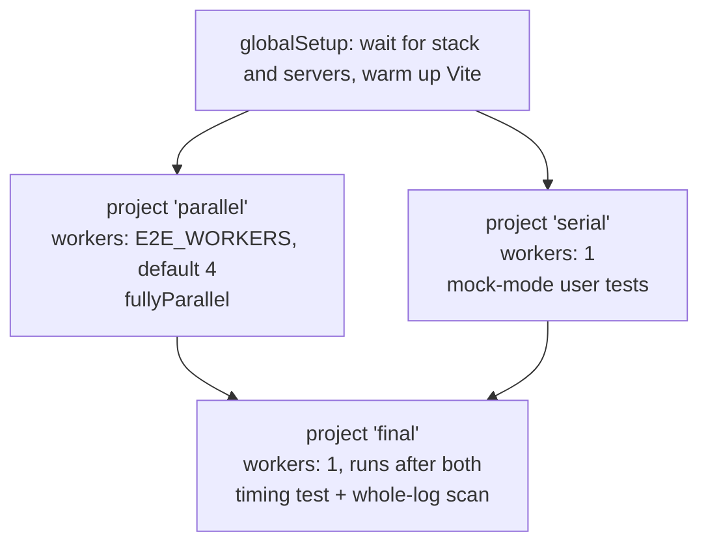

# System Design: Faster Test Suite

The gate goes under 10 minutes by changing only the E2E layer:

1. Run the E2E files on several Playwright workers instead of one.
2. Fence off the few tests that share state.
3. Turn the long "loop over every screen state" tests into one test per state, so the work spreads
   evenly across workers.

A small `pnpm test:quick` command covers day-to-day development. Product code, Vitest configs,
`test:supabase` and `supabase/config.toml` stay unchanged ([FR-003](requirements.md#fr-003)).

## Time budget

Measured on 2026-11-27 (warm caches, stack already running):

| Gate step | Now | Target |
|---|---|---|
| `pnpm db:start && pnpm db:reset` | about 11 s | same |
| `pnpm test:supabase` | 107 s | same (out of scope) |
| `pnpm lint`, `pnpm typecheck`, `pnpm build` | about 4 s (warm), up to about 60 s cold | same |
| `pnpm test` | about 21 s | same |
| `pnpm test:e2e` | 1,296 s | **under 420 s** ([NFR-002](requirements.md#nfr-002)) |
| **Total** | about 25 min | **under 10 min** ([NFR-001](requirements.md#nfr-001)) |

E2E work today is 1,278 s of test time on one worker. On 4 workers that is about 320 s. Add
about 100 s of extra seeding, since each worker seeds its own data, and about 40 s of server
start-up and warm-up. That gives an estimated 6–7 minutes. With 6 workers the estimate is about
5 minutes. The worker count is chosen by measurement in the dev plan, not fixed here.

## Architecture Overview

All three projects share the one pair of servers per mode that `webServer` starts today. The
`parallel` and `serial` projects run at the same time; `serial` only limits its own tests to one
worker. `final` starts after both finish.

## Components

| Component | Responsibility |
|---|---|
| `e2e/playwright.config.ts` | Three projects, `parallel`, `serial` and `final` (see [ADR-001](#key-decisions)). `workers` = `E2E_WORKERS` (default chosen in the dev plan, 4 to start). `fullyParallel: true` on `parallel`. Tests tagged `@serial` go to `serial`; `zz-api-logs` and `vc-perf` go to `final`. `retries: 0` stays. |
| Tag `@serial` | Marks a test that uses the one fixed mock-mode user: `auth-mock-mode`, the mock-mode tests of `sl-resilience`, and `TC-E-422` in `hc-holdings`. Plus anything else the audit ([FR-006](requirements.md#fr-006)) finds. |
| `e2e/lib/state-tests.ts` (new) | `stateTests({ id, title, states, seed, enter, check, variants })` generates one test per state, and per variant such as light/dark, titled `TC-E-415: <title> — <state> (<variant>)`. It provides the seeded context as a **worker-scoped fixture** (seeded once per worker), and a fresh **test-scoped** seed for states marked `fresh: true` ([ADR-003](#key-decisions)). |
| State lists in `e2e/lib/states.ts` | Gain an optional `fresh: true` flag on states that write data. Known now: `settings-dialog-with-rate` (saves a rate), `undo-toast-visible` (adds and deletes an entry). The audit completes the list. |
| The state-looping specs | `sl-a11y`, `sl-responsive`, `hc-a11y`, `hc-responsive`, `tl-a11y`, `tl-responsive`, `vc-a11y`, `vc-responsive`, `sfe-a11y`, `sfe-responsive`, plus the contrast loops in them such as `TC-E-919`. Rewritten to call `stateTests`. The checks in `check(page, state)` are moved over unchanged ([FR-004](requirements.md#fr-004)). |
| `scripts/*-report.mjs` | Already take the worst result of every test carrying an id (`results` map, `rank`), so a split TC fails if any state fails ([FR-005](requirements.md#fr-005)). Only the "tests" column grows. Checked, not rewritten. |
| `scripts/test-quick.mjs` (new) + `pnpm test:quick` | Runs `vitest run --changed main` in each workspace package. Then maps the changed paths to E2E spec prefixes through `e2e/quick-map.json` and runs those specs with `playwright test --project=parallel --project=serial`, which skips `final`, plus `--only-changed=main` for changed specs and helpers ([ADR-004](#key-decisions)). |
| `e2e/quick-map.json` (new) | Path-prefix → spec-glob pairs, for example `apps/web/src/features/chains/` → `vc-*`. |
| `CLAUDE.md`, `.claude/rules/test-gate.md` | Describe the two tiers, `E2E_WORKERS`, the three projects and the `@serial` tag ([FR-008](requirements.md#fr-008)). |

## Coupling audit (FR-006)

What is already known. The audit task confirms it and completes it.

| Shared thing | Who uses it | Safe in parallel? | Design |
|---|---|---|---|
| Sign-in rate limit | Every test (`signedIn` from node, plus `openSignedIn`) | **Yes.** 45 sign-ins in 2.5 s all succeeded on 2026-11-27 | No change |
| A fresh `@example.test` user per test | `sl`, `hc`, `tl`, `vc`, `sfe` specs | Yes | No change |
| The one fixed mock-mode user (`MOCK_USER_ID`) | `auth-mock-mode`, the mock-mode tests in `sl-resilience`, `TC-E-422` in `hc-holdings`, and `globalSetup`'s warm-up (read-only) | No | `@serial` → `serial` project |
| `dev-server.log`, sentinel scans | `hc-privacy`, `sfe-privacy`, `vc-privacy`, `tl-resilience`, `sl-import` | Yes. Each waits for its own request id, then looks for its own unique sentinel. Other workers' lines cannot contain that sentinel unless the product leaks it, which is the defect the test exists to catch. | No change |
| `dev-server.log`, whole-log scan | `zz-api-logs` | Only after all other tests | `final` project |
| CPU, for wall-clock thresholds | `vc-perf` `TC-E-923` (200 ms regroup) | No: other workers' load would distort it ([NFR-005](requirements.md#nfr-005)) | `final` project |
| Request-count checks | `TC-E-406`, `TC-E-419`, `TC-E-507` | Yes: they count requests, not time | No change |
| Data written by a screen state | `settings-dialog-with-rate`, `undo-toast-visible` | No, if the seed is shared per worker | `fresh: true` |
| Ports 5173/3000, 5273/3100 | All | Yes: one server pair per mode, shared by all workers | No change |

## Interfaces

There is no API or schema change. The developer-facing interface:

- **Full gate:** unchanged commands. `pnpm test:e2e` now runs on `E2E_WORKERS` workers (default
  from the dev plan). `E2E_WORKERS=1 pnpm test:e2e` gives today's behaviour, for debugging.
- **One file or test:** unchanged (`pnpm test:e2e sl-import`, `-g "TC-E-109"`). The `-g` option
  now also matches a single state: `-g "TC-E-415.*concentration-expanded"`.
- **Quick check:** `pnpm test:quick [ref]`, where `ref` defaults to `main`. It prints:
  - which Vitest packages ran
  - which spec files were chosen and why
  - when a changed path has no entry in `quick-map.json`, a line `shared code changed: run the
    full gate before review`

  It ends with Vitest's and Playwright's exit status.

## Key Decisions

| Decision | Options Considered | Chosen | Rationale |
|---|---|---|---|
| ADR-001: How to run the shared-state tests | (a) whole suite serial (today); (b) `test.describe.configure({ mode: 'serial' })` in each file; (c) separate Playwright projects with `TestProject.workers` and `dependencies` | **(c)** | (b) only orders tests inside one file; other files still run beside them on the same mock user. Project-level `workers: 1` (Playwright ≥ 1.52, here 1.65.1) fences them off across files. `final` uses `dependencies: ['parallel', 'serial']`. |
| ADR-002: Parallelism unit | (a) parallel files only; (b) `fullyParallel` (parallel tests) | **(b)** on `parallel` | The five a11y files take 670 s and would each sit on one worker under (a), so E2E could not go below about 200 s for `sl-a11y` alone, and the spread would be uneven. Per-test spreading is needed once the loops are split. |
| ADR-003: Seeded data for split state tests | (a) seed per test; (b) seed once per worker (worker fixture); (c) (b) plus a fresh seed for states that write | **(c)** | (a) adds about 1–2 s × about 300 tests. (b) alone lets a writing state change what a later state sees. (c) keeps the cost low and the states independent. The audit proves independence by running every non-fresh state and comparing the user's `GET /exports/backup.json` before and after. |
| ADR-004: Choosing E2E specs for the quick check | (a) `--only-changed` alone; (b) a path → spec map; (c) run everything | **(b) + (a)** | Specs do not import app code, so `--only-changed` misses a change in `apps/web/src` or `apps/api/src`. It does catch changed specs and `e2e/lib`. A short map in the repo is explicit and reviewable. Unmapped shared code (layout, `lib/`, domain) is reported, not guessed. |
| ADR-005: Default worker count | 2, 4, 6, 8 | **Measured in the dev plan, starting at 4** | The same machine runs Docker Supabase and two Vite + API pairs, and CPU starvation is the main flake risk ([NFR-003](requirements.md#nfr-003)). The plan picks the smallest count that meets [NFR-002](requirements.md#nfr-002) with 5 green runs in a row. |
| ADR-006: Auth rate limit | Raise it for tests; mint sessions via the Admin API; leave it | **Leave it** | Not hit (probe 2026-11-27). [OQ-1](requirements.md#oq-1) closed. |

## Risks

- **`final` is skipped when `parallel` or `serial` has a failure** (Playwright skips dependants of
  a failed project). The run is red anyway, but `zz-api-logs` and `TC-E-923` then show as
  skipped. The report scripts already print `SKIPPED` for that, so it is visible, not hidden.
  Using `teardown` instead was considered; it is meant for cleanup and its run-on-failure
  behaviour would need proof, so it is not used.
- **Load-sensitive waits.** Some `expect` timeouts (10 s) may be too short under 4–6 workers. A
  test that fails only in parallel is fixed at its cause, for example by waiting for the right
  signal. Raising timeouts or adding retries is not the fix ([NFR-003](requirements.md#nfr-003)).
- **One Vite dev server per mode, serving several browsers.** The first-visit dependency
  re-optimisation is already absorbed by `globalSetup`'s warm-up. If a new route is added later
  and not warmed, a parallel run could reload a page mid-test. The warm-up list stays the guard.
- **The test count in reports changes** (307 → about 550). [NFR-004](requirements.md#nfr-004)
  compares TC ids and verdicts, not counts.

## Dependencies

- **`@playwright/test` 1.65.1** (installed): `TestProject.workers` (since 1.52), `dependencies`,
  `--only-changed`, tags (`{ tag: '@serial' }`) and worker-scoped fixtures.
- **Vitest 5** (installed): `vitest run --changed <ref>`.
- No new packages.
