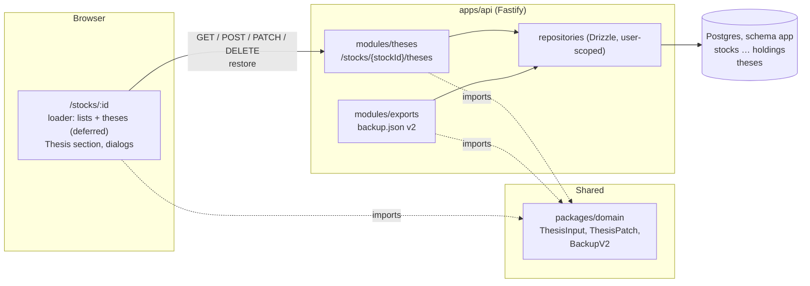

# System Design: Thesis Log

The design adds one table (`app.theses`), a `theses` API module nested under a stock
(`/stocks/{stockId}/theses`), one Zod schema in `@investhesis/domain`, a Thesis section on the
stock page, and the entries in a new version of the JSON backup. It follows the patterns of
[Stock Lists v1.0](../../stock-lists/v1.0/design.md) and
[Holdings and Concentration v1.0](../../holdings-concentration/v1.0/design.md): `app` schema,
composite user keys with cascade, RLS on with no policy, hand-written Drizzle typings with a drift
test, decimals as strings, user-scoped repositories, loaders and actions attached in
`stocks-routes.tsx`.

## Architecture Overview



The stock page does not wait for the entries; the Thesis section streams in on its own
([FR-008](requirements.md#fr-008), [ADR-004](#key-decisions)):

```mermaid
sequenceDiagram
  actor U as Investor
  participant W as Web /stocks/:id
  participant API as API
  participant DB as Postgres
  U->>W: open /stocks/:id
  W->>API: GET /stocks/:id, GET /lists (awaited)
  W->>API: GET /stocks/:id/theses (not awaited)
  API-->>W: stock, lists
  W-->>U: page with stock, holding, lists; Thesis section loading
  API->>DB: select theses where user_id and stock_id, order by date desc, created_at desc
  API-->>W: entries
  W-->>U: Thesis section with entries (or error + Retry)
  U->>W: delete an entry
  W->>API: DELETE /stocks/:id/theses/:thesisId
  API-->>W: 200 the deleted entry
  W-->>U: toast "Entry deleted" with Undo (5 s)
  U->>W: Undo
  W->>API: POST /stocks/:id/theses/restore {entry}
  API-->>W: 201 the same entry
```

## Components

| Component | Responsibility |
|-----------|----------------|
| `supabase/migrations/*_theses.sql` | Creates `app.theses` ([ADR-001](#key-decisions)). |
| `apps/api/src/db/schema/theses.ts` | Drizzle typing for the table, checked by the existing drift test. |
| `modules/theses` (new) | `theses.routes.ts` → `theses.service.ts` → `theses.repository.ts`: list, create, patch, delete and restore an entry of an owned stock ([API Contracts](#api-contracts)). |
| `modules/exports` (changed) | `buildBackup` reads the user's entries in the same snapshot transaction and writes backup format version 2 ([FR-010](requirements.md#fr-010), [ADR-006](#key-decisions)). |
| `lib/logger.ts` (changed) | `SECRET_KEYS` gains `note`, `invalidation` and `targetPrice` ([NFR-004](requirements.md#nfr-004)). The existing `err` serializer already drops a Postgres error's `detail` and `where`. |
| `packages/domain` (changed) | `THESIS_TYPES`, `ThesisInput`, `ThesisPatch`, `latestThesisDate`, and `BackupV2` ([ADR-003](#key-decisions), [ADR-006](#key-decisions)). |
| `apps/web/src/features/theses/` (new) | Thesis section, entry card, entry dialog (add and edit), delete with Undo, the deferred-load states, the action helpers. |
| `apps/web/src/features/stocks/` (changed) | The detail loader returns the deferred entries; the detail action gains the thesis intents; `DeleteStockDialog` names the number of entries ([FR-007](requirements.md#fr-007)). |

## Data Model

```sql
create table app.theses (
  id            uuid primary key default gen_random_uuid(),
  user_id       uuid not null,
  stock_id      uuid not null,
  type          text not null check (type in ('buy','sell','update','review')),
  entry_date    date not null,
  note          text not null check (char_length(note) between 1 and 10000),
  target_price  numeric(18,4) check (target_price > 0),
  invalidation  text check (char_length(invalidation) between 1 and 2000),
  created_at    timestamptz not null default now(),
  updated_at    timestamptz not null default now(),
  foreign key (stock_id, user_id) references app.stocks (id, user_id) on delete cascade
);
create index theses_user_stock_order
  on app.theses (user_id, stock_id, entry_date desc, created_at desc);

alter table app.theses enable row level security;
```

- The composite foreign key keeps an entry on its owner's stock and deletes it with the stock
  ([FR-007](requirements.md#fr-007), [NFR-003](requirements.md#nfr-003)), as `app.holdings` does.
- `char_length` counts characters (code points) in a UTF-8 database, the same rule the domain
  applies ([FR-001](requirements.md#fr-001)). The checks are a backstop; the domain validates first.
- `target_price` is `numeric(18,4)`, so `pg` returns a 4-decimal string; the web shows it with
  `formatUnitMoney`, which trims to the decimals entered, as for average cost
  ([NFR-006](requirements.md#nfr-006)). Its currency is not stored: it is the stock's `currency`
  ([OQ-1](requirements.md#oq-1), [FR-006](requirements.md#fr-006)).
- **Edited** is `updated_at > created_at` ([FR-004](requirements.md#fr-004)). The service writes
  `updated_at` only when a patch changes a field, so a no-op save leaves the marker off, and a
  restore keeps both times ([FR-005](requirements.md#fr-005)). No separate `edited_at` column.
- `entry_date` is a `date`, read and sent as `YYYY-MM-DD` text (`pg` type parser for `date`
  returns the string, never a `Date`, so no time-zone shift).

## Shared vocabulary and rules (`@investhesis/domain`)

- `THESIS_TYPES = ['buy','sell','update','review']` with labels Buy, Sell, Update, Review.
- `ThesisInput` (Zod, strict, unknown keys rejected with the key as the path):
  `{ type, date, note, targetPrice?: string | null, invalidation?: string | null }`.
  - `date`: `YYYY-MM-DD`, a real calendar date, not after `latestThesisDate`
    ([OQ-2](requirements.md#oq-2), [ADR-003](#key-decisions)).
  - `note`: `\r\n` → `\n`, trimmed, 1 to 10,000 code points.
  - `invalidation`: same treatment, up to 2,000; empty after trimming becomes `null`.
  - `targetPrice`: a string matching `^\d{1,14}(\.\d{1,4})?$`, greater than 0; numbers are rejected
    (as `HoldingInput`); `''` or `null` is not set.
- `ThesisPatch`: every field of `ThesisInput` optional, `targetPrice: null` and
  `invalidation: null` clear; `{}` is valid and changes nothing.
- The schemas are factories that take today: `thesisInput({ today })`, `thesisPatch({ today })`.
  The web passes the browser's local date; the API passes
  `latestThesisDate(now)` = the UTC date of `now + 14 h` (the latest calendar date anywhere,
  UTC+14), so a Bangkok user saving at 06:30 local is never refused for "today".
- Messages go in `messages.ts`.

## API Contracts

All routes follow the Stock Lists conventions: identity required (`401 unauthenticated`), JSON,
problem responses `{ type, title, status, code, detail?, errors?: [{ path, message }], requestId }`,
another user's stock or entry answers `404 not_found` ([NFR-003](requirements.md#nfr-003)), and
the OpenAPI spec gains every schema and route.

`Thesis`:

```json
{
  "id": "9b0c…",
  "stockId": "1f2e…",
  "type": "buy",
  "date": "2026-11-20",
  "note": "Data-centre capex keeps rising…\nMargins hold above 70%.",
  "targetPrice": "180.0000",
  "invalidation": "Gross margin below 65% for two quarters.",
  "createdAt": "2026-11-24T03:12:45.120Z",
  "updatedAt": "2026-11-24T03:12:45.120Z"
}
```

`targetPrice` and `invalidation` are `null` when not set. The response never carries `user_id`.

### GET /stocks/{stockId}/theses

- **200** — `{ "items": Thesis[] }`, sorted by `date` desc, then `createdAt` desc, then `id`
  ([FR-002](requirements.md#fr-002)). No paging: a stock's log is small, and
  [NFR-001](requirements.md#nfr-001) sizes it at 200 entries.
- **Errors** — `404 not_found` (no such stock for this user).

### POST /stocks/{stockId}/theses

- **Request** — `ThesisInput`.
- **201** — `Thesis`. **Errors** — `400 validation_failed` (paths `type`, `date`, `note`,
  `targetPrice`, `invalidation`), `404 not_found`.

### PATCH /stocks/{stockId}/theses/{thesisId}

- **Request** — `ThesisPatch`. The service merges it into the stored entry and re-parses the
  result with `ThesisInput`, as stocks do; when nothing differs it writes nothing and returns the
  entry unchanged ([FR-004](requirements.md#fr-004)).
- **200** — `Thesis`. **Errors** — `400`, `404` (stock or entry).

### DELETE /stocks/{stockId}/theses/{thesisId}

- **200** — the deleted `Thesis`, so the web can offer Undo without having to keep its own copy
  ([FR-005](requirements.md#fr-005)). **Errors** — `404`.

### POST /stocks/{stockId}/theses/restore

- **Request** — `{ "entry": Thesis }`: a whole entry as `DELETE` returned it. The fields are
  validated with `ThesisInput` (the date rule uses the entry's own date, so an entry backdated at
  creation stays valid); `id`, `createdAt` and `updatedAt` must be a UUID and ISO times with
  `createdAt ≤ updatedAt ≤ now`, and `entry.stockId` must equal the path's `stockId`.
- **201** — `Thesis`, identical to the deleted one ([ADR-005](#key-decisions)).
- **Errors** — `400 validation_failed`, `404 not_found` (the stock is gone),
  `409 thesis_exists` (an entry with that id exists, e.g. a double Undo).

### GET /exports/backup.json (changed)

- **200** — `BackupV2`: `formatVersion: 2` and a new top-level `theses: Thesis[]` (sorted by
  `stockId`, then the order of [GET](#get-stocksstockidtheses)); everything else as `BackupV1`
  ([FR-010](requirements.md#fr-010), [ADR-006](#key-decisions)). `backup.csv` is unchanged.

### Logging

The request logger never logs bodies. `SECRET_KEYS` gains `note`, `invalidation` and
`targetPrice`, so an accidental log of an entry is redacted at depths 0 to 2 (which covers
`entry.note` in a restore body). The pg error serializer already drops `detail` and `where`
([NFR-004](requirements.md#nfr-004)). A logging test posts, patches, restores and forces a check
violation with sentinel text and proves no sentinel reaches a log line.

## Web

- **Loader** (`createStockDetailLoader`): awaits `GET /lists` as today and returns
  `theses: api.get('/stocks/:id/theses')` **unawaited** ([ADR-004](#key-decisions)). The page
  renders `<Suspense fallback={ThesisSkeleton}><Await resolve={theses} errorElement={ThesisLoadError}>`;
  the error element's Retry calls `revalidator.revalidate()`. A thesis failure never reaches the
  route's `RouteError` ([FR-008](requirements.md#fr-008)).
- **Action** (`createStockDetailAction`): new intents `add-thesis`, `edit-thesis`,
  `delete-thesis`, `restore-thesis`, handled by `features/theses/thesis-actions.ts` and returning
  `ThesisActionResult` (`{ ok: true, thesis }` or `{ ok: false, message, errors? }`) for problems
  the user can act on, like the holding intents. A 404 on the stock says "This stock no longer
  exists." ([FR-009](requirements.md#fr-009)). Edit sends only changed fields; with none it sends
  nothing and closes ("No changes to save").
- **Thesis section** (`features/theses/components/`): `ThesisSection` (heading with count, Add
  entry, advice note of [FR-011](requirements.md#fr-011), the empty state of
  [FR-003](requirements.md#fr-003)), `ThesisEntryCard` (type as a text badge, date in the
  browser's locale, `Edited <date>`, note and invalidation in `whitespace-pre-wrap` with
  `wrap-anywhere`, target price with the stock's currency), `ThesisDialog` (add and edit; type
  radios, date input defaulting to local today with `max` today, note and invalidation textareas
  with counters, target price input), delete through an alert dialog then a sonner toast with
  Undo for 5 s that submits `restore-thesis`. The dialog mounts its fetcher with the dialog and
  takes `returnFocusTo`, as `HoldingDialog` does ([NFR-007](requirements.md#nfr-007)).
- **Text is text** ([NFR-005](requirements.md#nfr-005)): entries render as React text children;
  `dangerouslySetInnerHTML` is not used in `features/theses/` (a static test scans for it, like
  `filter-static.test.ts`).
- **Stock delete** ([FR-007](requirements.md#fr-007)): `DeleteStockDialog` takes
  `thesisCount: number | null` from the resolved entries; with a count above 0 it adds
  "This also deletes its N thesis entries."; while loading or after a load failure (`null`) it
  says "Any thesis entries for this stock are deleted too." No new API field ([ADR-007](#key-decisions)).
- **After a write**, the action's revalidation re-runs the detail loader, which re-reads the
  entries; the section keeps showing the previous entries while it does (no skeleton flash), by
  keeping the last resolved list in state.
- **Visual specs** come from Phase 3 (`ux-design.md`). Expected shadcn components: all installed
  (`card`, `dialog`, `alert-dialog`, `radio-group`, `textarea`, `input-group`, `badge`, `sonner`).

## Testing approach

- `packages/domain`: `ThesisInput`/`ThesisPatch` boundaries — every type, unknown type, dates
  (today, tomorrow, 29 Feb in a leap and a non-leap year, `2026-13-01`), note 0/1/10,000/10,001
  code points with emoji and Thai combining marks, CRLF normalised, invalidation empty → `null`,
  target `0`, `0.0001`, 14 and 15 integer digits, 5 decimals, a number rejected, unknown keys;
  `latestThesisDate` across the UTC day boundary; `BackupV2` accepts an export and rejects
  unknown keys. Coverage stays at or above 95%.
- `apps/api` (local Supabase, random user ids per file): CRUD and ordering (same-date entries by
  creation), no-op patch leaves `updatedAt`, clear target and invalidation, delete returns the
  entry, restore round-trip and `409 thesis_exists`, restore with a mismatched `stockId`, cascade
  on stock delete, two-user isolation on every route, 401 on every route, the logging sentinel
  test, the drift test for `app.theses`, the backup v2 shape and its snapshot transaction, a
  latency test for [NFR-001](requirements.md#nfr-001) (200 entries of 2,000 characters).
  Coverage includes `src/modules/theses/` at 85%. `scripts/`: the Data API cannot reach
  `app.theses` (as TC-A-106).
- `apps/web`: Testing Library tests for the section (loading, error + Retry, empty, entries,
  edited marker, line breaks, markup shown as text), the dialog (validation next to fields,
  date `max`, counters, keeps input on failure), delete + Undo, stock delete wording, and a
  200-entry render timing test for [NFR-002](requirements.md#nfr-002). `StubApi` scripts the
  deferred `GET`.
- E2E (`e2e/tl-*.spec.ts`): write, edit, delete and undo an entry; backdate one and see the
  order; delete the stock and see the entries gone from the backup; axe in light and dark;
  360 px; keyboard-only flow.

## Key Decisions

| Decision | Options Considered | Chosen | Rationale |
|----------|-------------------|--------|-----------|
| ADR-001: Where entries live | A JSON array column on `app.stocks`; one row per entry in `app.theses` | `app.theses`, one row per entry, composite FK to the stock with cascade | Entries are edited and deleted one at a time, sorted by date, and counted; rows make each an atomic write with its own id. Keeps private text out of every query that reads `stocks` (as ADR-001 of Holdings did for amounts). |
| ADR-002: Route shape | Flat `/theses/{id}`; nested `/stocks/{stockId}/theses/{id}`; entries inside `GET /stocks/{id}` | Nested under the stock, its own module | An entry always belongs to one stock, the page is per stock, and the nested path makes the stock check and the 404 rule explicit. Keeping entries out of `Stock` leaves `GET /stocks` (200 stocks on the table pages) the same size. |
| ADR-003: "Not after today" without the browser's time zone | Send the time zone; trust the client; server bound at the latest date anywhere | The web enforces the local date exactly; the API refuses dates after `latestThesisDate(now)` (UTC+14) | The API cannot know the investor's zone and needs no new header; the bound still rejects nonsense like next year. A one-day gap exists only for a hand-made request, which affects only the sender's own log. |
| ADR-004: Loading entries without blocking the page | Await them in the loader; fetch in a component effect; return the promise from the loader | Unawaited promise from the detail loader, rendered with `Suspense` + `Await errorElement` | Meets [FR-008](requirements.md#fr-008) with the router's own deferred data (React Router `Await`), keeps loading in loaders (Stock Lists ADR-008) and revalidates with the rest of the page after a write. |
| ADR-005: Undo after delete | Soft delete with `deleted_at` and a purge job; delay the DELETE until the toast closes; hard delete + restore route | Hard delete; `DELETE` returns the entry; `POST …/restore` re-inserts it with its id and times | No rows linger, nothing to purge, and closing the tab mid-toast still deletes, as the user asked. The restore route lets a client set `id`, `createdAt` and `updatedAt`, but only on its own stock and only for an id that does not exist, so it can change nothing a create and edit could not. |
| ADR-006: Entries in the backup | Add `theses` to version 1; a new version 2; a separate thesis export | `BackupV2`: version 1 plus `theses`, `formatVersion: 2` | `BackupV1` is strict and documented, so a reader of v1 would reject the new key; bumping the version is the honest change. Nothing restores backups yet, so no reader needs both. |
| ADR-007: The count on the stock delete | A `thesisCount` on every `Stock`; a count route; the count of the loaded entries | Count of the entries already loaded on the page, generic wording when they are not | The delete button exists only on the stock page, which loads the entries anyway; no API change and no extra query on every stock read. |
| ADR-008: Wire names | `text`; `thesis`; `note` | `note`, `invalidation`, `targetPrice`, `date`, `type` | `note` and `invalidation` are distinctive enough to redact by key name without catching unrelated fields; `thesis` would clash with the resource name. The UI still labels the field "Thesis". |

## Dependencies

- **Supabase CLI** and **Docker**: the migration and DB-backed tests, unchanged.
- **React Router** `Await` (already installed). No new npm package.

## Risks

- **Backup version bump**: the search-filter-export tests (`TC-A-50x`, `TC-U-5xx` on
  `BackupV1`) assert `formatVersion: 1`; they move to v2 in the API task, keeping v1's
  unknown-key rule.
- **Restore can set timestamps**: accepted for a single-user private log (ADR-005); the route
  refuses a foreign stock, an existing id and a time in the future.
- **Redaction by key name**: renaming `note` or `invalidation` would escape the redaction; the
  logging sentinel test guards it.
- **Deferred data and revalidation**: each write re-reads the entries; at 200 entries this is
  well under the 500 ms bar, and the section keeps the previous list on screen meanwhile.
