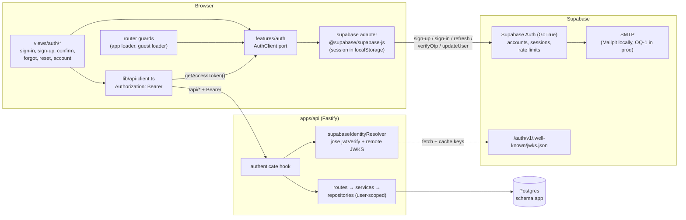

# System Design: User Auth (email + password)

Supabase Auth holds the accounts, password hashes, sessions and auth emails. The web app talks to
it through `@supabase/supabase-js`, wrapped in an `AuthClient` port so pages and tests never import
the SDK directly. Every call to the Investhesis API carries the Supabase access token as a bearer
token. The API checks that token itself against Supabase's published keys (JWKS) and turns it into
an `Identity` through a new `supabaseIdentityResolver`, plugged into the existing
`IdentityResolver` seam in `apps/api/src/plugins/authenticate.ts`. Routes, services and
repositories do not change. No new application tables are added.

## Architecture Overview



### Sign-in and an API call

```mermaid
sequenceDiagram
  actor U as Visitor
  participant W as Web
  participant SB as Supabase Auth
  participant API as API
  U->>W: open /lists (no session)
  W->>W: app loader: getSession() → null
  W-->>U: redirect /auth/sign-in?next=%2Flists
  U->>W: email + password
  W->>SB: signInWithPassword
  SB-->>W: access token (1 h) + refresh token
  W->>W: store session; navigate to safe next (/lists)
  W->>API: GET /lists, Authorization: Bearer <access>
  API->>API: jwtVerify(sig via cached JWKS, iss, aud, exp, alg)
  API-->>W: 200, rows for sub only
  Note over W,SB: supabase-js refreshes the access token before expiry
  W->>API: request with expired token (e.g. laptop woke up)
  API-->>W: 401 unauthenticated
  W->>SB: refreshSession() (once)
  SB-->>W: new access token
  W->>API: retry → 200
```

### Email links (confirm and reset)

```mermaid
sequenceDiagram
  actor U as Visitor
  participant W as Web
  participant SB as Supabase Auth
  participant MB as Mailbox
  U->>W: sign up (email, password ×2)
  W->>SB: signUp(email, password, emailRedirectTo=/stocks)
  SB->>MB: "Confirm" → SITE_URL/auth/confirm?token_hash=…&type=email&next=…
  W-->>U: /auth/check-email
  U->>W: open link (any browser)
  W->>SB: verifyOtp({ token_hash, type: 'email' })
  alt valid
    SB-->>W: session
    W->>W: replace URL (drop token_hash); go to safe next
  else expired / used / malformed
    W-->>U: /auth/link-expired (resend)
  end
  Note over U,W: Reset uses the same /auth/confirm with type=recovery,<br/>then lands on /auth/reset-password to set the new password
```

## Components

### API (`apps/api`)

| Component | Responsibility |
|-----------|----------------|
| `src/config/env.ts` | `AUTH_MODE` becomes `mock \| supabase`, default `supabase` (the default only matters when the variable is unset). New `SUPABASE_URL` (origin of the Supabase project, e.g. `http://127.0.0.1:54321`), required when `AUTH_MODE=supabase`; `Config.supabaseAuth = { issuer: <url>/auth/v1, jwksUrl: <url>/auth/v1/.well-known/jwks.json, audience: 'authenticated' }`. `mock` stays refused in `production` ([FR-017](requirements.md#fr-017)). |
| `src/auth/supabase-identity-resolver.ts` | `supabaseIdentityResolver({ issuer, audience, keys })`, where `keys` is a jose `JWTVerifyGetKey`: `createRemoteJWKSet(jwksUrl)` in production, `createLocalJWKSet(...)` in tests ([NFR-007](requirements.md#nfr-007)). Reads `Authorization: Bearer <jwt>`, calls `jwtVerify` with `algorithms: ['ES256', 'RS256']`, `issuer`, `audience`, and 30 s clock tolerance, then checks `sub` is a UUID, `role === 'authenticated'` and `is_anonymous !== true`. Returns `{ userId: sub, email: email claim, displayName: undefined }` ([FR-014](requirements.md#fr-014), [FR-015](requirements.md#fr-015), [NFR-001](requirements.md#nfr-001)). |
| `src/plugins/authenticate.ts` | `identityResolverFor(config)` gains the `supabase` branch. The hook is unchanged: public paths skip it, everything else must resolve. |
| `src/modules/me/` | Unchanged shape; in `supabase` mode `displayName` is `null` ([FR-016](requirements.md#fr-016)). |
| `src/lib/logger.ts` | Already redacts `req.headers.authorization`, `cookie`, `password`, `token`, `accessToken`, `refreshToken`. A test pins that a request with a bearer token logs `[redacted]` ([NFR-004](requirements.md#nfr-004)). |

### Web (`apps/web`)

| Component | Responsibility |
|-----------|----------------|
| `src/config.ts` | Reads `import.meta.env` once: `VITE_AUTH_MODE` (`supabase` \| `mock`, default `supabase`), `VITE_SUPABASE_URL`, `VITE_SUPABASE_PUBLISHABLE_KEY` (the public anon/publishable key, safe in the bundle). Throws at startup if `supabase` mode lacks either value. |
| `src/features/auth/auth-client.ts` | The `AuthClient` port, the only auth API pages see: `getSession()`, `getAccessToken()`, `refresh()`, `signIn`, `signUp`, `resendConfirmation`, `verifyEmailLink(tokenHash, type)`, `requestPasswordReset`, `setNewPassword`, `changePassword(current, next)`, `signOut()`, `onChange(listener)`. Methods return `{ ok: true, … } \| { ok: false, error: AuthErrorCode }` instead of throwing SDK errors. |
| `src/features/auth/supabase-auth-client.ts` | The adapter: `createClient(url, key, { auth: { persistSession: true, autoRefreshToken: true, detectSessionInUrl: false } })`. Only file that imports `@supabase/supabase-js` (lint rule `no-restricted-imports` elsewhere). Maps SDK error codes to `AuthErrorCode`. |
| `src/features/auth/mock-auth-client.ts` | For `VITE_AUTH_MODE=mock` (API in mock mode): always signed in, no token, auth pages redirect to `/stocks`. Also the base of the test fake. |
| `src/features/auth/auth-errors.ts` | `AuthErrorCode` → user copy (see [Error mapping](#error-mapping)). |
| `src/features/auth/safe-next.ts` | `safeNext(raw)`: accept only a path that starts with `/`, not `//` or `/\`, has no scheme, and is not under `/auth`; anything else → `/stocks` ([FR-008](requirements.md#fr-008)). |
| `src/features/auth/guards.ts` | `requireSession({ request })` for the `app` route loader: no session → `redirect('/auth/sign-in?next=' + encoded path+search)`. `redirectIfSignedIn()` for guest pages ([FR-009](requirements.md#fr-009)). |
| `src/features/auth/components/` | `SignInForm` (existing, now real), `SignUpForm`, `ForgotPasswordForm`, `NewPasswordForm` (reset and change share the new-password + confirm fields and the [NFR-002](requirements.md#nfr-002) checks), `ChangePasswordForm`, `ResendConfirmation`. |
| `src/lib/api-client.ts` | Adds `Authorization: Bearer` from `authClient.getAccessToken()` when present. On `401`: `refresh()` once and retry; if still `401`, `signOut()` and redirect to `/auth/sign-in?next=<current>` ([FR-010](requirements.md#fr-010)). Created here if Stock Lists T-007 has not created it yet; the later task extends it. |
| `src/components/layout/sidebar/nav-user.tsx` | Shows the email from `GET /me` (loaded in the `app` loader); Account links to `/account`; Sign out is a button calling `signOut()` then navigating to sign-in ([FR-007](requirements.md#fr-007)). |
| `src/main.tsx` / app root | Subscribes to `authClient.onChange`: a `SIGNED_OUT` from another tab or a failed refresh sends the user to sign-in; `TOKEN_REFRESHED` needs no action. |

### Routes

| Path | Area | Loader | Purpose |
|------|------|--------|---------|
| `/auth/sign-in` | guest | `redirectIfSignedIn` | Sign in; reads `?next=` ([UC-003](requirements.md#uc-003)) |
| `/auth/sign-up` | guest | `redirectIfSignedIn` | Create account ([UC-001](requirements.md#uc-001)) |
| `/auth/check-email` | guest | — | "Check your email" with resend; the email comes from router state, never the URL |
| `/auth/confirm` | public | verifies `token_hash` + `type` (`email` \| `recovery`) | Email-link handler ([FR-004](requirements.md#fr-004), [FR-012](requirements.md#fr-012)) |
| `/auth/link-expired` | public | — | Expired/invalid link, with resend or new-reset actions |
| `/auth/forgot-password` | guest | `redirectIfSignedIn` | Request reset ([FR-011](requirements.md#fr-011)) |
| `/auth/reset-password` | recovery session | requires a session, else `link-expired` | Set new password after a recovery link |
| `/account` | app | `requireSession` | Change password ([FR-013](requirements.md#fr-013)); crumb "Account" |

`/auth/confirm` calls `verifyOtp` in its loader, then `redirect`s, so the `token_hash` URL is
replaced in history and never rendered or logged ([NFR-004](requirements.md#nfr-004)). After a
`recovery` link it always goes to `/auth/reset-password`; after an `email` link it goes to
`safeNext(next)`.

### Supabase project (`supabase/`)

The Supabase CLI project is shared with Stock Lists ([ADR-001 there](../../stock-lists/v1.0/design.md#key-decisions)).
Whichever slice runs first creates it with `supabase init` and the root `db:*` scripts; this slice
adds the auth settings:

| Setting (`supabase/config.toml`) | Value | Why |
|---|---|---|
| `auth.site_url` | `http://localhost:5173` | Base of the email links |
| `auth.additional_redirect_urls` | `["http://localhost:5173/**"]` | Allowed `emailRedirectTo` / `redirectTo` |
| `auth.jwt_expiry` | `3600` | 1 h access tokens |
| `auth.enable_refresh_token_rotation`, `refresh_token_reuse_interval` | `true`, `10` | Stolen refresh tokens are detected; reuse within 10 s tolerated for concurrent tabs |
| `auth.enable_signup`, `auth.enable_anonymous_sign_ins` | `true`, `false` | [FR-001](requirements.md#fr-001); anonymous users never get an identity |
| `auth.minimum_password_length` | `8` | [NFR-002](requirements.md#nfr-002) (72 is Supabase's own maximum) |
| `auth.signing_keys_path` | `./signing_keys.json` (git-ignored, made by `pnpm db:keys` → `supabase gen signing-key --algorithm ES256`) | Local tokens are ES256 and published at the local JWKS, same as hosted ([ADR-001](#key-decisions)) |
| `auth.email.enable_confirmations` | `true` | [FR-002](requirements.md#fr-002) |
| `auth.email.secure_password_change` / current-password requirement | on | [FR-013](requirements.md#fr-013), [ADR-006](#key-decisions) |
| `auth.email.max_frequency` | `60s` | One confirmation/reset email per address per minute |
| `auth.email.otp_expiry` | `3600` | Confirmation and reset links expire after 1 hour (one setting for both) |
| `auth.email.template.confirmation`, `.recovery` | `supabase/templates/{confirmation,recovery}.html` | Link to `/auth/confirm?token_hash=…` ([ADR-002](#key-decisions)); copy stays Supabase's default wording with the app name |
| `auth.rate_limit.*` | defaults (`sign_in_sign_ups = 30` per 5 min per IP, `email_sent` per hour) | [NFR-003](requirements.md#nfr-003) |

The hosted project gets the same settings and templates by hand (dashboard), listed as a checklist
in `supabase/README.md`, plus the production SMTP from [OQ-1](requirements.md#oq-1) and an ES256
signing key made current. `supabase config push` can replace the checklist later.

## Data Model

No new tables or columns. The user id everywhere in the `app` schema is Supabase's
`auth.users.id` (the token's `sub`) ([ADR-004](#key-decisions)):

```
auth.users (owned by Supabase Auth; never read or written by the API)
   id uuid ──────────────┐  (logical reference, no foreign key)
                         ▼
app.<every table>.user_id uuid not null
```

Rows written in development under `MOCK_USER_ID` stay with that id; [OQ-2](requirements.md#oq-2)
expects there is nothing to move.

## API Contracts

### All non-public routes

- **Request** — header `Authorization: Bearer <Supabase access token>` when `AUTH_MODE=supabase`.
  Public paths (`/health`, `/ready`, `/openapi.json`) and `OPTIONS` need none.
- **401** `application/problem+json`, `code: "unauthenticated"`, plus `WWW-Authenticate: Bearer`,
  for: no header, a scheme other than `Bearer`, a malformed token, bad signature, unknown `kid`
  (after one JWKS refetch), wrong `alg` (anything not ES256/RS256, including `HS256` and `none`),
  wrong `iss` or `aud`, expired (`exp` beyond 30 s tolerance), `sub` not a UUID, `role` not
  `authenticated`, or `is_anonymous: true`. The body never says which check failed; the log line
  does (`reason`, no token).

```json
{ "type": "about:blank", "title": "Unauthorized", "status": 401, "code": "unauthenticated", "requestId": "…" }
```

- **503** `code: "auth_unavailable"` with `Retry-After: 5`, when the JWKS cannot be fetched and no
  cached key matches, so a Supabase outage does not look like a sign-out to the web app
  ([ADR-007](#key-decisions)).
- The OpenAPI spec declares a `bearerAuth` security scheme (`http`, `bearer`, `JWT`) applied to
  every route except the public ones.

### GET /me

- **Method / Path** — `GET /me`
- **Request** — bearer token only.

```json
{ "id": "6f1c…-uuid", "email": "investor@example.com", "displayName": null }
```

- **Errors** — `401 unauthenticated`, `503 auth_unavailable`.

### Supabase Auth calls (made by the web adapter, not by our API)

| `AuthClient` method | supabase-js call |
|---|---|
| `signUp` | `auth.signUp({ email, password, options: { emailRedirectTo: origin + '/auth/confirm' } })` |
| `resendConfirmation` | `auth.resend({ type: 'signup', email })` |
| `signIn` | `auth.signInWithPassword({ email, password })` |
| `verifyEmailLink` | `auth.verifyOtp({ token_hash, type: 'email' \| 'recovery' })` |
| `requestPasswordReset` | `auth.resetPasswordForEmail(email, { redirectTo: origin + '/auth/confirm' })` |
| `setNewPassword` | `auth.updateUser({ password })` (recovery session) |
| `changePassword` | `auth.updateUser({ password, current_password })` |
| `signOut` | `auth.signOut({ scope: 'local' })` |
| `getSession` / `getAccessToken` / `refresh` / `onChange` | `auth.getSession()`, `auth.refreshSession()`, `auth.onAuthStateChange()` |

### Error mapping

| Supabase error code(s) | `AuthErrorCode` | Shown to the user |
|---|---|---|
| `invalid_credentials` | `invalid_credentials` | "Email or password is incorrect." ([FR-005](requirements.md#fr-005)) |
| `email_not_confirmed` | `email_not_confirmed` | "Confirm your email first." + Resend ([FR-002](requirements.md#fr-002)) |
| `user_already_exists`, `email_exists` | *(treated as success)* | Same "check your email" screen ([FR-003](requirements.md#fr-003)) |
| `weak_password` | `weak_password` | Password policy text on the field |
| `same_password` | `same_password` | "Choose a password you haven't used here." |
| current password rejected | `wrong_current_password` | "Current password is incorrect." on that field |
| `otp_expired`, `flow_state_expired`, `bad_code_verifier`, missing params | `link_invalid` | `/auth/link-expired` |
| `over_request_rate_limit`, `over_email_send_rate_limit`, HTTP 429 | `rate_limited` | "Too many attempts. Try again in a few minutes." ([NFR-003](requirements.md#nfr-003)) |
| network failure, 5xx | `unavailable` | "Can't reach the sign-in service. Try again." |
| anything else | `unknown` | Generic error; details to `console.error` without tokens |

Forgot-password always shows the "if an account exists" message unless the result is
`rate_limited` or `unavailable` ([FR-011](requirements.md#fr-011)).

## Testing approach

- **API unit/integration (no network):** tests generate an ES256 key pair with jose, sign tokens
  with chosen claims, and build the app with `resolveIdentity: supabaseIdentityResolver({ keys:
  createLocalJWKSet(...) })`. One table-driven test covers every 401 reason above; separate tests
  cover the 503 path (a `keys` function that throws a JWKS fetch error), config validation, log
  redaction and a two-user isolation check through `GET /me`.
- **Web (Testing Library):** pages and guards run against a `FakeAuthClient` (in-memory accounts,
  scripted errors). `safeNext` gets a table of hostile inputs. `api-client` 401 → refresh → retry
  → sign-out is tested with a stubbed `fetch`.
- **End-to-end against local Supabase** (`pnpm db:start`): sign up → read the confirmation link
  from Mailpit's API (`http://127.0.0.1:54324/api/v1/messages`) → confirm → `GET /api/me` returns
  the new user; reset password the same way; sign-in rate limiting is not tested end to end.
  Needs Docker; joins the test-gate table as its own step.
- **Performance ([NFR-005](requirements.md#nfr-005)):** a timed test verifies 1,000 tokens against
  a cached local key set and asserts p95 ≤ 5 ms.

## Key Decisions

| Decision | Options Considered | Chosen | Rationale |
|----------|-------------------|--------|-----------|
| ADR-001: How the API verifies tokens | `supabase.auth.getUser(jwt)` per request; shared HS256 JWT secret; local verification against JWKS | `jose` `jwtVerify` with `createRemoteJWKSet` (ES256/RS256 only), keys cached in memory (jose default 10 min, 30 s cooldown on unknown `kid`) | No network call per request ([NFR-005](requirements.md#nfr-005)), no shared secret in the API's env, and key rotation in Supabase needs no redeploy. Local Supabase is given an ES256 key so dev and prod verify the same way. Pinning algorithms blocks `alg: none` and HS256 confusion. |
| ADR-002: Email link handling | Default `{{ .ConfirmationURL }}` (tokens in the URL fragment, implicit flow); PKCE `?code=` exchange; `token_hash` + `verifyOtp` | `token_hash` + `verifyOtp` in the `/auth/confirm` loader, for both `email` and `recovery` | Works when the link is opened in a different browser from the one that signed up (PKCE doesn't); no access or refresh token ever appears in a URL ([NFR-004](requirements.md#nfr-004)); one handler for both flows, easy to test with Mailpit. Cost: two custom email templates (link only) kept in sync on the hosted project. |
| ADR-003: Where the browser keeps the session | supabase-js in `localStorage`; httpOnly cookie through an API backend-for-frontend | supabase-js default `localStorage`, auto-refresh on | The API is a stateless bearer-token API and the SPA is the only client; a cookie BFF means proxying every auth call and adding CSRF defence. Risk: XSS could read the tokens, so the web keeps no `dangerouslySetInnerHTML`, React escapes output, and a CSP on the static host is noted for deployment. Refresh-token rotation limits replay. |
| ADR-004: Users table | `app.users` profile table synced from `auth.users`; FK from `app.*.user_id` to `auth.users`; no table | No table; `user_id` is the Supabase user id, with no foreign key into the `auth` schema | Nothing in v1 needs profile data (display name is out of scope), the API never reads `auth.*`, and a cross-schema FK ties `app` migrations to Supabase internals. Add `app.users` when profiles or account deletion arrive. |
| ADR-005: How the web uses Supabase | Call supabase-js from pages; `AuthClient` port + adapter + fake | `AuthClient` port; only `supabase-auth-client.ts` imports the SDK | Pages and tests stay SDK-free, mock mode is one more adapter, and replacing Supabase Auth later touches one file in the web and one resolver in the API. Same port-and-adapter idea as the API's `IdentityResolver`. |
| ADR-006: Checking the current password on change | `signInWithPassword` with the current password, then `updateUser`; `reauthenticate()` nonce by email; `updateUser({ password, current_password })` with the current-password requirement enabled | `updateUser` with `current_password`, enforced by the Auth setting | Checked by Supabase in the same request, so a stolen session alone can't change the password ([FR-013](requirements.md#fr-013)) and no email round-trip is needed. T-001 confirms the exact `config.toml` key on the pinned CLI version; if the installed Auth version lacks it, fall back to the sign-in-then-update option and record that here. |
| ADR-007: JWKS unreachable | Treat as 401; 503 | `503 auth_unavailable` + `Retry-After` | A 401 would make the web sign the user out during a Supabase blip; a 503 shows a retryable error and keeps the session. |
| ADR-008: Default `AUTH_MODE` | Keep `mock`; `supabase` | `supabase` when unset; `.env.example` switches to `supabase`; API tests set `mock` or inject a resolver explicitly | Matches "real auth becomes the default"; mock remains opt-in for development and tests and is still refused in production ([FR-017](requirements.md#fr-017)). |

## Dependencies

- **Supabase Auth** (hosted project + local stack via the Supabase CLI, Docker) — accounts, sessions, emails, rate limits.
- **`@supabase/supabase-js`** (web) — the Auth client used only by the adapter ([ADR-005](#key-decisions)).
- **`jose`** (API) — JWT and JWKS verification ([ADR-001](#key-decisions)); no other auth library in the API.
- **Supabase CLI** (root dev dependency, shared with Stock Lists) — local stack, signing key, Mailpit.
- **SMTP provider** for production ([OQ-1](requirements.md#oq-1)); Mailpit locally.
- **shadcn/ui** — existing `field`, `input`, `button`, `card`; adds `alert` for form-level errors.

## Risks

- **Supabase setting names drift between CLI versions** (current-password requirement, signing
  keys). T-001 pins the CLI version and proves each setting with a local test before later tasks
  rely on it.
- **Hosted and local config can drift**, since the dashboard checklist is manual. The end-to-end
  test only covers local; a short smoke check after each hosted change is in the checklist.
- **Tokens in `localStorage`** ([ADR-003](#key-decisions)) make XSS more costly; worth revisiting
  with a CSP once hosting is chosen.
- **Ordering with Stock Lists:** both slices create `supabase/` and `lib/api-client.ts`. Whichever
  task runs second extends the file rather than recreating it; the dev plan states this in both
  tasks.
