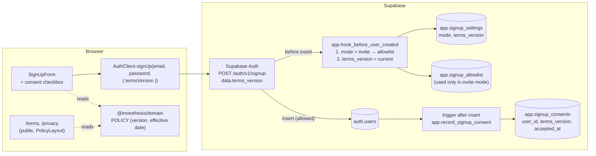

# System Design: User Auth v1.1 (open sign-up with consent)

v1.0's design ([v1.0/design.md](../v1.0/design.md)) stays in force. This document covers only what
changes: the Before User Created hook stops checking the allowlist (unless the owner switches
sign-up back to invite-only) and starts enforcing consent. A trigger stores an immutable consent
record, and the web gains a consent checkbox and two public policy pages. The Investhesis API does
not change.

## Architecture Overview



Sign-up sequence (open mode):

```mermaid
sequenceDiagram
  participant V as Visitor
  participant W as SignUpForm
  participant A as Supabase Auth
  participant H as hook_before_user_created
  participant DB as auth.users + trigger
  V->>W: email, password ×2, ticks consent
  W->>W: validateNewPassword + consent ticked (FR-020)
  W->>A: signUp({ email, password, options: { data: { terms_version: POLICY.version } } })
  A->>H: event.user.user_metadata.terms_version
  H->>H: mode open → skip allowlist; version = signup_settings.terms_version?
  alt version missing or outdated
    H-->>A: 403 terms_outdated
    A-->>W: error → "The terms have changed. Reload the page and try again."
  else ok
    H-->>A: {}
    A->>DB: insert auth.users (raw_user_meta_data.terms_version)
    DB->>DB: trigger inserts app.signup_consents (same transaction)
    A-->>W: ok → /auth/check-email (FR-003, unchanged)
  end
```

## Components

| Component | Change | Requirement |
|-----------|--------|-------------|
| `supabase/migrations/<ts>_open_signup.sql` | New: `app.signup_settings`, `app.signup_consents`, trigger function and trigger on `auth.users`, new body for `app.hook_before_user_created` | [FR-019](requirements.md#fr-019), [FR-021](requirements.md#fr-021), [FR-024](requirements.md#fr-024), [NFR-010](requirements.md#nfr-010) |
| `supabase/config.toml` | Unchanged: the hook stays enabled because it now enforces consent | — |
| `supabase/seed.sql` | Keeps the `@example.test` allowlist row (used by invite-mode tests) | — |
| `supabase/README.md` | "Sign-up allowlist" becomes "Sign-up mode and consent": open/invite switch, policy version bump, creating users by hand with `terms_version`; hosted checklist updated | [FR-024](requirements.md#fr-024) |
| `packages/domain/src/policy.ts` | New: `POLICY = { version: '2026-11-22', effectiveDate: '2026-11-22' }` | [FR-021](requirements.md#fr-021), [FR-022](requirements.md#fr-022) |
| `apps/web/src/features/auth/auth-client.ts` | `signUp(email, password, consent: { termsVersion: string })`; new `AuthErrorCode` `terms_outdated` | [FR-021](requirements.md#fr-021) |
| `supabase-auth-client.ts` | Sends `options.data.terms_version` | [FR-021](requirements.md#fr-021) |
| `map-supabase-error.ts`, `auth-errors.ts` | Map 403 `terms_outdated`; new copy for `signup_not_allowed` | [FR-021](requirements.md#fr-021), [FR-023](requirements.md#fr-023) |
| Mock adapter, `src/test/fake-auth-client.ts` | Accept and record `consent`; fake can script `terms_outdated` | — |
| `components/sign-up-form.tsx` | Consent `Checkbox` with links, client-side validation and error | [FR-020](requirements.md#fr-020), [NFR-011](requirements.md#nfr-011) |
| `features/policies/` (new) | `PolicyPage` (title, version, effective date, placeholder body), `terms-content.tsx`, `privacy-content.tsx` | [FR-022](requirements.md#fr-022) |
| `components/layout/policy-layout.tsx` (new) | Public shell: logo link, `<main>` article, footer links | [FR-022](requirements.md#fr-022), [NFR-012](requirements.md#nfr-012) |
| `components/layout/auth-layout.tsx` | Footer with Terms and Privacy links | [UC-009](requirements.md#uc-009) |
| `routers/router.tsx` | Top-level public routes `/terms` and `/privacy` (lazy `views/terms.tsx`, `views/privacy.tsx`), outside `/auth` and the `app` route, no guard | [FR-022](requirements.md#fr-022) |
| Test helpers: `scripts/lib/stack.ts` (`adminCreateUser`, `confirmedUser`), `scripts/auth-integration.test.ts`, `e2e/lib/*` | Every user they create carries `terms_version` (the hook also gates the admin API) | [NFR-010](requirements.md#nfr-010) |
| `apps/api` | No change | — |

### Routes

| Path | Guard | Page |
|---|---|---|
| `/terms` | none (public for visitors and investors) | Terms of Service |
| `/privacy` | none | Privacy Policy |

Both are siblings of `/auth` and the `app` route, so neither `requireSession` nor
`redirectIfSignedIn` applies. Each sets its tab title and has `RouteError` as its error boundary.

## Data Model

Migration `supabase/migrations/<timestamp>_open_signup.sql`, run after `*_signup_allowlist.sql`.
It is idempotent like the earlier ones.

```sql
-- Sign-up mode and current policy version: one row (ADR-010, ADR-012).
create table if not exists app.signup_settings (
  id            boolean primary key default true check (id),
  mode          text not null default 'open' check (mode in ('open', 'invite')),
  terms_version text not null check (terms_version ~ '^\d{4}-\d{2}-\d{2}$'),
  updated_at    timestamptz not null default now()
);
insert into app.signup_settings (terms_version) values ('2026-11-22') on conflict (id) do nothing;
alter table app.signup_settings enable row level security;
create policy auth_admin_read on app.signup_settings for select to supabase_auth_admin using (true);
revoke all on app.signup_settings from public, anon, authenticated;
grant select on app.signup_settings to supabase_auth_admin;

-- One immutable consent record per account created from v1.1 on (ADR-011).
create table if not exists app.signup_consents (
  user_id       uuid primary key,          -- auth.users.id; no FK into auth (v1.0 ADR-004)
  terms_version text not null,
  accepted_at   timestamptz not null       -- auth.users.created_at: server clock, not the browser's
);
alter table app.signup_consents enable row level security;
revoke all on app.signup_consents from public, anon, authenticated;

create or replace function app.record_signup_consent() returns trigger
language plpgsql security definer set search_path = '' as $$
begin
  if new.raw_user_meta_data ? 'terms_version' then
    insert into app.signup_consents (user_id, terms_version, accepted_at)
    values (new.id, new.raw_user_meta_data->>'terms_version', new.created_at)
    on conflict (user_id) do nothing;
  end if;
  return new;
end $$;
revoke execute on function app.record_signup_consent() from public, anon, authenticated;

drop trigger if exists record_signup_consent on auth.users;
create trigger record_signup_consent after insert on auth.users
  for each row execute function app.record_signup_consent();

-- The hook: invite mode checks the allowlist, then every sign-up must carry the current version.
create or replace function app.hook_before_user_created(event jsonb) returns jsonb
language sql stable as $$
  with s as (select mode, terms_version from app.signup_settings where id),
       e as (select lower(event->'user'->>'email') as email,
                    event->'user'->'user_metadata'->>'terms_version' as version)
  select case
    when (select mode from s) = 'invite' and not exists (
      select 1 from app.signup_allowlist a, e
      where a.pattern = e.email or a.pattern = '@' || split_part(e.email, '@', 2))
      then '{"error":{"http_code":403,"message":"signup_not_allowed"}}'::jsonb
    when (select version from e) is distinct from (select terms_version from s)
      then '{"error":{"http_code":403,"message":"terms_outdated"}}'::jsonb
    else '{}'::jsonb
  end
$$;
```

Grants on the hook stay as in v1.0 (execute for `supabase_auth_admin` only). If
`app.signup_settings` has no row, `mode` is null (treated as open) and `terms_version` is null, so
every sign-up is refused with `terms_outdated`. A missing setting fails closed.

User metadata written by the web: `raw_user_meta_data = { "terms_version": "2026-11-22" }`. The
user can edit it later through `updateUser({ data })`, which is why the record of truth is
`app.signup_consents`, which no client role can reach.

## API Contracts

The Investhesis API is unchanged. The contract that changes is the Supabase Auth call the web
adapter makes:

### Supabase sign-up (web adapter)

- **Method / Path** — `POST {SUPABASE_URL}/auth/v1/signup` through `auth.signUp`
- **Request** — `{ email, password, options: { emailRedirectTo: origin + '/auth/confirm', data: { terms_version: POLICY.version } } }`
- **Success** — unchanged from v1.0 (a registered email is reported as success, [FR-003](../v1.0/requirements.md#fr-003))
- **Errors** — v1.0 mapping, plus:

| Supabase error | `AuthErrorCode` | Shown to the user | Focus |
|---|---|---|---|
| HTTP 403, message contains `terms_outdated` | `terms_outdated` | "The terms have changed. Reload the page and try again." ([FR-021](requirements.md#fr-021)) | form alert |
| HTTP 403, message contains `signup_not_allowed` (invite mode only) | `signup_not_allowed` | "Sign-up is closed right now. Try again later." ([FR-023](requirements.md#fr-023), [FR-024](requirements.md#fr-024)) | form alert (no longer the email field: the message is not about the address) |

### Owner operations (SQL, documented in `supabase/README.md`)

```sql
update app.signup_settings set mode = 'invite', updated_at = now();   -- re-lock (FR-024)
update app.signup_settings set mode = 'open',   updated_at = now();   -- reopen
select u.email, c.terms_version, c.accepted_at
  from app.signup_consents c join auth.users u on u.id = c.user_id;   -- consent audit
```

A policy version bump is a release, not an SQL edit. It needs a migration that updates
`terms_version` together with a matching change to `POLICY.version`, and both ship together
([ADR-012](#key-decisions)).

## Testing approach

- **Domain:** `POLICY.version` matches `YYYY-MM-DD`, and `effectiveDate` is a valid date.
- **SQL / script level (`pnpm test:supabase`):** the hook called with crafted events, as a
  decision table over mode (open/invite), allowlisted (yes/no) and version (current, old, missing).
  Real sign-ups: open mode with a non-`@example.test` address succeeds and writes exactly one
  `app.signup_consents` row with `accepted_at = auth.users.created_at`; a missing version gives 403
  `terms_outdated` with no `auth.users` row and no Mailpit message; `anon`/`authenticated` cannot
  read `signup_settings` or `signup_consents` or run either function; a drift test checks that
  `signup_settings.terms_version` equals `POLICY.version`. Invite-mode tests switch the mode inside
  the test and restore it in `finally` (the test files run serially).
- **Web (Testing Library, `FakeAuthClient`):** the checkbox is unticked by default; submitting
  unticked shows the error, focuses the checkbox and calls nothing; ticked submit passes
  `{ termsVersion: POLICY.version }`; `terms_outdated` and `signup_not_allowed` alerts; links point
  at `/terms` and `/privacy` and open in a new tab; policy pages render the version and date and
  are reachable signed in and signed out.
- **E2E:** open sign-up with a fresh address → Mailpit link → confirmed → `/stocks`; consent row
  present; unticked submit blocked; policy pages at 360 px with axe clean.
- **Retired:** the allowlist-only cases (TC-U-025b, TC-U-039, TC-U-040, TC-C-027, TC-E-002,
  TC-E-003) are rewritten for open mode or invite mode, never skipped. The v1.1 test design maps
  each one.

## Key Decisions

| Decision | Options Considered | Chosen | Rationale |
|----------|-------------------|--------|-----------|
| ADR-010: How sign-up opens | Turn the hook off in config; drop the allowlist; blocklist; a mode setting the hook reads | Keep the hook. A one-row `app.signup_settings.mode` (`open` default, `invite`) decides whether the allowlist applies | The hook is still needed to enforce consent ([FR-021](requirements.md#fr-021)), so it can't be turned off. A mode row gives the owner a one-line SQL re-lock with no deploy and no Auth restart ([FR-024](requirements.md#fr-024)), and keeps the v1.0 allowlist working for invite mode. Supersedes v1.0 ADR-009. |
| ADR-011: Where consent is recorded | User metadata only; `app.signup_consents` written by the hook; written by the API on first `/me`; written by a trigger on `auth.users` | User metadata carries the version to the hook. An `after insert` trigger on `auth.users` copies it to `app.signup_consents` with `accepted_at = created_at` | The Before User Created hook can only accept or reject, and runs before the user row exists, so it can't write a keyed record (Supabase docs). User metadata alone can be edited by the user. An API write on `/me` would leave accounts without a record until first sign-in. The trigger runs in the same transaction as the user insert, so a record exists for every account (NFR-010), and no client role can reach it. Cost: the trigger depends on Supabase's `auth.users`, which v1.0 ADR-004 avoided for foreign keys; it is one trigger, `security definer` with an empty `search_path`, and it is covered by the drift and integration tests. |
| ADR-012: Source of the current policy version | DB only (web reads it before submit); web constant only; both, with a drift test | `POLICY` in `@investhesis/domain` for the web, `app.signup_settings.terms_version` for the hook, and a `test:supabase` check that they are equal | The web needs the version at render time to show it on the policy pages, and the sign-up page can't read the `app` schema. Supabase is the enforcer. A stale browser tab sends the old version and gets `terms_outdated`, and a reload fixes it. Date-style versions (`2026-11-22`) double as the effective date shown to users. |
| ADR-013: Copy when invite mode refuses | Keep "invite-only, ask the owner"; generic error; "closed right now" | "Sign-up is closed right now. Try again later." on the form alert | [FR-023](requirements.md#fr-023) retires the invite-only copy. Invite mode is now an owner switch for emergencies, so the message must not suggest the visitor can be invited or that the email was the problem. |
| ADR-014: Policy link behaviour on the sign-up form | Same tab; new tab; inline dialog | New tab (`target="_blank" rel="noopener noreferrer"`), with "(opens in a new tab)" for screen readers | Opening in the same tab would lose the typed email and passwords. A dialog would need the legal text inside the form flow. The footer links in `AuthLayout` and `PolicyLayout` open in the same tab. |

## Dependencies

- **Supabase Auth Before User Created hook** — now enforces consent as well as the optional
  allowlist. Confirmed in the Supabase docs: the event carries `user.user_metadata` (from
  `signUp`'s `options.data`), and the hook can only accept or reject.
- **shadcn/ui `checkbox`** — already installed (Stock Lists T-007).
- No new packages.

## Risks

- **`user_metadata` reaching the hook.** The docs show `user_metadata` in the event payload. T-001
  proves with a real local sign-up that `options.data.terms_version` arrives there, before the web
  depends on it.
- **The admin API is gated too.** Every helper that makes users with the admin API or with
  `signUp` (`scripts/lib/stack.ts`, `scripts/auth-integration.test.ts`, the E2E helpers) must send
  `terms_version`, or the whole stock-lists and auth suites fail. The owner must do the same when
  creating a user by hand (README).
- **Enumeration with a stale tab.** For an already registered email, Supabase may not call the hook
  (no user is created), so a stale version could answer success for a registered email and
  `terms_outdated` for a new one. This only happens across a policy release, and a test pins the
  actual behaviour. If it leaks, the web can compare versions first (accepted for v1.1 if
  confirmed).
- **XLSX import risk with strangers** (Stock Lists design, Risks): bounded by the 1 MB upload and
  the 1,000-row check after load. Accepted by the owner for v1.1, with no per-user limits.
- **Built-in mailer** (v1.0 [OQ-1](../v1.0/requirements.md#oq-1)): 2 emails per hour hosted.
  Public sign-up must not launch before custom SMTP is set up. This goes at the top of the hosted
  checklist.
- **Placeholder policies** ([OQ-3](requirements.md#oq-3)): the pages say the final text is pending.
  A public launch waits for the real text and a version bump.
