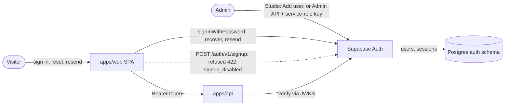

# System Design: User Auth v1.2 (admin-created accounts, no self sign-up)

Closes public registration. It is mostly deletion: one Auth setting, one retired hook, one
deleted route and its form. No new table, API route or screen. Requirements:
[requirements.md](requirements.md). Unchanged v1.0 design:
[v1.0/design.md](../v1.0/design.md).

## Architecture Overview



v1.0's Before User Created hook and `app.signup_allowlist` leave the picture. The dotted line is
the public sign-up call, which stays reachable (the anon key is public) and is refused by Auth.

## Components

| Component | Change |
|---|---|
| `supabase/config.toml` | `[auth] enable_signup = false`; remove the `[auth.hook.before_user_created]` block |
| `supabase/migrations/<ts>_close_signup.sql` | New, idempotent: drop `app.hook_before_user_created` and `app.signup_allowlist`. The v1.0 migration file stays as history |
| `supabase/seed.sql` | Remove the allowlist insert (nothing left to seed) |
| `supabase/README.md` | Replace "Sign-up allowlist" with "Creating accounts" (Studio steps, Admin API call, temporary-password hand-over, re-opening sign-up); update the hosted checklist |
| `apps/web` router | Remove the `sign-up` route and `views/sign-up.tsx` |
| `features/auth` | Delete `SignUpForm`; remove `signUp` from `AuthClient`, the supabase and mock adapters and `FakeAuthClient`; remove the `signup_not_allowed` code, its copy and its mapping |
| `SignInForm` | Remove the "Create account" link; keep unconfirmed-account resend |
| `scripts/lib/stack.ts`, `scripts/lib/global-setup.ts` | `confirmedUser` and the template warm-up no longer call the public `signUp`; they create the user through the Admin API and ask Auth for the confirmation email with `resend` |
| E2E | Delete `auth-sign-up.spec.ts` and sign-up entries in `e2e/lib/screens.ts`; rewrite cases that start from the form |

Kept as is: `CheckEmailPanel` and `/auth/check-email` (sign-in's unconfirmed resend and the
expired-link page still navigate there), `validateNewPassword` (reset and change use it),
`isAlreadyRegistered` is removed with sign-up.

## Data Model

```sql
-- <ts>_close_signup.sql: sign-up is closed in Auth settings (ADR-015); the allowlist has no reader.
drop function if exists app.hook_before_user_created(jsonb);
drop table if exists app.signup_allowlist;
```

The `app` schema, its `revoke` from `anon` and `authenticated` and the `supabase_auth_admin`
schema grant (shared with Stock Lists) stay. No `auth.users` change: accounts keep working.

## API Contracts

### Public sign-up (refused)

- **Method / Path** — `POST {SUPABASE_URL}/auth/v1/signup`
- **Request** — any `{ email, password }`
- **Response** — `422`, `{ "code": 422, "error_code": "signup_disabled", "msg": "Signups not allowed for this instance" }`; no `auth.users` row, no email.

### Admin creates an account (documented, not code)

```bash
curl -X POST "$SUPABASE_URL/auth/v1/admin/users" \
  -H "apikey: $SERVICE_ROLE_KEY" -H "Authorization: Bearer $SERVICE_ROLE_KEY" \
  -H 'Content-Type: application/json' \
  -d '{ "email": "investor@example.com", "password": "<temporary>", "email_confirm": true }'
```

Studio equivalent: Authentication → Users → Add user → Create new user, tick Auto Confirm User.
The admin shares the temporary password out of band; the investor signs in and uses Change
password ([FR-028](requirements.md#fr-028)). The service-role key stays in the admin's shell or
Studio ([NFR-014](requirements.md#nfr-014)).

### Admin re-opens sign-up (FR-030)

Local: `enable_signup = true` in `config.toml`, then `pnpm db:stop && pnpm db:start`. Hosted:
Authentication → Sign In / Providers → Allow new users to sign up. No code or migration.

## Testing approach

| Level | What |
|---|---|
| `scripts` (`pnpm test:supabase`) | `POST /auth/v1/signup` for any address answers `signup_disabled`, creates no row and no Mailpit message; the Admin API still creates a confirmed user who signs in; recovery works for it; the hook function and allowlist table are gone; `config.toml` has `enable_signup = false` |
| Web unit | No `/auth/sign-up` route (not-found page); sign-in has no sign-up link; `AuthClient` has no `signUp`; sign-in unconfirmed resend still reaches check-email |
| E2E | Visit `/auth/sign-up` → not found; admin-created user signs in → `/stocks` → `GET /api/me`; reset and unconfirmed-resend flows keep passing, now seeded through the Admin API |

New test ids use the 3xx range (`TC-U-301…`, `TC-C-301…`, `TC-A-301…`, `TC-E-301…`) so they never
collide with v1.0 (`TC-U-001..042`), Stock Lists or the unbuilt v1.1 (2xx).

## Key Decisions

| Decision | Options Considered | Chosen | Rationale |
|----------|-------------------|--------|-----------|
| ADR-015: How sign-up is closed | `enable_signup=false`; hook that refuses everything (`closed` mode); keep the allowlist and leave it empty | `enable_signup=false`, and retire the hook and allowlist | It is Supabase's own switch, so it also covers the web app's anon key being public. The Admin API and Studio keep working. It needs no code of ours, so nothing can drift. A refuse-all hook or an empty allowlist keeps a dead mechanism (supersedes v1.0 ADR-009 and v1.1 ADR-010) |
| ADR-016: Retire the hook now or keep it unused | Keep it enabled but harmless; drop it | Drop the function, the table and the config block | A hook that still checks an allowlist would refuse admin-created users on a hosted project whose allowlist is empty, which is a footgun for the one workflow v1.2 exists for. Re-opening sign-up needs only the Auth switch |
| ADR-017: Behaviour of `/auth/sign-up` | Redirect to sign-in; not-found | Not-found (route removed) | [FR-025](requirements.md#fr-025). A redirect would hide that registration is closed and keep old links alive for no reason |
| ADR-018: How tests get confirmation emails | Keep calling public `signUp` (needs sign-up open); Admin `generateLink`; admin-create unconfirmed then `resend` | Admin-create an unconfirmed user, then `auth.resend({ type: 'signup' })` | Exercises the real template and the real `/auth/confirm` link path, like the existing reset spec (`auth-reset.spec.ts`). Needs no setting flipped for tests |
| ADR-019: First password for an account | Temporary password in Studio; invite email | Temporary password ([OQ-7](requirements.md#oq-7)) | No new email template or set-password page. The investor changes it at once with the v1.0 change-password flow |
| ADR-020: Order of the work | Close Auth first; web first | Helpers, then web, then Auth (see the dev plan) | The test helpers and E2E sign up through the public API. Closing Auth first would fail the gate, so every step leaves `main` green |

## Dependencies

- **Supabase Auth** `enable_signup` and the Admin API — already in the local stack and hosted.
- No new libraries.

## Risks

- **Admin API vs `enable_signup=false`.** Auth documents that existing users and admin calls are
  unaffected, but T-003 proves it first: with the setting off and the hook gone, the Admin API
  creates a user, `resend` sends the confirmation mail and sign-in works. If not, stop and report.
- **Hosted rollout order.** Dropping `app.hook_before_user_created` while the hosted Before User
  Created hook is still enabled makes Auth fail every user creation. The checklist therefore says:
  disable the hook in the dashboard, turn sign-ups off, then `supabase db push`.
- **`signup_disabled` and enumeration.** The refusal is identical for every email, so it reveals
  nothing about accounts. Password reset still answers the same message for known and unknown
  emails ([FR-011](../v1.0/requirements.md#fr-011)).
- **Public `resend` of a signup email.** `auth.resend({ type: 'signup' })` stays callable for an
  existing unconfirmed email only; for an unknown email Auth sends nothing and answers success.
  T-003 pins that, since it is the one remaining public path that touches `signup`.
- **Self-registered unconfirmed accounts** that exist today are untouched
  ([OQ-6](requirements.md#oq-6)).
