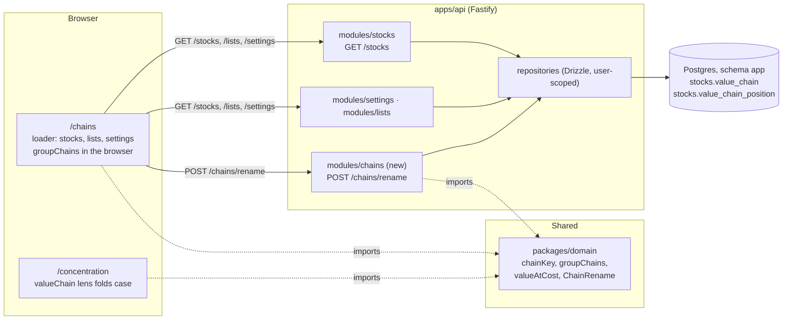
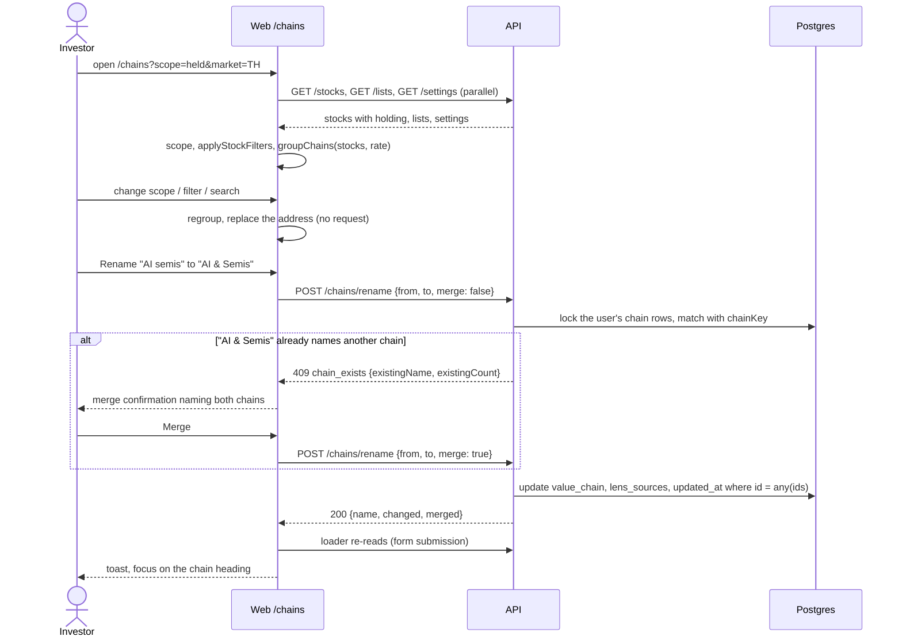

# System Design: Value Chains

The design adds **no table**. Chains are derived from the value-chain name and position already on
each stock ([ADR-001](#key-decisions)). The `/chains` page reads the same three endpoints as
`/concentration` (`GET /stocks`, `GET /lists`, `GET /settings`) and groups **in the browser** with
a new pure function in `@investhesis/domain`, `groupChains`, so scope, search and filter changes
send no request ([NFR-001](requirements.md#nfr-001), [ADR-002](#key-decisions)). The one new API
call is `POST /chains/rename` in a small `chains` module, which rewrites the chain name on every
matching stock in one transaction ([FR-009](requirements.md#fr-009) to
[FR-011](requirements.md#fr-011)).

It follows the patterns of [Holdings and Concentration v1.0](../../holdings-concentration/v1.0/design.md)
(browser grouping, exact `BigInt` value at cost, the settings rate, `revalidateOnSubmitOrPathChange`)
and [Search, Filter and Export v1.0](../../search-filter-export/v1.0/design.md) (`FilterToolbar`,
`useStockFilters`, filters in the address).

## Architecture Overview



The page loads once, regroups locally, and re-reads only after a rename:



## Components

| Component | Responsibility |
|-----------|----------------|
| `packages/domain` `chains.ts` (new) | `chainKey`, `CHAIN_AREAS`, `groupChains`, the `ChainRename` schema ([Shared rules](#shared-rules-investhesisdomain)). |
| `packages/domain` `concentration.ts` (changed) | `valueAtCost` is extracted from `groupConcentration` and exported, so both views value a holding the same way ([ADR-007](#key-decisions)). The `valueChain` lens groups by `chainKey` with the chain title rule ([ADR-006](#key-decisions)). `GroupableStock` gains `createdAt`. |
| `apps/api/src/modules/chains/` (new) | `chains.routes.ts` → `chains.service.ts` → `chains.repository.ts`: `POST /chains/rename` ([API Contracts](#api-contracts)). |
| `apps/api/src/app.ts` (changed) | Registers the chains routes. |
| `apps/web/src/features/chains/` (new) | `chains-routes.tsx` (`chainsRoute(api)`), `chains-data.ts` (loader and the `rename-chain` action), `chains-model.ts` (address, links, view plan), components: chain section, lane, stock entry, summary and notes, rename dialog, empty states. |
| `apps/web/src/features/stock-filters/scope.ts` (new, moved) | `readScope`, `stocksInScope`, `scopeName` and the `ScopeSelect` control, moved out of `features/concentration/` so `/chains` reuses them ([ADR-007](#key-decisions)). |
| `apps/web/src/features/concentration/` (changed) | Uses the moved scope helpers; `concentrationHref(scope, filters, lens?)` takes the lens so `/chains` links to the value-chain grouping ([FR-008](requirements.md#fr-008)); the loader's three reads become `readPortfolio(api)`, shared with `/chains`. |
| `apps/web/src/routers/router.tsx` (changed) | `/chains` uses `chainsRoute(api)` instead of the placeholder view. |

## Data Model

No migration. The slice reads and writes two existing columns of `app.stocks`
([Stock Lists data model](../../stock-lists/v1.0/design.md#data-model)):

| Column | Use |
|---|---|
| `value_chain text` (1..60 chars, nullable) | The chain a stock belongs to; `null` = no chain ([FR-006](requirements.md#fr-006)). |
| `value_chain_position text` (`Upstream`, `Midstream`, `Downstream`, `Integrated`, `None`, nullable) | The area of the chain ([FR-002](requirements.md#fr-002)). |
| `lens_sources jsonb` | A rename sets `valueChain` to `manual` (it already is for every stock written through the form or import). |
| `updated_at timestamptz` | Moves for each stock a rename changes, and only for those. |
| `created_at timestamptz` | Orders the spellings of a chain: the earliest-created stock's spelling titles it ([OQ-4](requirements.md#oq-4)). |

No index is added: a rename reads the user's rows that have a chain name (the existing
`stocks_user_market_ticker` index starts with `user_id`), at most a few hundred for one investor.

## Shared rules (`@investhesis/domain`)

- `chainKey(name) = name.trim().toLocaleLowerCase('en')`, the same fold the free-text filters use
  (`filters.ts`), exported from one place so the page, the filters, the concentration lens and the
  API rename agree on which stocks share a chain ([ADR-005](#key-decisions)).
- `CHAIN_AREAS = ['Upstream', 'Midstream', 'Downstream', 'Integrated', 'NoPosition']`;
  `NoPosition` holds position `None` and `null` ([OQ-2](requirements.md#oq-2)).
- `groupChains({ stocks, usdThbRate })` over `GroupableStock & { ticker, name, createdAt }`:

  ```ts
  type ChainsResult = {
    chains: Chain[]          // most stocks first, then title (FR-001)
    noChainIds: string[]     // stocks with no chain name (FR-006)
    needsRate: boolean       // a held USD stock with amounts and no rate (FR-005)
  }
  type Chain = {
    key: string              // chainKey
    title: string            // spelling of the earliest-created stock, ties by id
    spellings: string[]      // distinct spellings, title first (OQ-4 note)
    count: number; held: number
    value: string            // THB, 2 decimals, valued held stocks only
    leftOut: { noAmount: number; needsRate: number }
    areas: Area[]            // always the three lanes; Integrated, NoPosition only when non-empty
  }
  type Area = {
    position: (typeof CHAIN_AREAS)[number]
    stocks: { id: string; held: boolean; value: string | null }[]  // FR-003 order
    count: number; held: number
    value: string            // THB, 2 decimals
    valueShare: string | null  // of the chain's value, one decimal; null when the chain value is 0
  }
  ```

  Order inside an area ([FR-003](requirements.md#fr-003)): held with a value (value descending,
  exact `BigInt` compare), held without a value, then not held; each tier by ticker. Values use
  `valueAtCost` and `formatDecimal`/`percentOneDecimal` (half up, no floats,
  [NFR-005](requirements.md#nfr-005)).
- `ChainRename` (Zod, strict): `{ from: boundedText(60), to: fields.valueChain, merge?: boolean }`
  (default `false`). `from` is a chain as the page saw it; `to` follows the value-chain name rules
  ([FR-009](requirements.md#fr-009)). A `to` with the same `chainKey` as `from` is a case-only
  rename, never a merge ([FR-010](requirements.md#fr-010)).
- Messages (`chainNotFound`, `chainExists(name, count)`) go in `messages.ts`.

## API Contracts

The route follows the Stock Lists conventions: identity required (`401 unauthenticated`,
[NFR-003](requirements.md#nfr-003)), JSON, problem responses
`{ type, title, status, code, detail?, errors?: [{ path, message }], requestId }`, `503
db_unavailable` without a database. Only the caller's rows are read or written.

### POST /chains/rename

- **Method / Path** — `POST /chains/rename`
- **Request** — `ChainRename`

```json
{ "from": "AI semis", "to": "AI & Semis", "merge": false }
```

- **Response 200**

```json
{ "name": "AI & Semis", "changed": 7, "merged": false }
```

`changed` counts the stocks whose stored name differed from `to` and were written; stocks that
already carried `to` exactly are left untouched (so a no-op rename answers `changed: 0` and moves
no `updated_at`). `merged` is true when stocks of another chain took part.

- **Errors**
  - `400 validation_failed` — `errors` with paths `from`, `to` or an unknown key.
  - `404 chain_not_found` — no stock of the caller carries a name with `chainKey(from)`
    ([FR-011](requirements.md#fr-011)).
  - `409 chain_exists` — `chainKey(to)` names another chain and `merge` is not `true`; the body
    carries `existingName` (that chain's title) and `existingCount`, through
    `AppError({ extensions })` as `stock_exists` does ([ADR-004](#key-decisions)).

Service, in one `db.transaction` ([FR-011](requirements.md#fr-011), [ADR-005](#key-decisions)):

1. `select id, value_chain, created_at from app.stocks where user_id = $1 and value_chain is not null for update`.
2. `members` = rows with `chainKey(value_chain) = chainKey(from)`; none → `404`.
3. If `chainKey(to) ≠ chainKey(from)`: `others` = rows with `chainKey(value_chain) = chainKey(to)`;
   any and not `merge` → `409` with the title of `others` (earliest-created spelling) and its count.
4. `ids` = rows of `members ∪ others` whose `value_chain ≠ to`;
   `update app.stocks set value_chain = $to, lens_sources = lens_sources || '{"valueChain":"manual"}', updated_at = now() where user_id = $1 and id = any($ids)`.
5. Answer `{ name: to, changed: ids.length, merged: others.length > 0 }`.

Because the match is made on the rows locked at save time, a stock that joined or left the chain
after the page loaded is handled as it is now, and the answer's `changed` says what happened.

### Logging

The API does not log request bodies; nothing in this route adds a log line with the names. The
pino redaction list is unchanged: chain names are not secrets like amounts, and the backup already
exports them. A test sends sentinel names and checks no log line carries them
([NFR-004](requirements.md#nfr-004)).

## Web

- **Route** — `chainsRoute(api)` in `features/chains/chains-routes.tsx`: `path: 'chains'`, crumb
  `Value chains`, `shouldRevalidate: revalidateOnSubmitOrPathChange`, `lazy` attaches the loader
  (`readPortfolio(api)`: stocks, lists, settings in parallel) and the action.
- **Address** — `?scope=` (as `/concentration`: `all | held | <listId>`, a bad value falls back
  with a note) plus the filter params and `q` of Search, Filter and Export. `FilterToolbar` with
  `useStockFilters(stocks, { keep: ['scope'], sort: false })`. No sort param: chain and area order
  are fixed ([FR-001](requirements.md#fr-001), [FR-003](requirements.md#fr-003)).
- **Plan** — `planChains({ stocks, scope, filters, settings })` = `stocksInScope` →
  `applyStockFilters` → `groupChains`, memoised on the loader data and the address.
- **Links** ([FR-006](requirements.md#fr-006), [FR-008](requirements.md#fr-008)) —
  - See concentration: `concentrationHref(scope, filters, 'valueChain')`.
  - A chain's stocks: `/stocks` with the current filters and `valueChain=<title>` (replacing any
    value-chain picks); the filter matches every spelling because free-text filters fold case.
  - Stocks with no chain: the same with `valueChain=` ("Not set"); the base is `/lists/:id` when
    the scope is a list, and `/stocks` with `held=yes` added when the scope is held.
  - Each stock entry links to `/stocks/:id`.
- **Rename** — the action takes JSON `{ intent: 'rename-chain', from, to, merge }` and posts it.
  Results: `{ ok: true, name, changed, merged }` (toast "Renamed to …, N stocks changed" or
  "Merged into …"), `{ ok: false, needsMerge: { name, count } }` for `409 chain_exists` (the
  dialog switches to the merge confirmation, then resubmits with `merge: true`),
  `{ ok: false, gone: true }` for `404`, `{ ok: false, message, errors }` for `400`, network and
  5xx. The dialog mounts its form with the dialog and takes `returnFocusTo`, like
  `ListNameDialog`. The web also detects a merge before sending (it has the chains) so the first
  submit of a known merge already asks for confirmation; the `409` covers a stale page.
- **Focus after save** — on a plain rename focus returns to the chain's Rename button (the section
  re-renders under its new key, so it is found by `data-chain-rename=<key>`); after a merge, to the
  merged chain's heading ([NFR-006](requirements.md#nfr-006)).

## Key Decisions

| Decision | Options Considered | Chosen | Rationale |
|----------|-------------------|--------|-----------|
| ADR-001: Where chains live | (a) derive from `stocks.value_chain`; (b) `app.chains` table with stocks pointing to it | (a) | Owner decision (requirements). No migration, import, export and backup stay unchanged, and the existing filters and concentration lens already treat the name as free text. |
| ADR-002: Where grouping runs | (a) browser, from `GET /stocks`; (b) a `GET /chains` endpoint | (a) | Same as `/concentration` ADR-002: the page already needs every stock for the filters, a 200-stock regroup is well under 200 ms, and a query change must send no request ([NFR-001](requirements.md#nfr-001)). |
| ADR-003: Shape of the rename call | (a) `POST /chains/rename {from, to}`; (b) `PATCH /chains/{name}`; (c) many `PATCH /stocks/{id}` from the web | (a) | A free-text name (with `&`, `/`, spaces, Thai) is awkward and case-ambiguous in a path; (c) is not atomic and costs one request per stock ([FR-011](requirements.md#fr-011), [NFR-002](requirements.md#nfr-002)). |
| ADR-004: Guarding a merge | (a) server refuses with `409 chain_exists` unless `merge: true`; (b) trust the web's confirmation | (a) | A page loaded before another chain appeared could merge without the investor being asked; the 409 carries what the confirmation needs ([FR-010](requirements.md#fr-010)). |
| ADR-005: How the rename matches stocks | (a) read the user's chain rows `for update` and match with the domain `chainKey`; (b) SQL `lower(value_chain) = lower($from)` | (a) | One fold rule for web and API (`toLocaleLowerCase('en')` and Postgres `lower()` can differ outside ASCII), and the locked rows make the count exact. A few hundred rows per user keep it cheap. |
| ADR-006: Concentration's value-chain lens | (a) fold case with `chainKey` and the same title rule; (b) leave it case-sensitive | (a) | The page links to the concentration view grouped by chain ([FR-008](requirements.md#fr-008)); both must show the same chains. `GroupableStock` gains `createdAt`, which API and web rows already carry. Other free-text lenses (themes) are unchanged. |
| ADR-007: Reuse over copies | (a) extract `valueAtCost` (domain), move scope helpers and `ScopeSelect` to `features/stock-filters/scope.ts`, share `readPortfolio`; (b) copy them into `features/chains/` | (a) | One definition of value at cost and scope keeps the two pages' numbers equal; the moves are behaviour-preserving and covered by the existing concentration tests. |
| ADR-008: Title of a chain with several spellings | (a) earliest-created stock, ties by id; (b) most common spelling | (a) | Owner decision ([OQ-4](requirements.md#oq-4)); stable as stocks are added, and the section notes the other spellings so the investor can unify them by renaming. |

## Dependencies

- No new library or external service. Uses Zod, Drizzle and the existing web stack (React Router,
  shadcn/ui) and the domain's decimal helpers.
