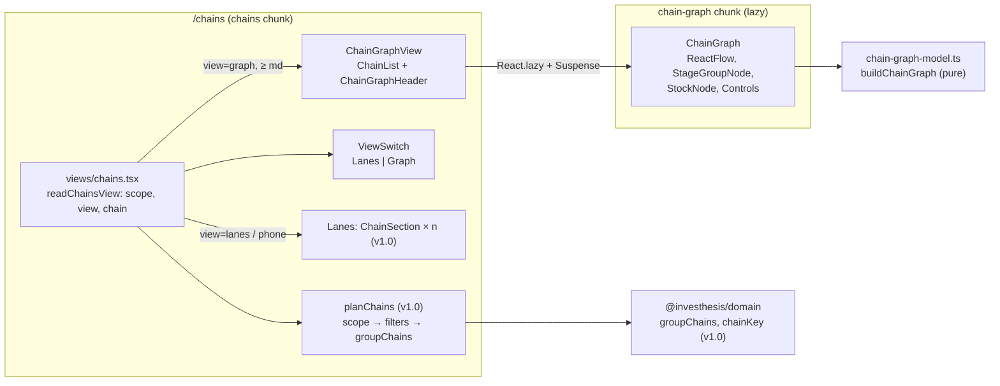

# System Design: Value Chains — Graph view

This slice works only in the browser. The API, the schema and the domain package are unchanged.
The Graph view is a second rendering of the `ChainsResult` that `planChains` already computes on
`/chains` ([NFR-104](requirements.md#nfr-104)). The design adds three things:

1. **Two address parameters**, `view` and `chain`, read next to `scope` by `readChainsView`
   ([FR-101](requirements.md#fr-101), [FR-103](requirements.md#fr-103)).
2. **A pure layout function**, `buildChainGraph`, that turns one `Chain` into React Flow nodes,
   groups and edges with fixed sizes, so it needs no measuring and runs in a unit test
   ([FR-104](requirements.md#fr-104) to [FR-107](requirements.md#fr-107),
   [ADR-103](#key-decisions)).
3. **A lazy `ChainGraph` component**, the only importer of `@xyflow/react`, loaded only when the
   Graph view is shown, so React Flow stays out of every other chunk
   ([NFR-102](requirements.md#nfr-102), [ADR-102](#key-decisions)).

Everything else is reused from v1.0: the loader (`readPortfolio`), the action (`rename-chain`),
`ChainRenameDialog`, `ScopeSelect`, `FilterToolbar`, `useStockFilters`, `chainStocksHref`,
`concentrationHref`, `leftOutText` and `revalidateOnSubmitOrPathChange`.

## Architecture Overview



A chain pick or a filter change never leaves the browser:

```mermaid
sequenceDiagram
  actor U as Investor
  participant R as React Router
  participant V as /chains view
  participant G as ChainGraph (lazy)
  U->>V: open /chains?view=graph
  V->>R: loader (v1.0): GET /stocks, /lists, /settings
  V->>V: planChains → ChainsResult
  V->>G: import() chain-graph chunk (first time only)
  G->>G: buildChainGraph(selected chain) → nodes, edges; fitView
  U->>V: pick "Oil & Gas" in ChainList
  V->>R: setSearchParams(chain=oil & gas, replace)
  Note over R: shouldRevalidate → false (query only)
  V->>G: new chain → new nodes; fitView
```

## Components

| Component | Responsibility |
|-----------|----------------|
| `features/chains/chains-model.ts` (changed) | `readChainsView(params, lists)` also reads `view` (`lanes` when absent; a bad value is `lanes` plus a note) and `chain` (a raw key or `null`). `selectChain(chains, key)` returns the chain to draw and a note when `key` is not in view ([FR-103](requirements.md#fr-103), [OQ-101](requirements.md#oq-101)). `chainGraphSearch` builds the address for a chain pick or a view change. |
| `features/chains/graph/chain-graph-model.ts` (new) | `buildChainGraph({ chain, stocksById })` → `{ nodes, edges, bounds }`, pure, with the layout constants. It knows React Flow's `Node`/`Edge` *types* only (`import type`) ([ADR-103](#key-decisions)). |
| `features/chains/graph/chain-graph.tsx` (new, lazy, default export) | `ReactFlowProvider` + `ReactFlow` set up read-only ([ADR-104](#key-decisions)), `nodeTypes = { stage, stock }`, `Controls` (zoom in, zoom out, fit view; no interactivity toggle), `Background`, `fitView` on mount and on every change of chain key, the `ariaLabelConfig` copy, and focus following ([ADR-105](#key-decisions)). It is the only module that imports `@xyflow/react` at runtime. |
| `features/chains/graph/stage-group-node.tsx` (new) | The parent node of a stage: a heading (stage name), the counts line, the value and share line from `ChainAreaGroup`, "No stocks" when empty, and hidden left and right handles for the stage arrows. |
| `features/chains/graph/stock-node.tsx` (new) | A child node: a React Router `Link` to `/stocks/:id` with the ticker, the shortened name (`title` holds the full name), the market, the `Held` badge and the THB value. The link carries `nodrag nopan` and the accessible name ([FR-106](requirements.md#fr-106), [FR-109](requirements.md#fr-109)). In No position the node is a `div` holding the stock link and a `Set position` link to `/stocks/:id/edit`, as in the Lanes view. |
| `features/chains/graph/chain-graph.css` (new) | Maps React Flow's `--xy-*` variables to the theme tokens of `src/index.css` under `.react-flow.chain-graph`, so `.dark` switches it with the rest of the app ([ADR-106](#key-decisions)). It is imported by `chain-graph.tsx`, so it ships in the lazy chunk. |
| `features/chains/graph/chain-list.tsx` (new) | The left column: a `nav` labelled "Chains" with one `Link` per chain (`replace`, `aria-current="true"` on the selected one, title plus "N stocks · M held") ([FR-102](requirements.md#fr-102)). It sits in the chains chunk, not the lazy one. |
| `features/chains/graph/chain-graph-view.tsx` (new) | The two-column body of the Graph view: `ChainList`, then the selected chain's header (title, Stocks link, Rename button, totals, left-out note, [FR-110](requirements.md#fr-110)) and `Suspense` around the lazy `ChainGraph` with a skeleton of the canvas size. |
| `features/chains/components/view-switch.tsx` (new) | Lanes and Graph as a shadcn `ToggleGroup` (single); writes `view` with `replace` and keeps every other parameter ([FR-101](requirements.md#fr-101)). The exact component is settled in the UX phase. |
| `views/chains.tsx` (changed) | Adds `view` and `chain` to `KEEP`, renders `ViewSwitch`, picks Lanes or the Graph view (`useIsMobile` forces Lanes with a note below `md`, [FR-113](requirements.md#fr-113)), and after a rename or merge writes `chain = chainKey(result.name)` ([FR-110](requirements.md#fr-110)). Focus after a save goes to the graph header's Rename button (`data-chain-rename`) or its heading after a merge, as in v1.0. |
| `apps/web/src/test/setup.ts` (changed) | The React Flow shims for jsdom: a `ResizeObserver` that calls back, `DOMMatrixReadOnly`, and `getBBox` (React Flow's testing guide), replacing the current no-op `ResizeObserver` stub without breaking the Radix poppers that use it. |

Nothing changes in `packages/domain` or `apps/api`.

## Data Model

There is no new stored data. The graph is a view model derived on every render:

```
ChainsResult (domain, v1.0)            buildChainGraph output (web, new)
└─ chains: Chain[]                     ├─ nodes: GraphNode[]
   ├─ key, title, count, held, value   │   ├─ StageNode  { id: "stage:<area>", type: "stage",
   ├─ leftOut                          │   │               position, width, height,
   └─ areas: ChainAreaGroup[]          │   │               data: ChainAreaGroup }
      ├─ position: ChainArea           │   └─ StockNode  { id: "stock:<stockId>", type: "stock",
      ├─ stocks: { id, held, value }[] │                   parentId: "stage:<area>", extent: "parent",
      └─ count, held, value, valueShare│                   position (relative), width, height,
                                       │                   data: { stock, held, value, area } }
Stock (loader, v1.0) via stocksById    ├─ edges: [ "stage:Upstream" → "stage:Midstream",
  ticker, name, market                 │           "stage:Midstream" → "stage:Downstream" ]
                                       └─ bounds: { width, height }
```

### Layout (fixed sizes, no measuring)

| Constant | Value | Use |
|---|---|---|
| `STAGE_WIDTH` | 256 | width of each of the three stage groups |
| `STAGE_GAP` | 96 | horizontal space between stages (holds the arrow) |
| `STAGE_HEADER` | 88 | heading plus the two figure lines |
| `NODE_HEIGHT` | 64 | a stock node (two text lines plus the badge) |
| `NODE_GAP` | 8 | vertical space between stock nodes |
| `PADDING` | 12 | inside a group, around its nodes |
| `ROW_GAP` | 48 | between the stage row, Integrated and No position |

- Stage `i` (0 Upstream, 1 Midstream, 2 Downstream) is at `x = i × (STAGE_WIDTH + STAGE_GAP)`,
  `y = 0`. All three take the height of the tallest, so the arrows sit level. An empty group has
  room for one row ("No stocks").
- Integrated, when present, is at `x = 0`, `y = stageRowHeight + ROW_GAP` and spans the full width
  (`3 × STAGE_WIDTH + 2 × STAGE_GAP`). Its stocks flow in rows of three columns, so a wide group
  stays short ([OQ-102](requirements.md#oq-102)).
- No position, when present, goes below Integrated (or below the stages) with the same width and
  the same three-column flow.
- Within a group, stocks follow `ChainAreaGroup.stocks`, which `groupChains` already sorts in the
  order of [v1.0 FR-003](../v1.0/requirements.md#fr-003). The model does not re-sort.
- Node ids are stable (`stage:<area>`, `stock:<id>`), so React keeps nodes mounted across a filter
  change and focus is not lost on an unrelated re-render.
- Parent nodes come before their children in the array, as React Flow requires. Nodes are ordered
  stage by stage, then by stock order, so the Tab order is Upstream, Midstream, Downstream,
  Integrated, No position, each top to bottom.

A 60-stock stage is 12 + 88 + 60 × 72 ≈ 4,400 px tall. `fitView` shrinks it to the minimum zoom
(`minZoom` 0.2), and the investor zooms or pans from there. Integrated and No position use three
columns, so they are a third as tall.

## API Contracts

None. The Graph view uses the v1.0 reads (`GET /stocks`, `GET /lists`, `GET /settings`) and the
v1.0 `POST /chains/rename`, unchanged. A query-only change (view, chain, scope, search, filters)
sends no request, because the route keeps `revalidateOnSubmitOrPathChange`
([NFR-101](requirements.md#nfr-101)).

## Address

| Param | Values | Absent | Bad value | Written |
|---|---|---|---|---|
| `view` | `graph` | Lanes | Lanes and one note ("Unknown view …, showing lanes") | only `graph`, with `replace` |
| `chain` | a chain key (`chainKey(title)`, URL-encoded) | first chain in view | first chain and one note ([OQ-101](requirements.md#oq-101)) | on a pick, with `replace`; removed when the investor picks the first chain |

Both are added to `KEEP`, so `useStockFilters` keeps them when filters change. A Lanes view with
a `chain` parameter ignores it and keeps it, so Back to Graph returns to the same chain. Links that
leave the page (`chainStocksHref`, `concentrationHref`) do not carry `view` or `chain`.

## Key Decisions

| Decision | Options Considered | Chosen | Rationale |
|----------|-------------------|--------|-----------|
| ADR-101: React Flow version | (a) `@xyflow/react` 12.12.1 (latest 12.x, 2026-11-02); (b) 13.0.3 (13.0.0 released 2026-11-16, adds `react-compiler-runtime` and `@xyflow/system` 1.0) | (a), exact pin | The parts this slice uses (sub flows with `parentId`, `extent: 'parent'`, `nodesFocusable`, `ariaLabelConfig`, the `--xy-*` CSS variables, `fitView` options) are in 12.x, and React 19 meets its peer range (`react >= 17`). 13.0 is eleven days old with three patch releases in its first week. Moving to 13 is a separate chore once it settles. Checked with Context7 (`/websites/reactflow_dev`) and `npm view` on 2026-11-27; the dev task re-checks the docs for the pinned version. |
| ADR-102: Where the graph lives | (a) the same `/chains` route with `?view=graph` and a `React.lazy` graph component; (b) a separate `/chains/graph` route | (a) | Owner decision ([FR-101](requirements.md#fr-101)). The scope, filters, rename dialog and loader data are shared without a second loader. `React.lazy(() => import('./graph/chain-graph'))` gives React Flow its own chunk, so the Lanes view never downloads it ([NFR-102](requirements.md#nfr-102)). An oxlint `no-restricted-imports` rule allows `@xyflow/react` only in `features/chains/graph/chain-graph*.tsx` and `stage-group-node.tsx`/`stock-node.tsx`; the model may `import type`. |
| ADR-103: Layout engine | (a) hand-written fixed-size layout; (b) dagre or elkjs auto-layout; (c) measure nodes, then lay out | (a) | The shape is always the same three columns plus up to two rows below, so a layout library adds a dependency for nothing. Fixed sizes make the layout pure and synchronous, so it is unit-testable in Node, has no flash of unmeasured nodes, and stays well inside 300 ms for 200 stocks. Long names are cut with an ellipsis and the full name is on the node's `title` and accessible name. |
| ADR-104: Read-only setup | (a) `nodesDraggable={false}`, `nodesConnectable={false}`, `elementsSelectable={false}`, `nodesFocusable={false}`, `edgesFocusable={false}`, `deleteKeyCode={null}`, `selectionKeyCode={null}`, `panOnDrag`, `zoomOnScroll`, `minZoom` 0.2, `maxZoom` 1.5; (b) React Flow's own node focus and selection | (a) | React Flow's focusable nodes announce "Press enter or space to select a node. Press delete to remove it", which is wrong for a read-only graph ([FR-108](requirements.md#fr-108)). Each stock node renders a real `Link` instead. It is natively focusable, Enter follows it, it has a proper name and it gets the router's client-side navigation ([FR-109](requirements.md#fr-109), [NFR-103](requirements.md#nfr-103)). `onlyRenderVisibleElements` stays off so every link is in the DOM and in the Tab order. |
| ADR-105: Keeping the focused node visible | (a) on a link's `focus`, call `setCenter` on that node at the current zoom when it is outside the viewport (no animation under `prefers-reduced-motion`); (b) rely on the browser scrolling into view | (a) | The pane is a CSS transform, so the browser cannot scroll a link into view. Without (a), Tab would move focus to nodes that cannot be seen (WCAG 2.4.7 and 2.4.11). |
| ADR-106: Theming | (a) import `@xyflow/react/dist/base.css` and map the `--xy-*` variables to theme tokens in `chain-graph.css`; (b) `style.css` plus `colorMode` from the theme store | (a) | `base.css` has the layout rules without React Flow's palette. The tokens already switch under `.dark`, so there is no second theme source and the contrast suite measures the same tokens. Group and node borders use `--muted-foreground` and arrows use `--foreground`, to reach 3:1 ([NFR-103](requirements.md#nfr-103)). The `fitView` animation `duration` is 0 under `prefers-reduced-motion`. |
| ADR-107: Attribution | (a) keep `Attribution` and style it with the theme; (b) `proOptions.hideAttribution` | (a) | Owner decision ([OQ-104](requirements.md#oq-104)). It is a plain link to reactflow.dev with no request made while the page loads ([NFR-105](requirements.md#nfr-105)). Its text and background are themed to pass 4.5:1. |
| ADR-108: Phones | (a) below `md`, render Lanes with a note and keep `view=graph`; (b) a touch canvas | (a) | Owner decision ([OQ-103](requirements.md#oq-103)). `useIsMobile` (`hooks/use-mobile.ts`, 768 px) already drives the sidebar, so the breakpoint matches. The lazy chunk is not imported on a phone. |
| ADR-109: Rename from the Graph view | (a) reuse `ChainRenameDialog` and the v1.0 action, then set `chain = chainKey(result.name)`; (b) a graph-specific rename | (a) | Same rules, same toasts, same 409 merge flow ([FR-110](requirements.md#fr-110)). After a merge `result.name` is the target, so the merged chain is selected. |

## Testing approach

- **Unit (Vitest, Node):** `buildChainGraph`: positions, sizes, parent-first ordering, stable ids,
  the two edges, Integrated and No position only when used, three-column flow, empty groups,
  200 stocks in under 50 ms. `readChainsView` and `selectChain`: absent, valid, bad `view`,
  unknown `chain`, chain hidden by a filter.
- **Component (Vitest + Testing Library, jsdom with the React Flow shims):** the view switch writes
  the address with no request; the chain list marks the current chain; a pick redraws; each stock
  node is a link with the right name and `href`; held stocks show "Held"; no draggable or
  selectable attributes; phone width shows Lanes with the note; rename from the graph header keeps
  the chain selected; empty states.
- **Static:** the `@xyflow/react` import is allowed only in `features/chains/graph/` (oxlint rule
  plus a scan test); the graph folder has no `fetch` or `api.` calls.
- **E2E (Playwright, real browser):** the canvas draws groups, nodes and two arrows; keyboard-only
  Tab through the nodes keeps the focused one in view and Enter opens the stock; axe in light and
  dark on the Graph view; the contrast check for borders, arrows, the focus ring and the
  attribution; the Lanes view and other routes load no chunk containing React Flow (network log);
  NFR-101 timing on dataset VC-C (logged, as in `vc-perf.spec.ts`); 360 px shows Lanes.

## Dependencies

- **`@xyflow/react` 12.12.1** (MIT), exact pin in `apps/web`, for the canvas, sub flows, controls
  and background. It brings `zustand` and `classcat` as its own dependencies and makes no network
  calls.
- **shadcn `toggle-group`**, if the UX phase keeps it for the view switch (`pnpm dlx shadcn@latest
  add toggle-group`, then the `cn` import fix from `CLAUDE.md`).
- No API, database or domain dependency changes.
